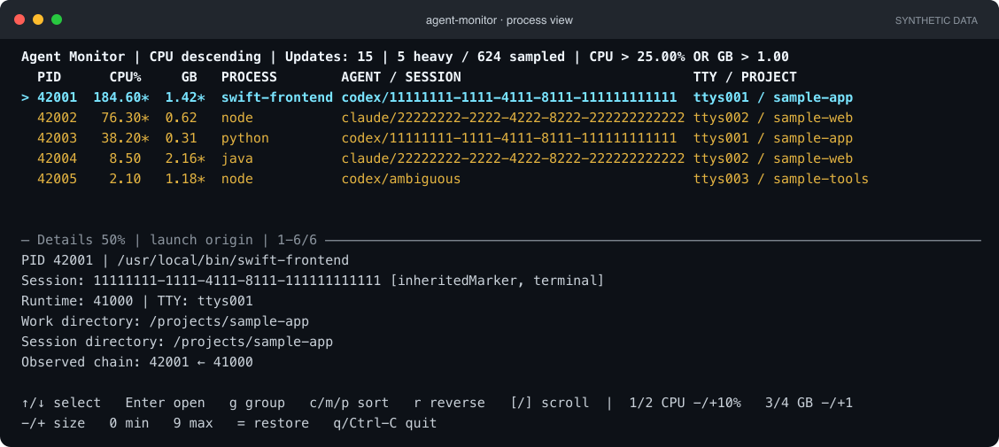

<p align="center">
  
</p>

<h1 align="center">Agent Monitor</h1>

<p align="center"><strong>Find the session behind the load.</strong></p>

Trace heavy CPU and memory usage to **Codex CLI and Claude Code sessions** on macOS.

When several coding agents are running, a busy `node`, `java`, or `python` process tells you little on its own. Agent Monitor connects heavy processes to their agent session, terminal, and project, so you can see where the work started.

## Features

- **Live terminal view** — watch CPU and memory usage, sort processes, and open details without leaving your terminal.
- **Session grouping** — bring related heavy processes together and see their combined resource usage.
- **Adjustable filters** — change CPU and memory thresholds while the monitor runs.
- **Responsive layout** — use narrow or wide terminals, resize the details pane, and copy text with normal terminal selection.
- **Scriptable output** — print a report or stream JSONL to other tools.
- **Explicit uncertainty** — unknown or ambiguous sessions stay visible instead of being guessed.

## Install

Requires **Apple Silicon and macOS 27 or later**. With [Homebrew](https://brew.sh) installed:

```sh
brew install mbackschat/tap/agent-monitor
```

No Xcode, root access, or agent hooks are required. Update with `brew update` followed by `brew upgrade agent-monitor`.

Prefer a direct download or a source build? See the [installation guide](docs/installation.md).

## Quick start

The **TUI (terminal user interface)** is a live, full-window dashboard that runs inside your terminal. It refreshes in place and is controlled with the keyboard. Launch it grouped by session from any directory:

```sh
agent-monitor --tui --group session
```

Switch between individual processes and session groups to see which agent launch they belong to. Open a process to inspect its full session ID, executable path, project directory, and attribution evidence in the lower pane. The layout adapts when you resize the terminal, and the footer keeps the available keys visible.



*Illustrative process view with details open. The text comes from the real layout renderer using entirely synthetic data; terminal colors and window decoration are illustrative. Press `g` to switch between this view and session groups.*

Use **↑ / ↓** to select, **Enter** to expand a session or inspect a process, **g** to toggle grouping, and **q** to quit. The controls and current filters are shown in the terminal.

By default, the monitor shows agent-associated processes exceeding **25% CPU or 1 GB memory footprint**. If the list is empty, press **1** to lower the CPU threshold or **3** to lower the memory threshold. CPU at 100% means one fully occupied core.

## More ways to run

```sh
# Print one report
agent-monitor

# Choose your own thresholds
agent-monitor --tui --cpu 10 --memory-gb 0.5

# Stream reports as JSONL
agent-monitor --json --samples 0

# Explore all options
agent-monitor --help
```

See the [usage guide](docs/usage.md) for all keyboard controls, filters, session grouping, and output options.

## Options and defaults

With no options, `agent-monitor` prints one text report after a one-second baseline interval. A process appears when **CPU OR memory exceeds its threshold**; only your user's agent-associated processes are included by default.

| Option | Description | Default |
| --- | --- | --- |
| `--cpu <percent>` | CPU threshold; 100% means one occupied core. Accepts nonnegative values. | `25` (%) |
| `--memory-gb <gb>` | Physical memory footprint threshold in decimal GB. Accepts nonnegative values. | `1` (GB) |
| `--interval <seconds>` | Wait between samples, from 0.1 to 60 seconds. | `1` (second) |
| `--samples <count>` | Number of reports; `0` runs until you quit. | `1`; `0` with `--tui` |
| `--tui`, `-tui` | Open the live terminal UI; requires interactive input and output. | Off; text reports |
| `--group <mode>` | `none` shows individual processes; `session` groups by launch session and totals displayed heavy processes. | `none` |
| `--json` | Emit JSONL: one complete JSON object per report. | Off |
| `--json-schema` | Print the report's JSON Schema and exit without sampling. | Off |
| `--all-processes` | Include unrelated and unattributed processes; same-user scope and heavy thresholds still apply. | Off |
| `--commands` | Include command arguments in reports and details; arguments can contain secrets. | Off |
| `--version` | Print the installed version and exit. | — |
| `-h`, `--help` | Show command help and exit. | — |

Choose only one of `--tui`, `--json`, or `--json-schema`. Session grouping is available for text and TUI output; `--group session` cannot be combined with `--json` or `--json-schema`.

## Current support

Agent Monitor supports Codex CLI and Claude Code terminal sessions. Claude Code's native installation has been checked with a real workload; npm-based Claude installations and real terminal Codex workloads have not yet been validated. Desktop conversation attribution and third-party agent plugins are not currently supported.

Session associations identify **where a process was launched**. A shared daemon may later serve other sessions, so its current activity cannot always be assigned to the session that started it. Group totals cover the heavy processes shown, not every process in a session.

The monitor inspects only your user's processes and does not read conversation transcripts. Command arguments are hidden unless you request them with `--commands`.

## Adding more agents

Codex CLI and Claude Code are built in today. The planned adapter approach will let new agents supply their own session knowledge while sharing the same resource monitoring and terminal UI.

- **Identify sessions (required):** recognize an agent's runtimes and return evidence linking processes to sessions. Conflicting evidence stays ambiguous.
- **Inspect sessions (optional):** provide additional session information or agent-specific metrics, such as token usage, when available.
- **Communicate (optional):** expose supported messaging capabilities for a verified session recipient.

CPU and memory measurement stay in the shared monitoring core. The intended first step is a small interface for built-in adapters, with an external plugin protocol considered later. **This is a design direction; v0.1.0 does not expose a third-party adapter API or messaging controls.** See the [adapter design](docs/architecture.md#proposed-agent-adapter-boundary) for the proposed boundaries.

## Documentation and contributing

- [Usage guide](docs/usage.md) — controls, measurements, grouping, and JSONL.
- [Development guide](docs/development.md) — build, test, and verification commands.
- [Architecture](docs/architecture.md) — how collection, attribution, and presentation fit together.
- [Validation record](docs/poc-validation.md) — what has been tested and known coverage limits.
- [Project plan](PLAN.md) — completed work and current scope.

Bug reports and focused contributions are welcome. Include your macOS version, agent installation type, command used, and expected versus observed behavior. Remove session IDs, project paths, and command arguments you do not want to share from any attached output. For code changes, start with the [development guide](docs/development.md).

## License

[MIT](LICENSE).
