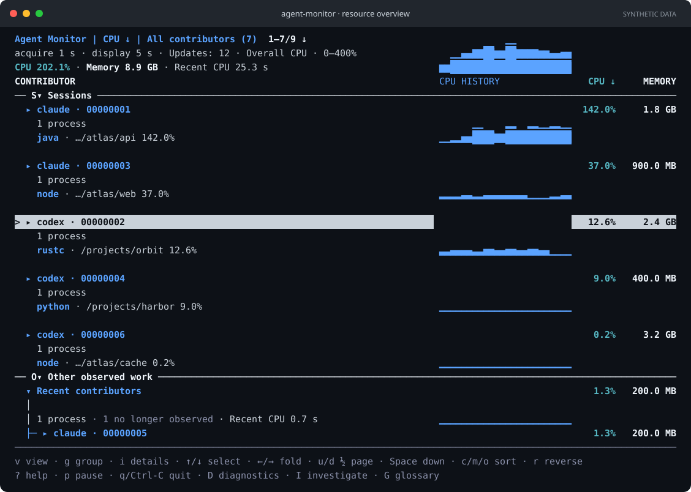
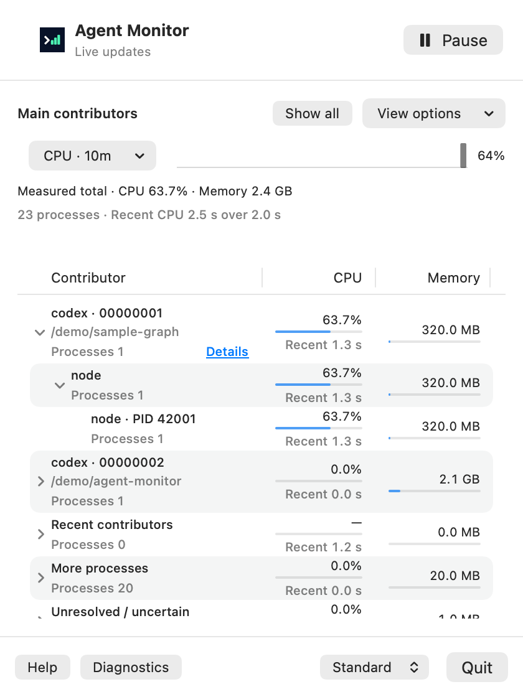

<p align="center">
  
</p>

<h1 align="center">Agent Monitor</h1>

<p align="center"><strong>Find the session behind the load.</strong></p>

**Which agent, session and process is consuming CPU or memory—and in which working directory?** Agent Monitor is built to answer that question for Codex CLI and Claude Code on macOS. It observes already-running workloads without a launch wrapper.

When several coding agents are running, compare their workloads together: agent, session, working directory, executable (such as `rustc`, `java` or `node`), CPU and memory. TUI process rows in both grouping modes and Mac process rows keep the worker’s compact CWD beside its executable; standalone Mac rows and children belonging to a different session than their group also show agent/session identity without opening details. Overview executable groups keep directory context visible beside long process names, using a second compact line in the TUI when needed. Open contributor information separately from expanding its children; use the overview to distinguish workloads with matching directory suffixes, inspect relevant arguments on demand, then jump to its terminal or review stopping an exact process.

The [product goal](docs/product.md) is a clear, actionable resource overview under pressure, rather than another general-purpose process list. **Presentation acceptance is still open:** session and process-group headings now lead with provider/session identity and compact workload directories; session labels use locally verified provider/session IDs; provider-listed names are unavailable in local-only operation. The [Mac/TUI review](PLAN.md#resource-accounting-priority) still covers multi-workload legibility and native interaction; the controls below describe the current interface.

This README describes the current source build, which can be ahead of the [latest release](https://github.com/mbackschat/agent-monitor/releases/latest); newer controls, history and the menu bar app require a [source build](docs/installation.md#build-from-source).

**Current accounting limitation:** a busy agent build can be substantially underreported when workers start and finish between scans. Reliable identification and complete understanding of agent CPU and memory use is the project's highest priority; the current sampler does not yet meet it. See the [measurement limits](docs/usage.md#filters-and-measurements) and [active accounting work](PLAN.md#resource-accounting-priority). A low agent total does not establish that agents are causing little load.

**Performance acceptance remains open:** bounded accounting and retention guards pass, but native collection cost, heavy-load short-worker coverage, a process-wide heap ceiling and the Mac smoke checks remain open. See [remaining acceptance work](PLAN.md#resource-accounting-priority) and [dated measurement evidence](docs/research/menu-bar-load-cost.md). Passing accounting tests does not establish acceptable cost or complete sampling coverage.

**Local-only runtime:** Agent Monitor does not launch provider CLIs or initiate Internet connections. Automatic Claude session listings/names and Codex/Claude messaging are unavailable because those helpers lack an offline guarantee; their execution paths are absent. Native process measurements and available local attribution continue; missing session identity stays explicit. Development-time downloads are separate from running the app.

**No automatic recording:** normal monitoring uses bounded rolling history in memory, with no process-data log written to disk. [Diagnostic recording](docs/proposals/diagnostic-recording.md) is a separate, unimplemented opt-in proposal; live history and Pause do not enable it.

## Features

- **Main contributors** — Mac and TUI start with the sessions contributing most CPU or memory. Recent bursts, unresolved work and quieter processes remain in quantified expandable summaries; filters never change totals.
- **Recent worker activity** — inspect a rolling 60-second target range of measured CPU, distinct-worker counts (or proven ranges after identity release), no-longer-observed workers, sampled memory maxima and kernel-peak evidence. Expand session → executable → exact process; `java` and `node` workers group by observed executable basename, independent of PID. Adapter-recognised embedded tools use their observed invocation name, such as `ugrep`, while inspection keeps the actual executable path.
- **Live terminal view** — request a 100 ms acquisition period by default (scan overruns remain visible); watch CPU and memory usage, sort processes, and open details without leaving your terminal. Stable ordering limits jitter; CPU/memory ordering applies within groups as well as between them. Acquisition defaults to 100 ms; the display refreshes independently every five seconds, retaining CPU from workers that disappear between refreshes. Freeze the view to inspect a window.
- **Native menu bar app** — open a compact macOS panel for resource usage and session actions, with Pause/Resume and on-demand **Help**, **Diagnostics** and a separate CPU investigation; three bold load bars keep collecting at the selected interval even while the panel is closed. Available from a source build.
- **Finite CPU diagnosis** — start with **d** in the TUI or **Diagnostics → Diagnose CPU** in the Mac app. Rank a new observation window by measured CPU-seconds, recover compatible counters across temporary read gaps, and retain contributors that leave before it ends, without changing live-table values. The Mac app can copy the completed report for further investigation.
- **Compact history** — one strip for agent CPU, memory or heavy-process count, covering the last 10 minutes or one hour in both live views, updated with every collected report.
- **Pinned inspection** — keep a process or session at the top while its values update, in both native and terminal views. Missing targets stay marked and removable; `u` or Mac **View options → Unpin all** clears pins in both views.
- **Memory burst context** — inspect the kernel footprint peak beside current memory; it survives freeing allocations but can reset on exec.
- **Session grouping** — bring related observed processes together and see their combined resource usage.
- **Adjustable filters** — change CPU and memory thresholds while the monitor runs.
- **Jump to the session's terminal** — bring the terminal running the agent to the front, selecting its tab in Terminal.app.
- **Stop a runaway process** — review and send SIGTERM to one process only.
- **Actions from scripts** — `kill` and `focus` commands; termination requires confirmation or `--yes`. Messaging is unavailable in local-only operation.
- **Responsive layout** — keep the selected contributor and its resources together in small terminals, resize the details pane, and copy text with normal terminal selection.
- **Scriptable output** — print a colored report or stream JSONL schema version 1 to other tools.
- **Explicit uncertainty** — unknown or ambiguous sessions stay visible instead of being guessed.

## Install

Requires **Apple Silicon and macOS 27 or later**. With [Homebrew](https://brew.sh) installed:

```sh
brew install mbackschat/tap/agent-monitor
```

No Xcode, root access, or agent hooks are required. Update with `brew update` followed by `brew upgrade agent-monitor`.

Prefer a direct download or a source build? See the [installation guide](docs/installation.md).

## Quick start

For a finite CPU answer, use `agent-monitor diagnose cpu --json` (or omit `--json` for text). It takes a baseline and three one-second waits, then ranks the top ten current-user lifetimes by measured CPU-seconds, with independent host context and explicit coverage limits. Native scans and metadata inspection add time. Start with `agent-monitor guide` for interpretation; [finite diagnosis](docs/usage.md#finite-cpu-diagnosis-and-local-guides) describes the output and exit codes.

The **TUI (terminal user interface)** is a live resource overview that uses your terminal window. It refreshes in place and is controlled with the keyboard. Launch it from any directory:

```sh
agent-monitor --tui
```

The default **Main contributors** overview combines aligned CPU, memory and recent CPU columns with fixed-scale resource meters on wide terminals. Expand sessions into executable groups and individual workers. **Recent contributors** retains observed short-lived work; **More processes** accounts for the quieter population. Press **v** for the process view shown below, or **g** for session grouping there. The layout adapts to terminal width and the footer shows the available keys. Press **?** for help and the shared metric glossary, or **D** for passive diagnostics; **Esc** returns without losing selection or pause. Wide process inspection aligns executable, agent/session and CWD columns; narrow inspection keeps identity above resources and working directory. Terminal context stays in details.



*Illustrative process view with the selected process pinned (`>★`) and details open. The text comes from the real layout renderer using entirely synthetic data; terminal colors and window decoration are illustrative. Press `g` to switch between this view and session groups.*

In the overview, use **↑ / ↓** to select, **← / →** to disclose children, **a** to show all session groups, **.** to pin/unpin a session, **u** to unpin all views, **c / m** to order by CPU or memory, including entries inside groups, **i** for details, **Enter** to inspect a current process without changing grouping, and **Page Up / Down** to scroll detail. **v** switches between overview and process inspection. In both views, folding reveals children and **i** shows or hides details; arrows on process leaves do not open details.

In the process view, use **↑ / ↓** to select, **← / →** to collapse/expand session children, **i** to show/hide details, **Shift+← / Shift+→** to collapse/expand session groups at the current level, **g** to toggle grouping, **o** for Stable order, **h** to change the history metric, **t** for 10-minute/hour history, **< / >** to update less or more often, **.** to pin/unpin the selected row, **p** to pause/resume the view, **d** for a finite CPU diagnosis, and **q** to quit. Process leaves have an `i` inspection marker; expandable groups use `▸`/`▾`. The footer labels pane controls **Details**, and current filters remain visible.

By default, totals include **all observed agent-associated processes**, including idle processes and missing resource measurements. The overview collapses quieter entries into quantified summaries; process and text views show individual rows. Display thresholds start at zero and never change totals. CPU at 100% means one fully occupied core.

## Choose what to show

Both interactive interfaces start in **Main contributors**. In the Mac app, **View options → Processes / Group by agent session** opens process inspection. In the TUI, **v** opens process inspection and **g** switches its grouping. `--group none|session` selects the text/process-view grouping; it does not disable the interactive overview. A session is one coding-agent conversation/run and the processes attributed to it.

| Setting | What it changes |
|---|---|
| **Main contributors** | Compact session overview with recent activity, executable groups and a quantified remainder. |
| **Processes** | A flat list of individual observed processes, each with its own CPU and memory values and session attribution. Use it to find the specific command consuming resources. Pinned session groups remain grouped at the top. |
| **Group by agent session** | Groups observed processes by attributed agent session or corroborated root session. Expand a group to inspect its processes. Counts and CPU/memory totals include all observed session members, independent of display filters; sampling can still miss work. The Mac app shows an unpinned one-process session directly as a process row. |
| **Sort** | Stable order keeps surviving rows in place and appends newcomers. CPU/Footprint/PID order ranks individual processes, or session groups by their totals/minimum PID. It does not change which processes qualify. |
| **CPU / Footprint thresholds** | Zero disables each filter independently. With both off, every observed process appears; otherwise a process must exceed at least one enabled threshold. Lower them to reveal lighter workloads; switching between Processes and Sessions does not change these filters. |
| **Interval** | Requested acquisition period, 100 ms by default. Native reads and in-memory accounting share one collection cycle; slow metadata/provider refresh and display run separately. Overruns stretch collection. This controls sampling cadence; the display refreshes independently every five seconds. |

Sessions are not projects: two sessions in the same directory remain separate, and one session can contain workloads in multiple directories. Unknown or ambiguous ownership stays separate rather than being guessed.

Shift+←/→ affects all displayed session groups when on a top-level row, or only the containing session when on a child process. It reveals/hides sibling rows without opening multiple process details. Expansion survives temporary filtering in both live views. Missing processes show no old measurements; a process's details reopen on return unless you explicitly change inspection. **Pin** keeps an identity at the top, including an unavailable placeholder when missing; **Pause** freezes the displayed measurements. See [grouping and expansion](docs/usage.md#session-grouping) for retention limits and [all controls](docs/usage.md#live-terminal-view) for details.

## Process actions

In the process view (`v` in TUI), select a process and press **k** to review a termination request or **f** to bring the session's terminal to the front. **Ctrl-Y** confirms termination; **Esc** cancels. Termination sends SIGTERM to that process only. Messaging is unavailable because its provider helpers cannot be guaranteed offline.

Focus selects the session's tab in Terminal.app; other terminal apps are only brought to the front, and macOS may ask for Automation permission. See [action controls and limits](docs/usage.md#process-actions).

## More ways to run

```sh
# Print one report
agent-monitor

# Choose your own thresholds
agent-monitor --tui --cpu 10 --memory-gb 0.5

# Stream reports as JSONL
agent-monitor --json --samples 0

# Explore all options
agent-monitor --help
```

See the [usage guide](docs/usage.md) for all keyboard controls, filters, session grouping, and output options.

## Menu bar app

Text reports retain full accounting context; TUI shows a compact CPU summary, and native Diagnostics holds host/process accounting details. Newborn processes contribute their first observed interval; work never observed or after the last observation remains uncounted. “No data” means host occupancy is unavailable. See [measurement semantics](docs/usage.md#filters-and-measurements).

The source-built Mac app runs with `bash scripts/menubar.sh run`. Its default **Main contributors** view highlights meaningful CPU and memory use, with **Recent contributors**, **More processes** and **Unresolved / uncertain** summaries. A ranked native ledger pairs bold CPU/memory values with a per-contributor activity lane. Executable and working-directory summaries use the full row width below; a mostly opaque reading surface, shared subtree shading and Pinned/Sessions/Other observed work headings make the hierarchy easier to scan. Contributor, CPU and Memory sort in either direction. Click a row to select it; the process-count/chevron button expands children and its tooltip explains the count. **ⓘ** opens a bottom details pane with complete selectable paths. A row’s **…** menu exposes exact current process targets and verified actions without switching tables. Unpinned session controls appear on hover or keyboard focus; pinned indicators remain visible. Detach the panel to resize its height by dragging a window edge. Footer **?** and **stethoscope** controls open Help and Diagnostics; Keyboard Shortcuts has its own options-menu item. Expand a session to inspect executable groups and individual workers, including workers no longer observed. **Show all** opens the remaining session population. **View options → Group by agent session / Processes** opens the existing process inspection view and verified actions. Its **Display filters** section changes visible process rows; **Sampling** controls acquisition and the live icon. Filters never change observed totals.

The default grouped overview gives CPU prominence to groups above 25% of one core, while preserving the existing memory and recent-activity criteria; quieter work stays in quantified summaries. Acquisition defaults to 100 ms and display updates independently every five seconds. Recent activity targets 60 seconds within bounded memory; coverage disclosure explains shorter ranges and missing observations, with failed-read and acquisition-overrun warnings visible in Mac and TUI process headers as well as text output. Sampling owns its deadlines independently of publication and display; backlog can merge history units, with their coalesced count and maximum span disclosed. Retention keeps or evicts whole units and shows the actual range. Pause holds summary and worker detail. With the live icon enabled, history continues while closed; static mode starts a new history when reopened. The three status bars show unfiltered observed agent CPU; right-click for the qualified process census. The unqualified numeric badge has been removed. See [overview usage](docs/usage.md#main-contributors-and-recent-activity), [menu bar controls](docs/usage.md#menu-bar-app), and [validation limits](docs/development.md#menu-bar-app).

The overview headings show **Main contributors (X/Y)** and **All contributors (Y)** for retained session groups. View options selects one of Main, All, Processes by session or Processes. Stable order keeps the current table and surviving sibling positions; sorting never changes views. CPU charts choose a fixed hardware default once: performance plus super cores × 100% (400% on a four-performance-core M1), falling back to all logical CPUs when core types are unknown. View options or `b` selects a manual range, including all cores; activity never rescales it. Above-range values remain available in details. 100% means one CPU-second per elapsed second, not computing-power saturation. Equal-width bars show successive interval averages; the caption identifies unequal durations.

<p></p>

*Production native view with synthetic data. Help and Diagnostics open on demand; row information stays attached to the selected contributor. This offscreen capture does not establish live menu anchoring or physical keyboard/mouse behavior.*

## Options and defaults

With no options, `agent-monitor` prints one text report after a one-second accounting window, requesting a 100 ms acquisition period. Resolution and delivery can arrive later. With both thresholds zero, every observed process in scope is included, including unavailable measurements; interactive views can collapse lower contributors into quantified summaries. With filters enabled, **CPU OR memory must exceed an enabled threshold**; zero disables that resource filter. Only your user's agent-associated processes are included by default.

The following options control reports; diagnosis has fixed defaults and its own output flags.

| Option | Description | Default |
| --- | --- | --- |
| `--cpu <percent>` | CPU threshold; 100% means one occupied core. Zero disables this filter. Accepts nonnegative values. | `0` (%) |
| `--memory-gb <gb>` | Physical memory footprint threshold in decimal GB. Zero disables this filter. Accepts nonnegative values. | `0` (GB) |
| `--interval <seconds>` | Requested acquisition period, or visible maximum with TUI adaptive sampling enabled, from 0.1 to 60 seconds; overruns delay collection. | `0.1` (seconds) |
| `--samples <count>` | Number of accounting windows; slow readers may receive combined reports. `0` runs until you quit. | `1`; `0` with `--tui` |
| `--tui`, `-tui` | Open the grouped contributor overview with a five-second display; requires interactive input and output. | Off; text reports |
| `--adaptive-sampling` / `--no-adaptive-sampling` | Enable/disable activity-based acquisition between the configured minimum and `--interval`; mutually exclusive and require `--tui`. | Off |
| `--sampling-minimum <seconds>` | Adaptive minimum; must be at least 0.1 and no greater than `--interval`. Requires `--tui`; does not enable adaptation. | `0.1` (seconds) |
| `--sampling-window <seconds>` | Rolling activity window, from 1 to 300 seconds. Requires `--tui`; does not enable adaptation. | `60` (seconds) |
| `--inspection-observations` | Experimental extra discovery between complete scans while the TUI is live and unpaused; requires `--tui`. Benefit and cost are unmeasured. | Off |
| `--group <mode>` | Text/process-view grouping: `none` shows individual processes; `session` groups by launch session and totals all observed members. | `none` |
| `--json` | Emit JSONL schema version 1: one complete JSON object per report, including CPU context, contribution windows and historical contributors. | Off |
| `--json-schema` | Print the report's JSON Schema and exit without sampling. | Off |
| `--all-processes` | Include unrelated and unattributed processes; same-user scope and display thresholds still apply. | Off |
| `--commands` | Include command arguments in reports and details; arguments can contain secrets. | Off |
| `--no-color` | Disable colors in text, TUI and action output, like `NO_COLOR=1`; JSONL is never colored. Colors otherwise appear only on a terminal. | Off |
| `--version` | Print the installed version and exit. | — |
| `-h`, `--help` | Show command help and exit. | — |

| Command | Description |
| --- | --- |
| `guide [semantics\|diagnostics\|actions\|tui]` | Show local guidance without sampling or provider queries. |
| `diagnose cpu [--json]` | Baseline plus three one-second waits; top ten by CPU-seconds. Text by default; JSON is one diagnosis v1 document. |
| `diagnose cpu --json-schema` | Print the separate diagnosis schema without collection. |
| `kill --pid <pid> [--yes] [--no-color]` | Review and send SIGTERM to one process. |
| `message [--no-color]` | Explain why provider messaging is unavailable; exit without inspecting processes or sending. |
| `focus --pid <pid> [--no-color]` | Bring the terminal hosting the process's agent session to the front. |

The `kill` command asks for confirmation in a terminal and needs `--yes` in scripts; see [actions from the command line](docs/usage.md#actions-from-the-command-line) for exit statuses.

Choose only one of `--tui`, `--json`, or `--json-schema`. Session grouping is available for text and TUI output; `--group session` cannot be combined with `--json` or `--json-schema`.

## Current support

Agent Monitor supports Codex CLI and Claude Code terminal sessions. Claude Code's native installation has been checked with a real workload; npm-based Claude installations and real terminal Codex workloads have not yet been validated. Desktop conversation attribution and third-party agent plugins are not currently supported.

Background jobs whose launching shell has exited can reconnect to their live runtime through an inherited session marker and a matching Codex thread writer or Claude inbox. Missing or conflicting runtime evidence stays unresolved.

A Codex runtime holding multiple thread writers is labeled **shared runtime** when its own usage cannot be assigned to one thread. Its workloads can still have exact session labels; the shared runtime stays separate from their session totals.

Session associations identify **where a process was launched**. A shared daemon may later serve other sessions, so its current activity cannot always be assigned to the session that started it. Group totals cover the heavy processes shown, not every process in a session.

The monitor inspects only your user's processes and does not read conversation transcripts. Command arguments are hidden unless you request them with `--commands`, **Read arguments** in a Mac process inspector, or `x` in TUI process details. On-demand inspection reads one verified process now, keeps only the active inspection in memory and does not start recording.

## Adding more agents

Codex CLI and Claude Code use built-in attribution adapters. Each adapter recognizes its runtime and interprets its session markers and runtime evidence; shared monitoring handles resource measurement, process lifetimes and conflicting claims.

Messaging is a separate capability. Additional session inspection and external plugins remain future work; **there is no third-party plugin API**. See the [adapter architecture](docs/architecture.md#agent-attribution-adapters) for the implemented boundaries and extension limits.

## Documentation and contributing

- [Usage guide](docs/usage.md) — controls, actions, measurements, grouping, and JSONL.
- [Development guide](docs/development.md) — build, test, and verification commands.
- [Architecture](docs/architecture.md) — how collection, attribution, and presentation fit together.
- [Validation coverage](docs/development.md#validation-coverage) — live checks and known coverage limits.
- [Project plan](PLAN.md) — open follow-ups and scope decisions.
- [Research findings](docs/research/README.md) — dated evidence, sources, and unresolved empirical questions.

Bug reports and focused contributions are welcome. Include your macOS version, agent installation type, command used, and expected versus observed behavior. Remove session IDs, project paths, and command arguments you do not want to share from any attached output. For code changes, start with the [development guide](docs/development.md).

Run `bash scripts/doctor.sh` to check your development environment. Use `python3 scripts/clean-build.py run -- <command>` for disposable probe output and `python3 scripts/clean-build.py clean` to preview abandoned scratch cleanup; see [artifact retention](docs/development.md#build-and-probe-artifact-retention). Contributors using Codex CLI or Claude Code can optionally run `bash scripts/skills.sh install`, then `bash scripts/skills.sh check`. This installer downloads pinned Swift concurrency/testing and SwiftUI review/performance skills into the ignored `.skill-sources/` directory and exposes them to both agents; it does not install Agent Monitor or change global agent settings. See [skill setup](docs/development.md#skills-shared-by-codex-cli-and-claude-code).

The TUI preview is generated from synthetic data using the production layout renderer. After changing its appearance, run `bash scripts/preview.sh update` and review the image. CI checks for stale previews on every pull request; see the [preview workflow](docs/development.md#readme-preview).

## License

[MIT](LICENSE). See [third-party notices](THIRD_PARTY_NOTICES.md) for dependencies, bundled components, and their licenses.
