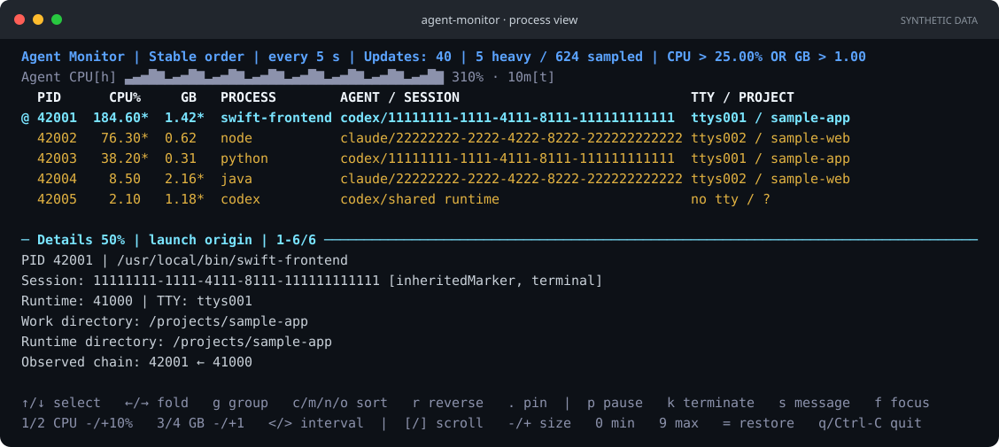

<p align="center">
  
</p>

<h1 align="center">Agent Monitor</h1>

<p align="center"><strong>Find the session behind the load.</strong></p>

Trace heavy CPU and memory usage to **Codex CLI and Claude Code sessions** on macOS.

When several coding agents are running, a busy `node`, `java`, or `python` process tells you little on its own. Agent Monitor connects heavy processes to their agent session, terminal, and project, so you can see where the work started. Then act on it: message the agent, jump to its terminal, or stop the process.

## Features

- **Live terminal view** — watch CPU and memory usage, sort processes, and open details without leaving your terminal. Change the update interval or freeze the view while you look.
- **Session grouping** — bring related heavy processes together and see their combined resource usage.
- **Adjustable filters** — change CPU and memory thresholds while the monitor runs.
- **Message the agent** — send a reviewed message to the process's verified Codex agent or Claude Code session; the process's PID and name are included automatically.
- **Jump to the session's terminal** — bring the terminal running the agent to the front, selecting its tab in Terminal.app.
- **Stop a runaway process** — review and send SIGTERM to one process only.
- **Actions from scripts** — the same actions as `kill`, `message`, and `focus` commands, with confirmation or `--yes`.
- **Responsive layout** — use narrow or wide terminals, resize the details pane, and copy text with normal terminal selection.
- **Scriptable output** — print a colored report or stream JSONL to other tools.
- **Explicit uncertainty** — unknown or ambiguous sessions stay visible instead of being guessed.

## Install

Requires **Apple Silicon and macOS 27 or later**. With [Homebrew](https://brew.sh) installed:

```sh
brew install mbackschat/tap/agent-monitor
```

No Xcode, root access, or agent hooks are required. Update with `brew update` followed by `brew upgrade agent-monitor`.

Prefer a direct download or a source build? See the [installation guide](docs/installation.md).

## Quick start

The **TUI (terminal user interface)** is a live, full-window dashboard that runs inside your terminal. It refreshes in place and is controlled with the keyboard. Launch it grouped by session from any directory:

```sh
agent-monitor --tui --group session
```

Switch between individual processes and session groups to see which agent launch they belong to. Open a process to inspect its full session ID, executable path, project directory, and attribution evidence in the lower pane. The layout adapts when you resize the terminal, and the footer keeps the available keys visible.



*Illustrative process view with details open. The text comes from the real layout renderer using entirely synthetic data; terminal colors and window decoration are illustrative. Press `g` to switch between this view and session groups.*

Use **↑ / ↓** to select, **Enter** to expand a session or inspect a process, **g** to toggle grouping, **< / >** to update less or more often, **Space** to freeze the view, and **q** to quit. The controls and current filters are shown in the terminal.

By default, the monitor shows agent-associated processes exceeding **25% CPU or 1 GB memory footprint**. If the list is empty, press **1** to lower the CPU threshold or **3** to lower the memory threshold. CPU at 100% means one fully occupied core.

## Process actions

Select a process and press **k** to review a termination request or **s** to compose a message to its Codex or Claude Code session, or **f** to bring the session's terminal to the front. **Ctrl-Y** confirms the reviewed action; **Esc** cancels or returns to editing. Termination sends SIGTERM to that process only.

The monitor automatically includes the selected workload's PID and name, then shows the exact message before sending. Codex messages default to the verified **root agent**; **Tab** can select the attributed agent when it is distinct and reachable. Codex CLI must be on PATH with the session loaded on its default local app server; standalone Codex sessions and remote/custom app servers are not supported. Claude Code messages go to the attributed session's local inbox; Claude Code 2.1.224 or later must be on PATH, and the session may hold or refuse messages from other processes under its own settings. Acceptance does not confirm delivery or action. Focus selects the session's tab in Terminal.app; other terminal apps are only brought to the front, and macOS asks once for Automation permission. See [action controls and limits](docs/usage.md#process-actions).

## More ways to run

```sh
# Print one report
agent-monitor

# Choose your own thresholds
agent-monitor --tui --cpu 10 --memory-gb 0.5

# Stream reports as JSONL
agent-monitor --json --samples 0

# Explore all options
agent-monitor --help
```

See the [usage guide](docs/usage.md) for all keyboard controls, filters, session grouping, and output options.

## Options and defaults

With no options, `agent-monitor` prints one text report after a one-second baseline interval. A process appears when **CPU OR memory exceeds its threshold**; only your user's agent-associated processes are included by default.

| Option | Description | Default |
| --- | --- | --- |
| `--cpu <percent>` | CPU threshold; 100% means one occupied core. Accepts nonnegative values. | `25` (%) |
| `--memory-gb <gb>` | Physical memory footprint threshold in decimal GB. Accepts nonnegative values. | `1` (GB) |
| `--interval <seconds>` | Wait between samples, from 0.1 to 60 seconds. | `1` (second) |
| `--samples <count>` | Number of reports; `0` runs until you quit. | `1`; `0` with `--tui` |
| `--tui`, `-tui` | Open the live terminal UI; requires interactive input and output. | Off; text reports |
| `--group <mode>` | `none` shows individual processes; `session` groups by launch session and totals displayed heavy processes. | `none` |
| `--json` | Emit JSONL: one complete JSON object per report. | Off |
| `--json-schema` | Print the report's JSON Schema and exit without sampling. | Off |
| `--all-processes` | Include unrelated and unattributed processes; same-user scope and heavy thresholds still apply. | Off |
| `--commands` | Include command arguments in reports and details; arguments can contain secrets. | Off |
| `--no-color` | Disable colors in text, TUI and action output, like `NO_COLOR=1`; JSONL is never colored. Colors otherwise appear only on a terminal. | Off |
| `--version` | Print the installed version and exit. | — |
| `-h`, `--help` | Show command help and exit. | — |

| Command | Description |
| --- | --- |
| `kill --pid <pid> [--yes] [--no-color]` | Review and send SIGTERM to one process. |
| `message --pid <pid> --text <text> [--to root\|selected] [--yes] [--no-color]` | Review and message the process's Codex or Claude Code session. |
| `focus --pid <pid> [--no-color]` | Bring the terminal hosting the process's agent session to the front. |

The commands ask for confirmation in a terminal and need `--yes` in scripts; see [actions from the command line](docs/usage.md#actions-from-the-command-line) for exit statuses.

Choose only one of `--tui`, `--json`, or `--json-schema`. Session grouping is available for text and TUI output; `--group session` cannot be combined with `--json` or `--json-schema`.

## Current support

Agent Monitor supports Codex CLI and Claude Code terminal sessions. Claude Code's native installation has been checked with a real workload; npm-based Claude installations and real terminal Codex workloads have not yet been validated. Desktop conversation attribution and third-party agent plugins are not currently supported.

Background jobs whose launching shell has exited can reconnect to their live runtime through an inherited session marker and a matching Codex thread writer or Claude inbox. Missing or conflicting runtime evidence stays unresolved.

A Codex runtime holding multiple thread writers is labeled **shared runtime** when its own usage cannot be assigned to one thread. Its workloads can still have exact session labels; the shared runtime stays separate from their session totals.

Session associations identify **where a process was launched**. A shared daemon may later serve other sessions, so its current activity cannot always be assigned to the session that started it. Group totals cover the heavy processes shown, not every process in a session.

The monitor inspects only your user's processes and does not read conversation transcripts. Command arguments are hidden unless you request them with `--commands`.

## Adding more agents

Codex CLI and Claude Code use built-in attribution adapters. Each adapter recognizes its runtime and interprets its session markers and runtime evidence; shared monitoring handles resource measurement, process lifetimes and conflicting claims.

Messaging is a separate capability. Additional session inspection and external plugins remain future work; **there is no third-party plugin API**. See the [adapter architecture](docs/architecture.md#agent-attribution-adapters) for the implemented boundaries and extension limits.

## Documentation and contributing

- [Usage guide](docs/usage.md) — controls, actions, measurements, grouping, and JSONL.
- [Development guide](docs/development.md) — build, test, and verification commands.
- [Architecture](docs/architecture.md) — how collection, attribution, and presentation fit together.
- [Validation coverage](docs/development.md#validation-coverage) — live checks and known coverage limits.
- [Project plan](PLAN.md) — open follow-ups and scope decisions.
- [Research findings](docs/research/README.md) — dated evidence, sources, and unresolved empirical questions.

Bug reports and focused contributions are welcome. Include your macOS version, agent installation type, command used, and expected versus observed behavior. Remove session IDs, project paths, and command arguments you do not want to share from any attached output. For code changes, start with the [development guide](docs/development.md).

Run `bash scripts/doctor.sh` to check your development environment. Contributors using Codex CLI or Claude Code can optionally run `bash scripts/skills.sh install`, then `bash scripts/skills.sh check`. This installer downloads pinned Swift development skills into the ignored `.skill-sources/` directory and exposes them to both agents; it does not install Agent Monitor or change global agent settings. See [skill setup](docs/development.md#skills-shared-by-codex-cli-and-claude-code).

The TUI preview is generated from synthetic data using the production layout renderer. After changing its appearance, run `bash scripts/preview.sh update` and review the image. CI checks for stale previews on every pull request; see the [preview workflow](docs/development.md#readme-preview).

## License

[MIT](LICENSE).
