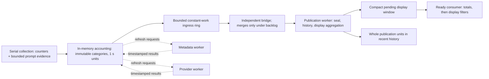
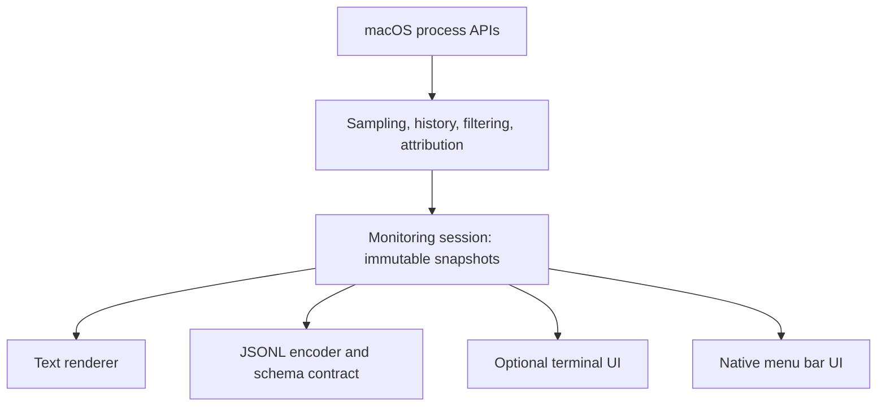

# Architecture

## Product experience

The [product contract](product.md) requires Mac and TUI to answer which agents, sessions and processes consume CPU or memory, with their workload CWDs visible in context. Every presentation decision serves comparison of multiple contributors. Use aligned tables, meaningful graphics and structured disclosure; explanations and arguments belong on demand. Measurement semantics, ownership and action guards stay shared, while native and terminal interaction differ.

**Current behavior:** overview and process-group headings lead with provider/session identity, followed by compact workload directory context. Contributor rows pair executable and frozen CWD. Session labels use locally verified provider/session IDs; provider-listed names are unavailable under the offline runtime contract. Directory summaries never establish ownership or invent session names.

## Purpose and status

Agent Monitor exists to identify the agents and processes responsible for CPU and memory use. Sampling and attribution must be reusable by text output, an optional terminal UI, and a native menu bar app. See [PLAN.md](../PLAN.md) for open work and scope, and the [development guide](development.md#validation-coverage) for validation limits.

## Resource visibility requirements

User priority clarified on 2026-10-23 and sharpened on 2026-10-25 in the [product contract](product.md): a full, reliable understanding of agent load and memory is the primary acceptance criterion. Coverage and correct attribution take precedence over collection cost and presentation convenience. Substantially underreporting a busy agent workload is a product failure; documenting that failure does not satisfy the requirement.

- **Transparent attachment:** observe already-running agents without requiring relaunch or cooperative worker instrumentation. A future event source must establish target access, lifecycle identity, loss detection and supported deployment before implementation; no complete transparent backend is currently validated.
- **Population:** agent/session resource totals must account for the relevant observed processes independently of display thresholds. Below-threshold workers and their memory must not disappear from totals merely to shorten a table. CPU and memory need separately stated populations and observation times; a sum of departed workers' last footprints is not current memory use.
- **Lifetime coverage:** evaluate short-lived workers and CPU consumed before exit, not just long-running processes. A shorter polling interval is an improvement only to the extent demonstrated by measurements; it does not prove complete accounting. UI refresh and collection choices must serve coverage rather than silently sacrifice it.
- **Responsibility:** identify the responsible process lifetimes and agents from verifiable evidence. Preserve the distinction between launch origin and current responsibility for shared services. Unattributed, ambiguous, unreadable and unobserved work must remain explicit; host usage minus measured agent usage is not a measured system-load category.
- **Evidence:** validate resource accounting against independent CPU-work and memory oracles, including churn, overlapping workers, nesting, exit and PID reuse. Prevent double counting as well as undercounting. Show coverage limitations where users interpret totals, and do not present a partial sum as the complete load.

The following sections describe the current implementation, which does not yet meet these requirements: collection can miss short-lived work and final exit CPU. Display filters no longer reduce observed session/icon totals and history refreshes with each report. The [active accounting work](../PLAN.md#resource-accounting-priority) tracks the gap. The [exited-descendant counter decision](decisions/exited-descendant-cpu.md) remains a correctness constraint; the new priority does not make unsafe counter addition valid.

## Current implementation

`AgentMonitorCore` owns native process inspection, resource measurements, metadata parsing, process-lifetime history, threshold filtering, and attribution. Models are `Sendable` values. The serial collection worker owns the mutable monitor and counter ledger; the metadata worker returns timestamped observations. The core has no terminal UI or SwiftUI dependency.

`AgentMonitor` owns Apple Argument Parser options, validation, and output selection. `AgentMonitorCore.MonitoringSession` composes [independent acquisition](#independent-acquisition): one serial native/accounting cycle, a separate metadata worker and immutable `MonitoringSnapshot` publication. The collection cycle owns counter baselines and attribution; bounded display windows coalesce independently of the consumer. Thresholds are read immediately before delivery and only project the unfiltered findings. Zero disables each resource filter independently; enabled filters combine with OR and strict greater-than, while both zero admits every observation, including unavailable measurements. `LiveInterval` wakes the acquisition wait when its value changes; unchanged settings do not create a new wait generation. Freezing remains presentation state: `LiveReportState` holds its displayed snapshot while collection and history continue. Cancellation drains active native work before the session returns.

`AgentMonitorPresentation` owns text output, report and diagnosis encoding/schemas, local guides, and UI-independent sorting, process selection, disclosure, and compact report layout. `AgentMonitorTUI` alone depends on the regular, unmodified SwiftTUI package and maps presentation lines to terminal views. The UI owns keyboard input and the runtime lifetime; its lifecycle task consumes the same monitoring session as the CLI.

`SessionGrouping` derives neutral groups from unfiltered observations and frozen window contributions. Group CPU follows each contribution’s label and acquisition-time root corroboration; unresolved CPU stays separate. Each process row appears once under its last observed owner, with current memory only when present in the final scan. Earlier resource-only groups remain visible without an actionable child, including when the process is pinned. Group counts are distinct contributors per group and are not additive after a label change. Exact groups use provider plus session ID; unresolved entries use process lifetime. A changed label or corroborated root is qualified as “Label changed in window”, not converted into conflicting evidence. Such groups retain their headers instead of flattening into a whole-process CPU row. No directory/TTY/shared-runtime heuristic supplies identity, and no extra process collection or provider control requests occur. Missing measurements produce explicitly partial sums of known values; all sums cover observed members, including those whose rows are filtered. `findings` remains the display projection; group children use only that projection. Unpinned session headers require at least one displayed, unpinned member; explicitly pinned sessions remain visible even without matching children. This visibility rule does not change the group membership or totals.

`LiveReportState` owns typed process/group selection and disclosure for both interactive views. A filtered snapshot cannot distinguish a temporarily quiet workload from an exited one. Group expansion therefore follows the exact provider/session or unresolved process-lifetime identity across absence; active `openGroups` contains only current or pinned groups, while up to 256 absent identities retain expansion in most-recently-expanded order. Visible/pinned expansions are never evicted by that bound. Explicit collapse removes the remembered choice. Disclosure memory retains identities only, never measurements or executable action state.

Process inspection remains limited to one active process (native inline details or the TUI pane): disappearance clears its visible process and scroll offset, retaining only one pending PID/start identity. That exact process restores its details and report selection on return unless the user selects another row, changes disclosure/grouping, minimizes/restores the pane or opens an action panel. A reused PID cannot inherit it. Automatic fallback selection while the process is absent does not cancel restoration; keyboard focus is not assigned by restoration. The existing details mode and split survive filtering. Collection reset (including native dismissal) clears disclosure memory. Text and TUI reuse the grouping projection; JSONL preserves flat process records for both observed and displayed projections.

The shared table formatter pads headers and fields explicitly, reserving a marker cell after each numeric column (`*` for an exceeded process threshold, `~` for a partial group total). The name-only process column fits the longest process name across the current findings or its heading, whichever is wider, up to the viewport-dependent cap. Measuring across findings keeps scrolling from changing column positions. Unused process space goes to provider/session identity and then terminal/project information; short names no longer absorb spare terminal width. Compact views omit the terminal/project column and split the remaining width between process and agent/session, abbreviating oversized names so they cannot push identity out of view. Group headers label observed totals; sampling can still miss short-lived work.

`LiveReportState.setSessionDisclosure` applies explicit bulk expansion/collapse to the current presentation level. Top-level targets are displayed session groups (including pinned groups); a nested process targets only its containing group. Hosts supply the focused/selected identity and the native singleton-flattening policy, without provider recognition. Individually pinned processes and flattened native singletons are top-level, unavailable/hidden targets cannot supply child scope, and actions block the command. Collapse moves a hidden selection to its parent and clears hidden process details, preventing subsequent sampling from reopening the group to reveal a stale selection. Bulk operations update the same bounded disclosure memory and never open multiple process inspectors.

## Attribution evidence and inspection scope

Each finding identifies a process lifetime, its usage, available working directory, provider session/thread ID, runtime PID and terminal when known, and the evidence supporting that association. Display thresholds default off; enabled thresholds reduce visible rows while all observed in-scope contributors remain available for totals. Ancestors also supply tracing context.

- **Codex:** child `CODEX_THREAD_ID` / `CODEX_SESSION_ID` markers identify logical threads and their root session. Open writer-lock descriptors can identify a thread when exactly one candidate exists in the nearest native runtime. With no observed runtime ancestor, a marked workload is linked back to the one live Codex runtime holding a writer descriptor for its exact thread ID, provided that runtime started no later than the process carrying the marker. A matching root-session ID alone is insufficient; multiple matching runtimes leave the runtime unresolved while preserving the marked thread. A runtime started later, including one resuming the same thread, cannot establish launch origin.
- **Claude Code:** `CLAUDE_CODE_SESSION_ID` identifies launch origin. Native `claude` executables and the versioned native installation are recognized as runtime boundaries only when invoked as themselves: the same executable runs embedded tools selected by `argv[0]` (observed: `ugrep` behind the Bash tool's `grep`), so an `argv[0]` naming neither `claude` nor the executable withdraws the runtime claim and the process resolves as a workload through its own marker. Unreadable arguments keep the executable claim. Native runtimes carry no marker of their own, and platform-binary children such as Bash-tool shells expose no environment; their exact session may remain unresolved because production [harness session listings](#harness-session-registries) are disabled under the offline contract. See [runtime attribution research](research/claude-runtime-attribution.md). A workload detached from its runtime (for example a background job whose shell exited and which was reparented to launchd) is linked back to the one live Claude runtime that listens on the inbox socket named by its `CLAUDE_CODE_MESSAGING_SOCKET`, provided that runtime started no later than the process carrying the marker; a later start means PID and socket-name reuse. The adapter requests native listening-socket paths for recognized runtimes; detached candidates enter enrichment in a second pass after the marker is known. npm-based Claude roots have not been validated.
- **Historical ancestry:** parent relationships survive observed parent exit. PID plus microsecond start time prevents PID reuse from inheriting a different process's history.
- **Nested agents:** one agent started inside the other (Codex → `claude`, or Claude → `codex exec`) leaves both providers' markers in its workloads. The inner agent is the nearest runtime above the workload and set its own marker last, so its provider's marker attributes the workload; a detached workload carrying both stays ambiguous.
- **Uncertainty:** multiple runtime thread candidates, conflicting markers, and incomplete metadata remain explicit. A known runtime/terminal can still be reported when the logical thread is unresolved. Unresolved agent-associated heavy consumers remain visible; unrelated unknown consumers require `--all-processes`.

The monitor retains the complete adapter recognition set until a polling-visible execution boundary (path/name change or kernel-peak footprint reset); each boundary invalidates that set and metadata. A read `argv[0]` can only narrow the set for that lifetime through the adapter's invocation check, without repeating path recognition, and an unreadable later read keeps the earlier invocation. A per-snapshot index contains only live runtimes claimed by exactly one provider. Adapter path parsing supplies explicit URL directory hints, avoiding filesystem checks during recognition; the host remains the native I/O boundary. Detached lookup uses that index without re-recognizing every process for every query. Session markers, descriptors and sockets still refresh through the native reader; reuse of resolved ownership follows the [input-invalidation contract](#reusing-unchanged-collection-context).

Detached runtime candidates are enriched in a second pass after reading the workload's marker. Every enrichment refreshes all eligible candidates, including after a prior match, so a closed descriptor or competing runtime cannot leave a cached association in place. Sampling and action lookup share this path; it does not invent parent edges in the reported ancestry.

The Codex adapter identifies a process as a **shared runtime** only when it is the attributed Codex runtime itself (matching PID and start time), has no exact thread, and carries ambiguous evidence with more than one distinct writer thread ID. This uses existing snapshot evidence; it does not reinterpret unresolved descendants as shared runtimes or change the JSONL contract. The runtime remains a singleton in session grouping because its own resource usage cannot be allocated among the hosted threads. Exact workload markers keep precedence over this label. No terminal or client association follows from the label.

These are **launch-origin associations**. A Gradle, Kotlin, MCP, or other shared daemon can later serve different sessions; its inherited marker does not establish which session caused its current CPU usage. Desktop hosts are labeled nonterminal where identifiable, with no promise of desktop conversation attribution. A terminal-less detached worker can retain a known logical session even when its runtime is unavailable.

The monitor examines only same-user processes. It reads allowlisted session markers, permitted process metadata, and Codex writer-lock descriptor paths, and never launches provider session-listing commands; it does not read conversation transcripts or keep full environment buffers. Attribution history exists only in memory for live processes and their necessary ancestors; the [counter ledger](#retained-counter-accounting) independently retains bounded CPU baselines for missing lifetimes. Monitoring after an unmarked process has already detached may not recover its session.

## CPU accounting

CPU is averaged between snapshots in the one-core unit (100% = one logical CPU). Each native snapshot records its listing time `L(k)` immediately before `proc_listpids` and its scan duration. Listing times, each lifetime's sample time `t`, cumulative user+system CPU `C` and birth time `b` from `ri_proc_start_abstime` use the reader's same Mach timebase conversion; Mach absolute time excludes sleep. The BSD wall-clock start remains part of exact PID-plus-start identity and is never compared with these measurement times. `exec` preserves that identity and cumulative accounting.

| Observation | CPU percentage |
| --- | --- |
| Same lifetime observed in the preceding snapshot with valid counters and positive sample-time delta | `100 × ΔC / Δt`, unchanged. |
| First observed now, born after the preceding listing | `100 × C / (t − L)`, where `L` is the retained listing immediately before birth (usually `L(k−1)`, or the current listing for birth during a scan). |
| First observed now, born at or before the preceding listing | Unavailable; subsequent valid observations use normal deltas. |
| First snapshot | Unavailable. |

Newborn CPU uses a zero baseline at the retained listing immediately before birth, rather than process age or the configured wait. A birth during the current scan uses its current listing; a first run-baseline observation remains ineligible. Its window can exceed an existing lifetime's window by at most the previous scan duration. A lifetime absent from the preceding snapshot does not receive a latest-interval CPU rate. The independent counter ledger can recover its CPU over the original endpoints, as described below; ancestry retention never supplies its counter baseline. Missing or decreasing counters and nonpositive elapsed times do not produce latest-interval CPU values; an accepted zero CPU delta remains measured zero. Lifetimes never observed and CPU after a lifetime's last observation remain uncounted; exited-descendant recovery is deferred and child counters are unused. Existing threshold, attribution, history, icon and session-group aggregation rules remain unchanged; their values incorporate these measurements.

Host occupancy is measured at each listing with `host_processor_info(PROCESSOR_CPU_LOAD_INFO)`, behind an injectable core source. Per-logical-CPU user, system, idle and nice tick deltas are summed; occupancy is `100 × logical CPU count × (user + system + nice) / all ticks`. This is unweighted occupancy in the one-core unit, not equivalent computing capacity across performance and efficiency cores. `host_statistics` is excluded because third-party reads are cached at short intervals; see the [review evidence](research/cpu-accounting.md#review-follow-up--2026-10-16).

`MonitoringSnapshot.cpuAccounting` contains `hostBusyPercent: Double?`, `logicalCPUCount: Int`, `measuredUserPercent: Double`, `unmeasuredLifetimeCount: Int` and `previousScanSeconds: Double?`. The measured total includes all sampled current-user lifetimes before thresholds or attribution filtering, including historical contributors in a display window; the monitor itself remains excluded. Window rates use eligible CPU-seconds divided by the enclosing duration. Its missing-value count covers observed lifetimes with excluded measurements, not never-observed processes. The previous scan duration bounds newborn window skew and is absent on the baseline snapshot. This accounting requires no metadata enrichment or all-agent summary; text and JSONL keep summary collection disabled.

Host occupancy is unavailable on the first snapshot, failed calls, zero total tick delta, any per-CPU counter decrease (including wrap), or logical CPU-count changes. A failed read breaks the baseline; the next successful read establishes a new one. Successful but unusable readings become the next baseline. The count comes from a successful host reading, falling back to the native active logical CPU count when the call fails. Missing host occupancy is shown as “No data”; measured idle occupancy remains 0%. Sleep/wake consistency remains an [empirical question](research/cpu-accounting.md#unresolved-empirical-questions); inconsistent counters are rejected.

Presentation owns one shared context string, for example `CPU: host 211% of 800% · your measured processes 169% (3 without data)`, reused by the text report, TUI header, native panel header, native status menu and accessibility text. Percentages are rounded to whole numbers for this line. The TUI reserves one additional header row and clips at the viewport width; native text can wrap within its fixed panel width. Host occupancy and measured CPU are shown side by side, with no computed remainder: missed work, scan skew and tick resolution prevent interpreting their difference as outside-population load. History, native icon levels and session totals retain their existing populations and aggregation rules.

JSONL schema version 1 retains the report-level `cpuAccounting` object and adds optional `acquisition` timing/status; unavailable `hostBusyPercent` and `previousScanSeconds` are omitted. The report and object reject additional properties. Findings stay flat; the report also requires unfiltered `observedFindings` beside the displayed `findings`. There is one current report schema and no compatibility output modes. [Schema discovery](../Sources/AgentMonitorPresentation/Resources/report.schema.json) remains available through `--json-schema` without sampling.

### Retained counter accounting

The first CPU-01 foundation is implemented in [CounterLedger](../Sources/AgentMonitorCore/CounterLedger.swift) and used by every `Monitor` ingestion. Each monitor owns an acquisition-run UUID and monotonically increasing scan sequence. A process observation is identified by that scan plus its exact PID/start lifetime; a contribution identifies both its opening observation (or pre-birth listing) and closing observation. `Monitor.counterScan` exposes the latest immutable observations, accepted contributions, exclusions, evicted baseline identities and, for snapshot ingestion, the original native snapshot including host counters. Acceptance-rule version 1 describes this core contract; it is not a recording format or report JSONL version.

The ledger retains the last valid counter through missing scans and unavailable resource reads. The next compatible counter produces one delta over its real endpoints. Native user/system Mach ticks are retained as integers and subtracted separately before conversion, so floating-point rounding or an increase in one component cannot hide a decrease in the other. Counter decreases, invalid values and incompatible counter representations/timebases break continuity; a valid reset reading establishes a new baseline. Invalid read times cannot move the baseline backwards. Executable changes alone do not reset cumulative CPU; no execution-epoch or historical session-ownership guarantee follows from this rule.

The first valid counter of a lifetime born after the initial listing may use a zero opening at the retained listing immediately before its verified monotonic birth, including after earlier unreadable observations or at the current listing for birth during a scan. The first scan establishes the run baseline without accepting CPU. That opening is a listing reference with birth evidence, never a fabricated process sample. Pre-existing lifetimes, absent birth evidence, previously established baselines and unavailable pre-birth history cannot recover their first cumulative counter. Baseline state and listing retention are independent of attribution and display filtering.

Baseline retention is capped at 8,192 lifetime states and listing history at 4,096 listings in the initial implementation. These are engineering caps, not validated coverage or heap-size guarantees. Baseline eviction removes least recently observed states, with exact-identity ordering for ties, and advances a conservative birth-time floor through evicted read times. A scan-ordered queue skips stale references and sorts only the oldest scan's tied identities when eviction needs them, rather than sorting all retained states on each birth. Periodic linear pruning bounds lazy references to twice the baseline cap, including when a long-missing lifetime pins the oldest scan. Pruning also shrinks sparse batch allocations and releases empty buffers, so departed lifetimes cannot each pin the original full-population scan array. A returning evicted lifetime cannot re-add its cumulative CPU as a newborn; lifetimes born at or before that floor establish a new baseline with a history-evicted exclusion. This can also conservatively exclude other delayed first readings. Exclusion and eviction records preserve that loss without unbounded lifetime tombstones. Contributions are returned per scan; the ledger does not retain an unbounded contribution archive.

`CounterWindow` selects closing observations in `(baselineScan, finalScan]`, deduplicates contribution IDs and rejects conflicting copies or mixed acquisition runs. Openings before the baseline remain separately recovered CPU, excluded from the window's rate. Its denominator is the enclosing window from the baseline listing to the final scan end. Widening/coalescing a window re-evaluates endpoints and unique contributions; adding percentages is invalid. No accepted contributions means unavailable CPU, while an accepted zero delta remains measured zero. This projection is shared by finite diagnosis and the independent live display-window aggregation.

Live process/session/icon rates use the enclosing display window and exclude recovered CPU whose opening precedes that window. Finite diagnosis uses its wider acquisition window and now includes retained-counter recovery within that window once, preserving each contributor's actual interval. No earlier acquisition run supplies its baseline. Display windows expose recovered contributions and frozen point attribution across every frontend; later graph/metadata labels do not rewrite earlier CPU ownership. Existing live ancestry still orders parent candidates by BSD wall-clock birth timestamps and retains prior parent links; that mechanism cannot certify historical ancestry across clock adjustments. Historical support must use retained exact edges with monotonic birth evidence.

Native snapshots preserve raw per-process CPU and birth/read ticks, original footprint/kernel-peak values, and ordered absolute/continuous/wall-clock anchors with the Mach timebase. These anchors are not atomic or interchangeable; host reads occur between scan start and the listing anchor. Structured native outcomes retain the listed PID, operation, return value/expected length, failure errno captured at the syscall boundary, read time and, for resource/path failures, identity only when the resource-read identity bracket passed. Out-of-scope outcomes retain the identity observed by the initial BSD read. Permission denial, ESRCH, short reads, identity/UID changes, other failures and readable out-of-scope users remain distinct; ESRCH does not establish normal exit. Failed final verification rejects the sample while preserving earlier operation failures without claiming an identity. Enumeration failure still throws its native errno. Existing live unreadable counts retain their earlier meaning; richer outcomes are available in the core for the subsequent reporting/recording work.

Frozen point attribution and historical rows build on this counter foundation in the independent display-window layer below. Recording remains separate. Controlled-load cadence/coverage and retained-memory acceptance remain open in [PLAN.md](../PLAN.md#resource-accounting-priority). Polling still cannot measure never-observed lifetimes or reliably recover final exit CPU.

### Independent acquisition

Live text/JSONL, TUI and native collection share one serial `AgentMonitor acquisition` cycle for native reads, bounded prompt evidence, counter ingestion and in-memory attribution/accounting. Slow native metadata uses a separate dedicated worker. A dedicated `AgentMonitor publication` worker seals closed units, admits recent history, aggregates display windows and creates history snapshots. Acquisition does not enter the history store or wait on its UI-shared lock. There is no raw-scan FIFO or resolution backlog. The native acquisition thread owns its absolute start-to-start deadlines. Interval changes and cancellation signal its wait directly; there is no per-scan Swift task submission or task-group timer race. A preallocated bounded ring transfers closed units in constant bookkeeping work; a separate async bridge admits and merges them in the publication channel. Neither history work nor actor admission runs on the acquisition thread. Injected clocks implement the same synchronous deadline/wake boundary, so deterministic backlog, overload and drain tests exercise the production loop. Swift tasks coordinate the bridge and consumers; synchronous native work runs off the cooperative executor. Collection currently requests `userInitiated` QoS, a provisional policy rather than a real-time guarantee. Finite diagnosis retains its separate finite-window service.

Requested thread QoS does not establish effective scheduling priority: the launch context and macOS task resource policy can constrain it. The collector does not reclassify its host process or override an inherited background/utility policy. Acceptance therefore distinguishes ordinary CLI/TUI launch, a diagnostic application-policy launch and the native app, and records requested QoS alongside effective thread priorities. `taskpolicy -a` changes process policy at launch; its results cannot stand in for ordinary CLI/TUI or closed-panel Mac acceptance. See the [profile protocol](../Tools/CPUAccountingProbe/README.md#live-pipeline-profile) and Apple’s [requested/effective policy distinction](https://github.com/apple-oss-distributions/xnu/blob/main/osfmk/kern/task_policy.c).

Acquisition requests a start-to-start period, 100 ms by default. Native reads and in-memory work can stretch that period under load; the collector never runs overlapping or catch-up scans. Each report window records accepted scan count, timed-period count, maximum start-to-start gap and the number of periods exceeding 1.5 times their requested duration. These aggregate over every scan and merge by sum/max, so an on-time final scan cannot hide a prior gap. Mac/TUI coverage details and JSONL expose the window summary; overruns have a compact visible warning. Persistent sampling explanations live behind native coverage disclosure or terminal details, rather than repeating below every table; actionable coverage warnings remain visible. Polling still misses never-observed workers and final exit CPU.

Prompt capture uses bounded attempts, elapsed time and reserved argument bytes per scan, with per-lifetime/executable discovery state. Discovery eviction shares the counter ledger’s scan-order queue: only the oldest tied identities are sorted, and stale references are bounded by periodic pruning. Long-running churn therefore does not repeatedly sort the whole discovery cache; eviction still preserves the same re-capture eligibility. `KERN_PROCARGS2` reads with budgets up to 64 KiB, including default prompt capture, query size first: an argument area larger than the allowance is explicitly truncated and is never parsed. Larger read budgets, including background enrichment, first try a 64 KiB buffer. Only a result shorter than that buffer is parsed directly: XNU returns the full supplied capacity for a truncated tail. A filled buffer falls back to the size-query/read/post-size-check path, which rejects oversize arguments and growth beyond the allocation. For ordinary targets whose environment is included, this removes two size-query syscalls, not two argument copies: XNU skips the stack copy for size-only queries. Restricted targets whose environment is omitted can copy during those queries. Arguments exceeding 64 KiB incur an additional initial read before fallback. Refresh frequency is unchanged; the [argument reader](../Sources/AgentMonitorCore/NativeProcessArguments.swift) owns the shared check. Native identity/path checks bracket access. The short-read path omits the post-read size query, so a same-path exec growing arguments during the kernel read can escape that former race check; the size-checked path was not atomic either. Unchanged-path exec remains an observation limitation. Captured evidence stays at its actual read time. Successful no-marker reads have a separate captured status and are forwarded for metadata reuse rather than reported as unavailable. A process can overwrite its argument area without exec, so empty reads retain existing markers. Executable path changes, name changes and observed kernel-peak footprint resets clear metadata and markers; delayed pre-boundary evidence cannot restore them. An exec missed by polling can therefore retain an earlier marker, an explicit attribution limitation.

Metadata refresh uses its own worker and timestamped results. Stable metadata batches are due one second after their previous request time; read completion timestamps qualify evidence freshness, not the next refresh deadline. Slow workers may coalesce requests instead of catching up. New lifetimes and polling-visible execution changes are eligible immediately. Only replaceable refresh requests coalesce; accepted counter observations do not. Cancellation cannot forcibly interrupt an in-flight native syscall. Collector-owned descendants remain measured and identified for adaptive-sampling exclusions. There is no provider-listing worker or request path.

Native metadata prepares one adapter-owned runtime observation plan per read, sharing its fresh invocation decision between terminal eligibility and descriptor requests. Path-only executable recognition is reused in a reader-owned, synchronized FIFO cache capped at 256 entries and 64 KiB of executable-key UTF-8 bytes; these logical limits are not a whole-process heap ceiling. The collection’s immutable adapter registry owns recognition and evidence interpretation. Only nonempty absolute paths are cached, including negative claims; oversized and relative paths use fresh recognition. A canonically equivalent path with different UTF-8 bytes bypasses the cached entry without replacing its stored spelling or byte charge. The registry also prepares the immutable environment-key union, its UTF-8 spellings and each adapter’s allowlist once. Every parse still scans fresh argument bytes and validates fresh values; this retains declarations, never arguments or environment values. Invocation narrowing, descriptor reads and evidence interpretation happen outside the cache lock on every metadata observation. Arguments, environment variables, process identities, descriptor results and ownership evidence are not cached here. Both native lifetime/path checks still bracket metadata reads; the cache introduces no filesystem persistence.

The retained attribution graph has an independent reservation using the pipeline’s record/text limits, covering retained ancestors, metadata, cached resolution context and indices even when visible ancestry is short. Mutation-time charges are checked after ingest and evidence application, before enrichment admission or window append. Cached resolutions are optional derived data: when evidence growth exhausts the combined reservation, discard the resolution cache before validating required evidence. Each cache miss checks its prospective retained charge, subtracting any stale entry it replaces; if it cannot fit, return the complete uncached resolution without retaining it. Cache pressure therefore increases recomputation instead of terminating collection or reducing attribution detail. This permits one candidate resolution as scratch beyond the accepted graph reservation; emitted findings and downstream windows have separate storage costs. Ingest and evidence batches are checked after mutation, so their rejected-batch scratch is not covered by this reservation. Exhausting required evidence storage terminates the run with an explicit attribution-stage error naming the rejected scan, drains previously accepted CPU, and discards later scans; it is not a skipped scan followed by continued monitoring. Required ancestry is never silently discarded. This bounds accepted retained graph state, not the simultaneous incoming batch, enrichment worker state or process-wide heap. The [population/scratch ownership audit](research/menu-bar-load-cost.md#population-and-scratch-ownership-follow-up--2026-10-26) identifies the additional allocations outside those reservations.

Open accounting units, the closed-unit ingress ring, pending publication units and pending reports each use logical caps of 65,536 retained records and 16 MiB UTF-8 text. The ingress ring also caps its unit count at 128. Its consumer releases a slot before merging; in-flight transfer and transactional merge copies are additional bounded transient storage. If the bridge itself cannot keep up, ingress rejects a unit explicitly and drains already accepted units. Recent history, prompt discovery and ledger state have their own bounds; these are not a measured process-wide heap ceiling. Capacity pressure first reduces older detail as described below. A genuinely unrepresentable current population or required crossing context still produces an explicit stage/scan failure rather than fabricated totals. Final-build cost, long-run retention and short-worker coverage remain acceptance work in [PLAN.md](../PLAN.md#resource-accounting-priority).

#### Pressure disclosure

When a pending report exceeds its logical budget, older lifetime detail may collapse into frozen resource categories. Current observations and crossing endpoints needed for recovery remain retained. A collapsed record preserves exact eligible CPU-seconds, accepted interval/missing-read counts, exclusions, the maximum sampled worker footprint with its observation time, evidence-time bounds and its enclosing observation/contribution time range. It contains no synthetic process identity and permits no process action. These CPU sums must be included alongside detailed contributions; they are not additional measurements.

Distinct process/worker counts become proven ranges. Within a collapse batch, identities are deduplicated exactly. Across batches, where a missed read can allow the same worker to return, the conservative union lower bound is the maximum of the proven lower bounds and the upper bound is their sum. Accounting can tighten the lower bound when an incoming lifetime’s verified monotonic birth is strictly after every earlier collapsed observation in that category: add that deduplicated disjoint subset to the previous minimum, then take the maximum with the incoming batch count. Worker counts apply the same proof separately from runtime counts. Only raw birth/sample ticks in the same acquisition run establish this ordering; wall-clock identity timestamps, disappearance and CPU interval endpoints do not. Missing or invalid sample provenance keeps the earlier boundary unknown through updates, merges and category release. Accounting retains fixed-size timing bounds per run/category, not released identities. Independently collapsed populations still combine conservatively; the private provenance does not enter JSONL or history. These bounds also apply when combining retained identities with collapsed records or independently collapsed display/history populations; time containment does not prove identity containment. They are not stopped-process counts. A wide range is shown honestly, rather than assuming disjoint populations. Arbitrary category churn can also exhaust storage: category labels may then collapse into explicitly mixed older agent-associated/other work, keeping runtime and worker roles separate, preserving resource sums, maxima, count bounds and time ranges while declaring lost category detail. Such a remainder does not assign uncertain work to an agent or reclassify historical ownership.

Published recent-range snapshots compact immutable categories within at most twelve temporal spans of their retained range, coarsening under pressure; the store alone retains the admitted publication units for rolling eviction. These are normally one-second units but can span several seconds after publication backlog. A paused projection therefore does not pin every original unit. Each nonempty snapshot lease charges its own header and unit-reference entries in addition to deduplicated backing payloads; fully exhausted snapshots register no empty lease. Holding a projection across run/scope changes keeps its original lease charged until release. Within each immutable unit, equal owner context shares its candidate-array storage and is charged once, preserving all candidate claims. Admission evicts original store units before shortening a published projection. Distinct failed-PID detail is also bounded: released detail keeps count bounds and its observation range, while failed-observation totals and per-scan maxima remain exact. Distinct excluded-lifetime/evicted-baseline counts expose ranges after identity release.

Display and recent-history collapsed records keep separately labelled time ranges in details; overlapping CPU sums are never added together. JSONL carries typed `collapsedContributions`; text, native and terminal presentation disclose collapsed work, its time range and count bounds. Mac/TUI integrate retained frozen categories into the appropriate session/root or uncertainty hierarchy and keep a visible pressure marker beside totals. CPU contributions use the enclosing report duration; historical sampled maxima never enter current memory totals. The bounded recent-history store remains independent of a delayed presentation window.

### Adaptive acquisition

`SamplingSession` owns one controller on the existing acquisition thread. Mac and TUI opt into adaptation explicitly; initial settings are **off**, minimum and visible maximum 100 ms, closed-panel multiplier one, and a 60 s rolling window. Ordinary text/JSONL retain fixed acquisition. Display refresh, provider/metadata freshness, accounting and recording are independent. The [prototype findings](research/cpu-accounting.md#adaptive-sampling-offline-prototype--2026-10-27) establish modeled scan savings, not native CPU savings or approval of slower defaults; [remaining policy decisions](proposals/resource-accounting.md#adaptive-acquisition) stay separate.

| Setting | Meaning and valid range |
| --- | --- |
| Mode | Adaptive sampling, or **Use maximum interval**. Off continues collection at the context maximum. |
| Minimum | Shared across contexts; at least 0.1 s and no greater than the visible maximum. |
| Visible maximum | Existing `--interval`, native presets and TUI faster/slower steps; 0.1–60 s. |
| Closed-panel multiplier | Mac only; finite and at least one, with visible maximum × multiplier no greater than 60 s. Applies in both modes. |
| Activity window | 1–300 s; defaults to 60 s. Activity does not reset the window. |

Settings are validated together. Invalid direct edits are rejected atomically and menus/steps skip invalid combinations. Native settings stay in memory until quit. TUI exposes `--adaptive-sampling` / `--no-adaptive-sampling`, `--sampling-minimum` and `--sampling-window`, without new in-app keys or a multiplier control. Minimum/window options do not enable adaptation implicitly. With adaptation off, `--interval 1` means fixed 1 s in TUI; with it on, 1 s is the maximum. A configured Mac multiplier of 2.5 makes a 5 s selection permit 12.5 s when closed, including in maximum-interval mode.

**Eligible evidence.** Evaluate before display filtering across the measured same-user population. Exclude explicit collector exclusions, verified out-of-scope PIDs, the monitor and collector-owned helpers through retained exact ancestry. Proven helper membership survives ancestor departure within the existing graph retention; a reused PID does not inherit it. Unknown helper ancestry remains eligible. Completed own metadata and the retained resolution chain must establish no agent candidate before a lifetime is excluded. A negative parent alone cannot exclude a pending child or a child with its own agent markers. Queued and unavailable refreshes retain a valid completed negative; detected execution or changed resolver inputs invalidate it, and malformed/ambiguous evidence remains eligible. Pending, point, uncertain and supported agent evidence all qualify for CPU activity.

A complete scan contributes newly accepted eligible CPU, eligible arrivals, observed departures and read uncertainty. Startup establishes the existing population without arrival events. Listed-but-unverified episodes count once, and later verification does not recount the same episode; a verified replacement does. Admitted supplemental lifetimes count at their admitting scan unless already counted. Completed own negatives suppress lifecycle events only when available at that observation; later metadata cannot erase historical control events. Absence is not proof of exit.

**Rolling controller.** Retain at most 3,002 control aggregates: all-eligible CPU, young-worker CPU, arrivals, event flags and enclosing support times. A contribution is young if its verified birth lies within the activity window at its counter observation; unknown birth qualifies conservatively. Freeze classification when admitted. Young evidence can therefore remain influential for another window after the worker ages out. Cumulative accounting continues for workers of every age; the controller keeps no additional per-worker archive.

For lookback H, select aggregates closing in `(now − H, now]`, always including the latest one. The denominator is the enclosing span from the earliest opening to now, including the preceding listing and earlier recovered CPU endpoints. It can exceed H: 25 ms CPU gathered over 12.5 s is 2 ms/s, and two 625 ms intervals occupy 1.25 s in a nominal one-second lookback. Charge accepted CPU once, without guessed proration. A settings reset cannot shorten CPU support; relaxation elapsed time starts at the settings boundary independently.

Normalize rolling young-worker CPU between 1 and 20 ms CPU/s, and arrivals between 2 and 20 per minute, clamping each score to 0–1. The larger score selects `baseTarget = maximum − score × (maximum − minimum)`. Shorten the base immediately. Lengthen it by at most `(maximum − minimum) × elapsed / window` per acquisition, capped at the target. These thresholds are policy candidates from the prototype, not measured workload distributions.

Request the minimum while any eligible arrival/departure remains in the one-second event lookback, recent all-eligible CPU exceeds its rolling mean by at least 20 ms/s, or recent absolute CPU reaches 100 ms/s. Both CPU rates use enclosing support. The absolute guard keeps continuously busy older workers fast after their rolling mean catches up. First valid counters after missing reads add a one-second recovery override. Brief overrides do not reset the independent base.

Unavailable counters on a currently listed eligible lifetime request the minimum and freeze the base. Retain history but give no relaxation credit for held time. Valid counters, verified replacement or absence from a successful scoped listing retire the blocker; final unmeasured CPU stays unknown. Persistent read failures can keep the minimum indefinitely; the prototype's persistent-failure relaxation is not enabled. **Complete-listing failure retains the existing fatal collection contract:** drain accepted accounting and surface the error. No retry loop or fabricated empty census is introduced.

**Modes and deadlines.** Startup/enabling adaptation starts at the minimum with fresh control history, without resetting process counters. Opening the Mac panel sets the base to minimum but retains history; closing changes only the context maximum. Visible maximum/multiplier edits clamp the base and keep history. Minimum/window/mode changes restart control history. Grouping, thresholds and presentation pause do not reset it. Static icon mode still stops collection while closed and starts a new acquisition baseline when reopened.

Enabled experimental discovery with active run-local inspection permission holds the minimum in either sampling mode; neither flag alone does so. Adaptive history continues while permitted. Releasing permission resumes the contemporaneous base or fixed context maximum. Discovery's read/admission algorithm is unchanged.

Activity is evaluated after scans; it cannot wake acquisition before observation. UI changes wake the existing wait. An earlier deadline becomes `max(now, lastStart + newInterval)`; a deadline already due cannot be deferred or erased by a later setting. Reads remain serial and cannot be interrupted, with no catch-up scans. `requestedPeriodSeconds` retains the actual policy request, while `effectivePeriodSeconds` records the deadline baseline used for that period's overrun test. A 1 s request shortened to 100 ms at 500 ms has a 500 ms effective baseline; it does not invent a 500 ms policy request.

**Coverage and limits.** Shared coverage details and JSONL retain requested-period extrema, current/base intervals, mode/bounds, CPU/arrival rates and their support spans, applied policy changes, override activation counts and time under each override. Counts/durations sum on coalescing and expire with their owning recent units. Maximum achieved gap appears with maximum requested period; overruns exceed 1.5 times the effective deadline baseline. Repeated scans under the same override are duration, not repeated activations. Fixed collection emits its fixed requested range without adaptive overrides. Coverage fields do not alter totals or make historical memory current.

Slower polling can miss the first burst or repeated sparse jobs before any trigger is seen. Low observed rates are not proof of inactivity. New idle sessions, unresolved churn and sufficiently large aggregate heartbeats can keep fast sampling. Older eligible workers with modest steady CPU may relax; their counters retain intervening readable work, but final tails and memory age grow. Completed-negative long-lived workers have no CPU trigger. These limitations remain visible and constrain [default acceptance](proposals/resource-accounting.md#adaptive-acquisition). No per-process scheduling, memory trigger, extra probe scans, host-load subtraction or automatic recording is added.

### Supplemental inspection observations

The [approved inspection proposal](proposals/inspection-observations.md) is implemented behind `MonitoringConfiguration.inspectionObservations`, default `false`. TUI supplies a run-local `LiveInspection` permission when `--inspection-observations` is explicitly selected; pause suspends it. Mac collection supplies no permission or enable control. Ordinary text/JSONL collection has no inspection session. Disabled collection performs no supplemental enumeration or reads and creates no held buffer. Recording remains off; all evidence below is bounded in-memory state.

On the same acquisition worker, one discovery opportunity is eligible at complete-scan start +50 ms. Acquisition/resolution must finish before that slot; there is no catch-up. Work ends at the earlier of slot +10 ms and next complete deadline −5 ms. Each native operation checks that allowance, including enumeration, worker identity/path/counters, parent identity and checked CWD; an in-flight call cannot be preempted. Limits are 16 candidate attempts, 132 native operations, and 16 held readings sharing 512 logical records and 64 KiB of UTF-8 context. These are logical limits, not a whole-process heap ceiling. The start position rotates, census members are not targeted, and no candidate queue survives the opportunity. Optional extra argument capture is omitted; ownership comes from verified preceding-census context and existing adapter recognition.

Only the next complete scan admits held readings. A successful same-lifetime read supersedes the held counters and memory completely. Absence, a whole-process ESRCH, or a successfully verified replacement identity permits one historical carried observation with its actual timestamp. A readable identity with unavailable resource counters, permission/short/other failures, an unproven mismatch or a different UID drops it. Per-operation path/resource failures cannot establish disappearance. Carried readings share the next complete sequence but never become listing anchors, current memory or current population. They can collapse under ordinary pressure while conserving admitted CPU and sampled maxima. Recent records explicitly retain census membership; final sequence alone is insufficient.

The checked parent identity and worker identity use BSD start microseconds in the same domain. Only an exact preceding-census node with parent start no later than worker start may supply context. A one-node resolver overlay freezes the row without entering the live graph, consuming enrichment or triggering listings. A later census cannot supply a newer owner for the held endpoint. Parent departure does not erase already frozen evidence. Polling can still miss exec/reparenting, and the candidate's CPU remains unresolved when prior context cannot establish ownership.

`inspectionCoverage` is present in every JSONL report and accounting window: disabled/enabled/mixed mode, opportunities, enumeration failures, candidate outcomes, carried/superseded/dropped/discarded readings and maximum complete-deadline lateness while supplemental work was in progress. Counts sum and maxima survive unit/report coalescing and whole-unit history eviction. Complete-scan timing, read coverage, endpoints and CPU denominators exclude supplemental attempts. TUI coverage details alone add the between-scan row when any retained interval was enabled; Mac rows and controls remain unchanged. Pause/close/run replacement discard unadmitted evidence. Cancellation preserves a fixed-size `LiveInspection.terminalCoverage` projection, including when the last accepted unit was already delivered; no duplicate CPU report or synthetic endpoint is emitted. TUI joins its owned collection task before reporting nonzero terminal discards at exit; SwiftTUI cancellation alone does not join task cleanup.

Deterministic guards cover admission, census-only memory/population, frozen parent context, bounded discovery, missing reads, counter reset, PID reuse and cumulative-counter conservation. The [bounded native comparison](research/cpu-accounting.md#bounded-inspection-comparison-retry--2026-10-26) measured improved 50 ms-worker capture and no skipped opportunities, but persistent short-worker loss and enabled cost above the exploratory target. It does not close short-worker or sustained-load shipping gates. Further native trials require separate authorization.

## Independent display windows

Production TUI and native collection use the shared five-second display period in `LiveReportState.displayIntervalSeconds`; text/JSONL use one second. Acquisition requests 100 ms by default. Accounting/history units close at the first scan listing at least one second after their baseline, independently of the display preference. The first closed unit is eligible for immediate display; subsequent reports combine whole units until the display period is reached. Scan overruns or a cadence that does not divide one second can lengthen these windows; rates always use the actual enclosing duration. Delivery has no additional sleep after its consumer callback. A blocked consumer receives compacted pending work when ready. Finite `samples` counts these publication boundaries; coalescing may deliver fewer combined reports, but accepted partial work also drains on normal end or collection failure.

Closed units merge only when an earlier unit is still queued for publication. The same exact accounting merge and bounded category compaction apply: eligible CPU sums, interval counts, memory maxima, recovered crossings, scan counts, maximum gap and overrun counts survive. An unrepresentable merge fails explicitly at the publication stage; already admitted units drain before the error. Publication appends a unit before taking its matching history snapshot. Finite collection counts source display boundaries independently of publisher speed, and end/failure drains the last accepted partial after earlier units. Normal display aggregation never marks units as publication-coalesced.

`publicationCoverage` in JSONL schema 1 records original and admitted unit counts, the number of original units involved in backlog merges, maximum admitted-unit span, and the enclosing monotonic range of coalesced work. Mac/TUI distinguish current-window coalescing from recent-history coalescing in coverage-status notices with unit count and maximum span. Coverage detail qualifies the enclosing monotonic range. Range compaction sums this metadata without pretending to recover the original time resolution. Retention evicts whole admitted units, never prorates their CPU. The newest admitted unit remains inspectable even when its span exceeds the nominal recent-history target; the displayed actual range then exceeds that target. On later admissions it is evicted whole once its start precedes the retention cutoff.

The acquisition worker admits each changed window transactionally: a rejected scan leaves the previous partial and its endpoint metadata intact for draining. Capacity accounting counts UTF-8 bytes directly. Ancestor retention visits only parents not already retained and removes only unreachable nodes; shared departed ancestors remain available while any live descendant needs them.

The [pipeline](../Sources/AgentMonitorCore/IndependentMonitoringPipeline.swift) owns stage scheduling and failure propagation; [AccountingWindow](../Sources/AgentMonitorCore/AccountingWindow.swift) owns retained observations and frozen contributions; [MonitoringChannel](../Sources/AgentMonitorCore/MonitoringChannel.swift) owns bounded handoff and pending-window coalescing. Frontends consume the same published snapshot rather than reconstructing accounting from visible rows.

[AccountingWindow](../Sources/AgentMonitorCore/AccountingWindow.swift) is the single accumulator for CPU and sampled memory. It retains one eligible CPU sum per exact lifetime, frozen attribution, executable, runtime role and corroborated root category, plus individual contributions whose opening precedes the unit baseline. Repeated categories merge even when another category occurs between them: record endpoints enclose accepted intervals and do not assert continuous ownership. Accepted zero intervals remain measured through `intervalCount`; unavailable CPU remains distinct. Records retain missing-read and exec-change interval counts and evidence-time minima/maxima/missing counts. Evidence timestamps are values, never category keys. Exclusions retain counts and distinct lifetimes rather than every scan identity. Baseline/final endpoints retain timing and host counters, not complete raw scans.

Only contiguous, disjoint units from one run may merge; overlapping ranges are rejected because compact sums cannot deduplicate arbitrary partial overlaps. Merging adds eligible sums, memory extrema and counts, then absorbs crossings whose opening is eligible at the widened baseline. Other crossings retain their original endpoints as recovered CPU, excluded from the displayed rate. It never adds percentages or prorates an interval. Admitted publication units support rolling-history queries; the queued display carries a separate compact aggregate rather than an ever-growing list of original units.

Rows include lifetimes no longer observed in the final scan. Their CPU remains eligible for the window, their last footprint remains inspectable, and their current footprint/peak are unavailable and excluded from memory totals. Historical row memory filters use the last observed footprint solely for visibility. Historical rows cannot initiate process actions, including through shared action services or restored message drafts. Snapshot publication retains one displayed window for inspection; Pause preserves it while acquisition continues. Counts describe observed contributors, not a count of currently running processes. A row whose contribution identities conflict with its latest point label remains uncertain; it cannot assign current memory to an old session. Grouping preserves unique candidate identities even when the evidence method changes, while each contribution retains its own evidence.

For example, a worker contributing 0.08 measured CPU-seconds to an exactly 1.0-second enclosing window contributes 8% of one core even if it disappears before publication. Its last footprint remains historical evidence, not current memory.

Exported contribution records follow the requested process scope, including mixed-ownership lifetimes retained as uncertain candidates. The separate current-user CPU context still uses all sampled same-user contributions; filtering exported records must not redefine that population total.

All fronts qualify CPU as point-evidence candidates or uncertain/unresolved; report JSONL schema 1 carries the full window and contribution records. Current live ancestry still uses the existing point-attribution graph; frozen chains do not certify monotonic historical ancestry or interval continuity. Coverage validation and any future interval-support claims remain subject to the [accounting acceptance gates](proposals/resource-accounting.md#acceptance-evidence).

## Memory observations

The native reader requests `RUSAGE_INFO_V4`. `footprintBytes` is current physical footprint; optional `kernelPeakFootprintBytes` carries `ri_lifetime_max_phys_footprint` unchanged through core findings and report JSONL schema 1. This is the kernel task peak and can reset on exec while PID/start identity stays unchanged, as the [controlled probe](research/cpu-accounting.md#kernel-memory-high-water-mark) demonstrated. A later observation replaces it, even when lower or unavailable. Text, TUI and native process details label it separately; sorting, session totals, icon and memory history use current footprint. Display thresholds also use current footprint for live rows; historical rows use their last observed footprint solely for visibility. Independent process peaks cannot be added as concurrent session memory.

## Finite CPU diagnosis

Implemented on 2026-10-17. `agent-monitor guide` explains the workflow; `guide semantics`, `guide diagnostics`, `guide actions` and `guide tui` provide focused local guidance, including exhaustive TUI keys. Top-level help leads with `agent-monitor diagnose cpu --json`, identifies report/action commands and retains the report option reference. Help, guides and both schemas work without sampling, provider queries or network access. PATH makes the executable callable, not necessarily discoverable for an unnamed CPU question. The [dated CLI investigation](research/existing-solutions.md#agent-oriented-cli-investigation--2026-10-16) does not establish live effectiveness or token savings.

`diagnose cpu` returns text by default, one compact JSON document with `--json`, or its schema without collection with `--json-schema`. It takes a baseline followed by **three one-second waits and measurement scans**, then returns the **top ten measured lifetimes**, including nonagents and the invoking agent but excluding the monitor. These fixed defaults are a design judgment, not a benchmark-derived optimum. Explicit report controls, including default-valued controls, are rejected. Shared typed output options preserve flags consumed during Argument Parser descent. Existing report JSONL schema 1, report defaults/options, streaming, thresholds, history, native icon, session totals and actions keep their separate contracts.

### Window measurements

The window starts at the baseline listing and ends at the final process scan's end. `elapsedSeconds` uses achieved Mach-clock duration, including scans and excluding system sleep; `startedAt`/`endedAt` are display timestamps, not its denominator. Collection and later enrichment can extend runtime beyond the three configured waits. `maximumScanSeconds` is the largest scan duration, including the baseline, and bounds newborn scan skew.

`Monitor.cpuContribution(for:)` exposes the same accepted R1 numerator and duration from which live percentages are derived. `CPUDiagnosisWindow` aggregates them independently of report snapshots and history:

| Valid observation | CPU-seconds added | Covered seconds added |
| --- | --- | --- |
| Compatible valid observations of one PID/start lifetime, including retained read gaps | Current minus last valid cumulative CPU | Current minus last valid sample time |
| First valid observation, born after the run baseline, with retained pre-birth history | Current cumulative CPU | Current sample time minus the listing immediately before birth |
| Baseline, invalid/unavailable counters, or an older first observation | None | None |

Birth comparisons use Mach time, never the BSD identity timestamp. Retained compatible counters recover CPU across read gaps within the diagnosis window; resets or lost baselines do not. `exec` retains cumulative CPU, and PID reuse creates another contributor. Newborn coverage includes zero before birth, rather than describing process age. Work never observed and CPU after the last observation remain uncounted; child counters remain unused.

For each measured lifetime, `cpuSeconds` sums valid contributions, `observedSeconds` sums their covered durations, `validIntervals` counts them, `meanCPUPercent = 100 × cpuSeconds / observedSeconds`, and `peakCPUPercent` is the largest valid interval rate. Ranking is descending CPU-seconds, then ascending PID/start; a brief high-rate burst cannot outrank more measured CPU solely through its mean. Ranking retains at most ten candidates, removing the lowest retained candidate before inserting a replacement; population counts and CPU totals traverse the complete lifetime union without materializing or sorting it. This bounds ranking entries, not allocator capacity or the diagnosis lifetime union. Valid zero is eligible. Earlier contributors remain in the window, with their latest executable/name and latest measured footprint/timestamp, even when no longer listed.

Population `cpuSeconds` sums the same contributions before truncation, including omitted and earlier lifetimes. Returned plus omitted CPU-seconds equals that total. `windowCPUPercent = 100 × cpuSeconds / elapsedSeconds` describes measured contribution over the whole window, not missing CPU. With no measured lifetimes, omit both population CPU fields; measured zero remains zero. Never sum unequal lifetime means or reconstruct CPU-seconds from `CPUAccounting.measuredUserPercent` using a common interval.

`host.meanBusyPercent` is a duration-weighted mean of valid per-listing host occupancy, using positive consecutive listing-time deltas. `host.observedSeconds` and `host.validIntervals` cover only those valid intervals; missing intervals are excluded, never zero-filled or bridged. All [CPU accounting unavailable cases](#cpu-accounting) apply. `host.logicalCPUCount` is present only when the count is unchanged throughout the window; a change invalidates the crossing interval, while valid intervals on either side still contribute unweighted one-core occupancy. With no valid intervals, omit the mean and show **No data**. Host coverage ends at the final listing, while process measurements extend through the final scan.

Show host occupancy beside measured process contribution. Never compute an unattributed remainder or infer an idle machine from low measured CPU. Tick resolution, scan skew, monitor/lookup overhead and missed current-user work prevent causal subtraction. Unweighted logical-CPU occupancy does not measure equivalent performance/efficiency-core capacity. Coverage counts observations, not proof of complete host or current-user visibility.

### Enrichment, response and boundaries

`CPUDiagnosisSession` owns the finite run with injected reading, host source (through the native reader) and clock. Enrichment runs once after the final scan, for returned contributors, their live ancestry, and adapter-declared detached-runtime candidates discovered from their markers; there is no per-scan enrichment. The ordinary report’s two-pass enrichment is shared: read each target once, restrict detached candidates to the same provider and a start time no later than the marker owner, and require an exact unique socket/writer link. This bounded extension was approved on 2026-10-17 to preserve detached Claude and Codex attribution; candidate discovery reads only native evidence. Provider-listing readers, parsers and lookup outcomes are absent from the production and fixture contracts.

A contributor absent from the final scan or no longer observable as that exact lifetime gets `notObservedAtEnrichment`, while its measured CPU and latest measured footprint remain. Absence alone does not prove exit. An observed lifetime with unavailable metadata and no attribution gets `metadataUnavailable`. An observed but unresolved association can still carry the existing `unknown`, `runtimeOnly` or `ambiguous` evidence. Available attribution includes its observation timestamp and preserves provider, evidence, candidate IDs and launch-origin limitations. It describes the latest association, not ownership of all window CPU or exclusive use of a shared daemon. Directories never establish ownership, and a reused PID cannot supply an earlier lifetime's metadata.

Presentation owns [diagnosis schema version 1](../Sources/AgentMonitorPresentation/Resources/diagnosis.schema.json), its encoder and text view. The [complete example](../Tests/Fixtures/Diagnosis/example.json) and actual encoded fixtures are checked with the independent validator described in [development](development.md#terminal-and-machine-output-checks). The schema rejects unknown properties and omits unavailable optional fields, never emitting null or invented zero. `ProcessIdentity` and `Attribution` exactly reuse the report schema's definitions; identity and candidate IDs are never truncated. Percentages use 100% = one logical CPU, durations are nonnegative seconds, counts are nonnegative integers, and timestamps are ISO 8601. The fixed fields are `requestedIntervalSeconds: 1`, `measurementIntervals: 3` and `scope: "currentUserExcludingMonitor"`.

| Coverage field | Meaning |
| --- | --- |
| `measured.observedLifetimeCount` | Distinct identities across baseline and all measurement scans. |
| `measured.measuredLifetimeCount` | Lifetimes with at least one valid CPU interval. |
| `measured.unmeasuredObservationCount` | Listed lifetimes lacking CPU at measurement scans, excluding baseline; repeated failures can count repeatedly. |
| `measured.unreadableObservationCount` | Reader failures summed over all four scans; neither deduplicated identities nor proof of their UID. |
| `measured.omittedContributorCount` | Measured lifetime count minus `contributors.length`. Population totals still include them. |

A contributor label is the executable path's last component, falling back to the BSD process name, capped at 120 Unicode scalars with `labelTruncated`. Text sanitizes control characters before quoting untrusted labels and paths; JSON retains the original data. Full arguments, environment, transcripts and arbitrary provider error text are excluded. Exact evidence can still be large, so ten rows are not a universal byte/token bound.

Each diagnostic code appears at most once. `unmeasuredCPU` and `unreadableObservations` flag nonzero missing counts; `hostCoverageIncomplete` flags fewer than three valid host intervals; `hostCapacityChanged` flags a changed count; `attributionUnavailable` flags unavailable returned attribution; and `noMeasuredLifetimes` means no valid lifetime interval, not measured idle. One presentation explanation per code is shared between text output and `guide diagnostics`; there is no free-form generated diagnosis or automatic remediation.

Guides explain all attribution values and contexts, launch-origin limitations, candidate IDs as alternatives, disabled-by-default display filters, or strict CPU-or-footprint thresholds when enabled, decimal GB physical footprint rather than RSS, unavailable values, and finite existing reports for memory/repeated observations. A known PID is located by its PID/start record in reports; no PID-report filter is implied. Names and paths are data, never instructions. `guide actions` explains separate authorization and fresh verification, including that `--pid` resolves identity at invocation rather than binding to a prior diagnosis.

Exit **0** means a valid result, including empty or partial observations; complete scans with missing counters remain valid. Exit **1** means collection failed to acquire a baseline or required scan: no success document is written, and stderr carries `collectionFailed` plus an explanation. Cancellation and encoding errors propagate separately rather than being relabelled as collection failures; the core checks cancellation after synchronous reads and before publishing a result. Invalid usage remains **64**. Production messaging refuses with exit **1** before helper execution. JSON stdout has no banners, colour or appended guidance; warnings/errors belong on stderr.

Diagnosis does not intentionally change workload, UI or session state. Native reads consume resources; diagnosis launches no provider helpers. No installation, elevation, transcript/token inspection, messaging, signaling or focus belongs to diagnosis. There is no instruction pointer, command manifest, caller marking, memory diagnosis, exited-descendant recovery, new action API, continuous diagnostic history, provider expansion or optional agent evaluation in this implementation.

Measurement and aggregation stay in core, provider recognition/evidence interpretation in attribution adapters, strings/schema/guides in presentation, and Argument Parser in CLI targets. Ordinary snapshot and history semantics are not broadened for diagnosis. Deterministic acceptance covers coverage gaps, newborns, exec/PID reuse, retained contributors, zero/empty results, host failures/count changes, exact and ambiguous attribution, omission conservation and independent clocks; it does not establish live effectiveness or close existing user-run validation gates.

### Interactive CPU diagnosis

The native **Diagnose CPU** control and TUI `d` start a fresh finite investigation immediately, without confirmation. The question is which listed processes consumed the most measured CPU during this new window; earlier contributors remain inspectable after they leave the final scan. Diagnosis cannot reconstruct a burst that ended before invocation. It reuses the baseline, three one-second waits, top ten, population accounting and bounded enrichment above, including detached-runtime evidence. It never invokes another Agent Monitor subprocess.

Native control help, the collecting state and `guide tui` explain three one-second waits plus native scan and metadata time. The terminal footer uses the concise `d CPU diagnosis` hint; it does not disclose duration before invocation. Production runs never launch provider CLIs. Collecting, completed, failed and cancelled are distinct states. A failed required scan shows `collectionFailed` with no partial result; missing counters and failed lookups remain valid partial results with shared explanations.

Shared guidance explains the purpose and when to run diagnosis: investigate a slowdown while it is happening, because prior exited work cannot be recovered. Result guidance starts with CPU-seconds ranking, locating the PID/session in the live table and checking coverage and helper evidence before drawing conclusions. The native panel shows the purpose beside its start control, and the collecting state, results and TUI guide reuse the presentation wording.

The scrollable fixed result includes observation timestamps, CPU-seconds, mean/peak CPU, coverage, exact PID/start identity, latest measured footprint and available attribution evidence. It qualifies launch origin and shared daemons, and explains absence at enrichment as not proof of exit. The heading pairs population `windowCPUPercent` with the duration-weighted host mean and valid host intervals out of three. Unavailable host CPU is “No data”; absent logical CPU count omits capacity and shows `hostCapacityChanged`. No remainder is computed. Results and retained identities have no terminate, message or focus actions.

`CPUDiagnosisSession` can receive the running interface's monitor PID independently of excluded PIDs. Core flags a contributor as `isMonitorHelper` when its observed parent PID equals that live PID or its existing observed ancestry reaches an exact lifetime with that evidence. The flag persists per PID/start identity for the finite window, including reparenting and departure; reuse does not inherit it. The excluded monitor needs no graph node or metadata read. Detection uses existing parent links and per-lifetime window state, without a second ancestry-retention model. Unobserved/reparented helpers and other monitor instances may remain unflagged. The flag does not change CPU totals, provider attribution, CLI text or either JSON schema.

`CPUDiagnosisController` in presentation owns one cancellable finite run per interface. Starting discards the previous result immediately; failure or cancellation never restores it. Cancel immediately shows cancelled state; dismissal immediately hides and discards it. Both invalidate publication while owned work drains, and another run stays disabled until completion. A generation guard rejects late results, and shutdown cancels and awaits owned work. The injected source returns the core result; the default and CLI both use `CPUDiagnosisSession.collectLocal` to create an independent native diagnosis off the main actor, with the same monitor exclusion and reader-initialization failure mapping. `DiagnosisViewState` publishes sanitized report sections, separate from live report/history state, and reuses diagnosis explanations and formatting with helper flags and coverage qualifications. Shared sections put the summary first, give each ranked contributor its own name/CPU-seconds heading and evidence block, and finish with coverage and interpretation notes. Plain text and the TUI separate sections with blank lines; native SwiftUI uses system typography, quieter evidence text and bordered contributor cards. Process names and paths remain literal text, never Markdown or links; exact identities and evidence stay visible and copyable.

Ordinary sampling, history, native icon, session totals, thresholds, grouping, pins and live selection remain independent. Diagnosis can start while the report is frozen/paused without resuming it; Back restores that state or the latest unpaused report. Results are in-memory only, retained until rerun or dismissal. The native completed view offers **Copy report**, an explicit plain-text clipboard copy of the fixed report including full identities, timestamps, coverage, attribution qualifications and helper flags. It starts no collection or actions; copying reports success/failure, and that status resets with the next diagnosis state. Other states have no copyable result. File exports, automatic/background reruns, rolling process history, new settings and historical-row actions are excluded. Native dismissal/detachment and TUI viewport controls are defined in their interface contracts below.

The [local assessment](research/existing-solutions.md#interactive-diagnosis-assessment--2026-10-17) records alternatives and evidence limits. Lowering the existing live interval to one second is sufficient for fresher latest-interval values, but does not retain departed contributors or rank cumulative CPU-seconds. Concurrent diagnosis adds scans and possible provider work. Usability, live cancellation latency and overhead alongside monitoring remain unverified; no responsiveness or energy claim follows from fake-source tests or offscreen rendering.

## Boundary for multiple presentations

The monitoring session owns cadence, baseline acquisition, metadata enrichment, cancellation, and snapshot publication. Snapshot values carry timestamps, measurement semantics, process identities, resource usage, and attribution evidence. UI code consumes them without inspecting processes itself. Sampling must not block keyboard input or native UI interaction, and slow rendering must not create an unbounded snapshot backlog.

Snapshots are neutral, immutable, `Sendable` structures with typed identities, numeric measurements, timestamps, session associations, and evidence. A process row’s attribution is its last observed point label; its whole-window CPU may span labels, disclosed by `labelChangedInWindow`. Candidate and unresolved CPU-seconds are summed per frozen contribution. `corroboratedRootSessionID` belongs to each CPU record; `lastObservedCorroboratedRootSessionID` separately preserves the row’s final point context even when that observation had no CPU reading. They contain no terminal escapes, display strings, widgets, or Argument Parser types. Text, TUI, and JSONL are peer adapters over the same monitoring results, not separate collectors. The CLI loop and report envelope have been extracted; adapters consume the same neutral snapshot.

The JSON adapter owns serialization and the versioned wire contract. `--json` already emits one compact report per line; `--json-schema` emits its schema and exits without collection. Keep schema examples and validation tied to actual encoded snapshots so documented fields and runtime output cannot drift. Generated CLI help should describe defaults, measurement units, streaming behavior, and schema discovery. Neither JSON encoding nor help generation belongs in the collector.

Presentation owns layout, colors, text formatting, keyboard or pointer input, selection, scrolling, and disclosure. Selection and disclosure use process identity (PID plus start time), so sorting or PID reuse cannot silently switch the displayed process. If a process disappears from the findings, clear its details and show a notice while preserving pane geometry. A view refresh does not trigger extra CPU measurements.

Lines carry display roles rather than colors (`ReportLine.Style`): the status line is `title`, filters, key hints and panel notes are `muted`, heavy rows are `heavy`, the selection and details divider are `selected`/`separator`, and action panels add `warning`, `success` and `failure`. The SwiftTUI adapter maps roles to blue, gray, yellow, cyan, green and red; `NO_COLOR`, or `--no-color` passed to the host as `NO_COLOR`, removes them, and the README preview approximates them. Text reports and action commands carry the same roles; `ANSIText` encodes them as basic SGR colors that follow the terminal theme, and the CLI applies them only when the output descriptor is a terminal and neither `--no-color` nor `NO_COLOR` is set.

Shared display sanitization preserves U+200C/U+200D for script and emoji shaping while replacing other control/format characters, including bidi controls. JSON preserves original data.

Text, TUI, and GUI share measurement and attribution results. Their rendering and interaction code remain specific to each interface. A SwiftUI-like terminal library does not itself guarantee reusable native SwiftUI views. Any reusable presentation state must remain free of terminal control codes and UI framework types.

The current directory-summary rule (not the required primary session title) uses displayed workload working directories, excluding the runtime’s own directory when workload rows exist. A shared runtime is labeled without a project claim. Groups use the same `WorkloadDirectory` summary as the overview: a compact path for one directory, a count for several (including nested paths), and an explicit unavailable qualifier for missing CWDs. Matching directory suffixes gain leading components across the grouped population, using the same disambiguation rule as the overview. No project-root inference is made. Native subtitles and wide TUI rows do not substitute a shared runtime’s launch directory for workload evidence. Runtime directories remain available in details. Directory labels are presentation only and never alter provider/session identities or attribution confidence.

## TUI contract

Input retention remains an open boundary: discarding paste in the host wrapper does not bound the pinned reader's raw/partial-paste storage, AsyncStreams or runtime event batches. With the composer removed, paste no longer mutates action state from the producer. The [source findings](research/terminal-ui.md#ordered-input-and-retention-boundary--2026-10-26) and [on-hold dependency contract](proposals/bounded-terminal-input.md) describe the remaining upstream storage gap; no backpressure fix is claimed. The user [rejected maintaining a SwiftTUI fork](decisions/swifttui-fork.md); the dependency remains official upstream.

The process table uses leading `▸`/`▾` controls for collapsed/expanded session rows, matching the overview. Process leaves show `i` for inspection rather than a child-disclosure arrow. All wide process rows reserve the same control column as groups so numeric columns align, including pinned groups in flat mode. Column labels use muted styling; session rows keep the heading role. In both TUI views, `>` marks selection independently of the adjacent `★` pin indicator, including missing placeholders and NO_COLOR output. Narrow process blocks place the pin on the identity line and repeat selection on the resource line. Below 85 columns, the secondary process view uses complete two-line blocks: provider/session identity and executable or group disclosure first, then PID/member count, CPU, memory and compact CWD. Numeric formatting, partial-value markers and pin/selection identities are unchanged. The viewport admits whole blocks only; insufficient pane height shows a resize hint. Full paths and evidence stay in details. Wide flat process tables reserve aligned executable, provider/session and CWD columns from the remaining width after numeric fields; no compact fallback removes CWD. `[past]` belongs inside the executable cell, so historical rows preserve column alignment. Every clipped field has an explicit ellipsis, and terminal context remains in details. Wider grouped process tables retain single-line resource columns and reserve space for executable, compact CWD and provider/session identity before truncating individual fields. A scrolled-away group heading must not remove the child’s ownership context. Native directory truncation preserves the leading components that distinguish matching suffixes. Attribution evidence remains in details. `ProcessDirectoryLabels` shares missing/shared-runtime handling and disambiguated path suffixes with native process rows; the native row index builds these labels once per displayed projection, not per row command. Full directories remain in details and native tooltips.

The default live view is the shared [contributor overview](#contributor-overview-and-recent-activity). `v` switches to the process table described below; `n`/`o`/`g` also enter that view, while `c`/`m` reorder the overview. `a` opens recent/remainder disclosure, arrows navigate/fold, `i` toggles selected details, `.` pins the owning session, Page Up/Down scroll details, and Return inspects an eligible current process without changing grouping.

`d` starts a separate finite CPU diagnosis, including from a frozen report. Its fixed result replaces only the viewport, with ↑/↓ and Page Up/Down scrolling, `x` Cancel, Esc Back, `d` Run again and ordinary quit controls. Action review prevents starting diagnosis; while it is visible, report/action keys cannot mutate the live view or execute actions. The TUI mirrors the shared controller’s published display state into `LiveReportState.diagnosis` for SwiftTUI invalidation. Its separate `diagnosisOffset` belongs to the viewport: controller publications preserve it within a phase, while phase changes reset it. Collection and history continue independently. Below 40×8, starting/rerunning is disabled while cancellation, Back and quit remain available. The footer advertises `d CPU diagnosis`, retains “Resize for all keys” in compact layouts, and replaces the diagnosis shortcut with a muted cleanup status while another run cannot start. Complete key hints pack individually to preserve table space; process-pane controls follow a **Details:** label, with quit and other unrelated controls outside that group. The contributor overview reserves room for a complete session identity/resource pair, removes optional history/range/column chrome before reducing key help, and preserves pause/resume and quit. If coverage text would still consume that body space, it becomes counted warnings/notices with an explicit resize-for-details hint; current filters remain visible at the supported minimum size. The collecting state and guide explain duration and lookup cost. Shutdown cancels and drains the diagnosis controller.

- Leave mouse reporting disabled through SwiftTUI's public host configuration so the terminal owns drag selection and copying. TUI navigation remains keyboard-driven. The PTY smoke guard rejects mouse-reporting enable sequences in both color and NO_COLOR modes.

- Launch explicitly with `--tui`; accept the user's suggested `-tui` spelling as an alias. The existing default text report and JSON mode retain their behavior.
- Use the terminal window and refresh in place. TUI mode watches continuously unless an explicit `--samples` limit is supplied; `--interval` is the fixed interval when adaptation is off and the visible maximum when enabled. Reject simultaneous TUI and JSON output or a noninteractive output stream with an actionable message.
- Show observed processes passing the selected display filters in a compact table: process/PID, CPU, footprint, provider/session abbreviation and compact workload CWD; terminal context is available in details. Preserve explicit unknown and ambiguous labels. Highlight exceeded resource values and the selected row; meaning must also be readable without color.
- Stable arrival order is the default; `o` selects it. Offer CPU, footprint and PID sorting through `c`, `m` and `n`; `r` reverses numeric sorts and has no effect on Stable order. Show the active sort and applicable direction. Use stable process identity as a tie-breaker; preserve selection and disclosure by PID plus start time when sorting or refreshing, rather than by row index.
- ↑/↓ selects a row; → expands and ← collapses children only. Process leaves do not expand. `i` independently shows/hides the selected process details containing the full session ID, directories, runtime, ancestry, and attribution evidence. Keys `[` and `]` scroll visible details by one line; Page Up/Down scroll by five lines in either view. Scrolling never changes the hidden inspector. Full arguments are captured for reports only with `--commands`; `x` requests a bounded live read for the active process inspector. `q` or Ctrl-C exits and restores the terminal.
- Separate the details pane with a full-width rule and allocate its height from a remembered content-area ratio, independently of row counts, text length, or disclosure content. Start minimized; `i` opens at 50% initially. `-`/`+` adjust by five percentage points within 10–90%; `0` minimizes, `9` maximizes, and `=` restores the remembered ratio. These modes do not overwrite the ratio. The divider labels the requested ratio as `pane N%` to distinguish it from CPU usage. Minimum pane heights take precedence in small terminals. Pad each pane to its allocation and constrain each rendered line to one terminal row. Open details follow explicit row selection; disappearing processes clear content without moving the divider.
- Measure report-table padding, clipping, detail wrapping and action-panel wrapping in terminal cells, preserving whole grapheme clusters. `TerminalCells` matches the pinned SwiftTUI width classification without importing a terminal framework into presentation; renderer-comparison tests guard that agreement. Native SwiftUI layout remains independent.
- Adapt chrome to the terminal width: three header rows at 120 columns and above, four at 85–119, and five below 85, including the shared CPU-context row and the reserved coverage-status row. These base allocations keep pane geometry stable as counters, notices, coverage notes and pending filters change; only a status longer than the width wraps, and pane geometry uses its actual wrapped height. Shorten oversized status text with an ellipsis while retaining filter values. Pack complete key groups onto shared rows where they fit; split an oversized group only between whole controls. Derive table/details heights and detail-scroll limits from the same actual header/footer row counts. Very small viewports retain a bounded resize hint and quit control.
- At supported minimum heights, the process view reduces optional header/history chrome before sacrificing the selected process or group's complete identity/resource block. Coverage may become a counted warning/notice summary with an explicit resize hint; active or pending filters and paused snapshot time remain visible. Split/minimized details yield their space to that block, while explicit maximization still gives the space to details. Rendering and detail-scroll limits use the same pane allocation.
- Handle resizing and preserve selection across updates. Disclosed shared-daemon associations must retain the launch-origin qualification.

[CoverageStatus](../Sources/AgentMonitorPresentation/CoverageStatus.swift) owns one status row for the overview and process headers on Mac and TUI and for text output. The row is always present, showing “No read failures or overruns” when nothing is noted, so a gap appearing or clearing never moves the rows under the selection. Warnings lead: read failures (denied, identity changed or other native failures on a listed same-user PID), unidentified or latest-scan read gaps whose cause is unknown, acquisition overruns with the maximum gap, collapsed detail, exclusions and unavailable memory. Notices follow: PIDs that exited between listing and reading (ESRCH), which are an expected polling limit rather than a failed read of a live process, publication coalescing and released read-gap detail. Each note's definition is its tooltip. Native coverage disclosure uses a metric grid, a retained-time bar and a compact failure-category table; cell tooltips explain definitions. TUI coverage details use aligned metric columns. The time bar represents retained history, never completeness of process coverage. Background limitations live in help; disclosure never hides material gaps.

## Verification boundary

Core tests continue to use deterministic observations and native measurement checks. The extracted session needs cadence, cancellation, and error tests with controllable inputs. Presentation tests cover selection identity, disclosure, unknown/ambiguous states, and narrow layouts. A real terminal test must verify refresh, resizing, input responsiveness, and terminal restoration. Measure TUI overhead separately from the existing collector result.

The isolated SwiftTUI runtime passed terminal interaction checks; [TUI research](research/terminal-ui.md) records the host behavior and measured probe overhead behind the adoption decision. Integration has dedicated presentation tests and a PTY journey. The native menu bar app consumes the same contract with separate SwiftUI rendering and AppKit lifecycle ownership.

## SwiftTUI host evaluation

The completed [isolated probe](research/terminal-ui.md) used SwiftTUI 0.14.0’s public `RunLoop` with a `TerminalHost`, input reader, signal reader, state container, and focus tracker. This bypasses the high-level scene launcher’s mandatory discovery socket without modifying upstream code. SwiftTUI still owns raw mode, rendering, focus, input, resizing, and cleanup; the application owns the runtime lifetime. No browser or discovery service starts.

The monitor uses the same public host with neutral presentation state confined to the main actor. SwiftTUI is declared as an exact remote package dependency in the main manifest. `swift build -c release` compiles the unchanged upstream sources with standard compiler optimization; no custom framework build or fork is maintained.

### On-demand process arguments

[CommandInspectionController](../Sources/AgentMonitorPresentation/CommandInspection.swift) owns one active inspection for both hosts. An explicit request invokes the native reader on a dedicated blocking worker, with exact lifetime, same-user and executable checks before and after the read. The argument-area allowance is 256 KiB; oversized/unreadable results are unavailable, and only argv leaves the reader. The result is labelled with its actual read time, including when inspecting a paused view; it is not evidence from the frozen accounting window. Same-path exec remains subject to the native observation limitation.

The controller permits one in-flight read, discards late results after dismissal, and drops inspection state when selection, executable or visibility changes. It does not enable command capture for collection or enter the accounting/history/JSONL model. Mac displays a bounded-height numbered argument list; TUI uses numbered lines in its scrollable details pane. Closing the host joins any outstanding native read. Recording remains off unless explicitly enabled under its separate contract.

## Offline runtime

Agent Monitor initiates no Internet connections, directly or through launched provider helpers. Provider-listing readers, adapter commands/parsers, scheduling, bindings and listed-name storage are absent from collection and diagnosis. Messaging adapters, transports, recipient/draft types and composer states are absent. Native controls disable Message; the TUI and CLI explain its unavailability without inspecting a recipient or opening an action panel. Provider-listed names/current-session fallback and messaging are therefore unavailable, with a shared explanation in diagnostics/help. No UI or CLI option enables an unsafe provider helper. The retained accounting probe also rejects `--providers` before native collection.

Native process inspection, local attribution, termination and terminal focus remain available. The only production subprocess is fixed `/usr/bin/osascript` code addressing the already-running local Terminal application; it does not execute shell/network commands. There is no HTTP client or remote URL-opening path. This is source-level elimination of the Internet-capable provider paths, not an OS-wide sandbox or a claim that other running agents cannot use the Internet. Internal fixture injection is not a production option; tests use disposable local programs.

## Process and session actions

Production permits verified termination and local terminal focus. Messaging is unavailable under the [offline runtime contract](#offline-runtime); there is no provider messaging implementation, protocol transport or composer, including through fixture injection.

`AgentMonitorActions` depends only on the monitoring core, Foundation/Darwin, and AppKit's `NSRunningApplication` for finding and activating terminal applications. `ProcessActions` exposes asynchronous termination and terminal focus; `SessionActions` runs native work off the main actor. `ActionPanel` in presentation owns the frozen target list, termination confirmation and result; SwiftTUI owns one cancellable action task. Sampler cadence, text/JSONL output and the snapshot schema remain read-only and unchanged.

Contributor termination review freezes the current exact process list, including multiple targets for **Terminate all…**. Shared termination execution submits each target once through the existing verified service, stops on failure or uncertain outcome, and preserves accepted, failed/uncertain and unattempted results. It does not send a process-group signal or include later arrivals. Termination rechecks same-user ownership, PID/start time and executable directly before SIGTERM. Native identity checks and the eventual OS mutation are separate operations, so they cannot eliminate every race. Claude's marker-associated inbox socket and native listening-socket evidence remain attribution inputs; the removed messaging layer cannot read or write an inbox. Socket paths do not enter snapshots or JSONL.

Terminal focus is adapter based. `TerminalFocus` reads the runtime's current controlling terminal and the nearest regular application above it (`NativeActions.terminalHost`, revalidating PID and start time), then routes by bundle identifier to a `TerminalFocusAdapter`. An adapter receives only the `/dev/ttysN` device path and the host application, and returns whether a session owns that device; it may select, unminimize, order and activate, never type, run commands or read screen contents. A host without an adapter is only activated through `NSRunningApplication`, while an adapter that finds no session fails instead of activating, because another window could show a different session. `TerminalAppFocus` is the first adapter: a fixed AppleScript run by `osascript`, with the device path passed as `argv`. The router and protocol live in `Sources/AgentMonitorActions/TerminalFocus/`, one adapter per file under its `Adapters/` folder, registered in `TerminalFocus.local()`. Adding iTerm2, WezTerm, kitty, Ghostty or tmux means adding an adapter (or, for tmux, a resolution step before the lookup); see [terminal focus research](research/terminal-focus.md).

The `kill` and `focus` subcommands reuse `ProcessActions` through `ActionRunner` in the CLI target. `NativeActions.process(pid:)` replaces row selection: it observes the PID's current lifetime and attribution independently of thresholds, and that observation is the frozen identity the actions recheck. Termination confirmation is a `[y/N]` prompt on interactive stdin, or `--yes`. The separate `message` command reports unavailability without lookup, confirmation or action-service calls; it has only the shared colour option. Reports and action commands accept `--no-color` before or after the subcommand. Generic uncertain-action results retain status 2 and warning presentation; an interrupted native termination must not silently invite retry.

Owned local Terminal automation subprocesses are cancelled and reaped on shutdown, with bounded output and deadlines. The UI requires separate Ctrl-Y confirmation for SIGTERM; small viewports cannot confirm hidden actions. Bracketed paste is discarded before command handling, so pasted keys cannot quit, begin or confirm an action. Confirmation stays attached to the frozen identity across report refreshes. Results distinguish accepted signals from confirmed exit. See [usage](usage.md#process-actions) for the public contract and [historical action research](research/session-actions.md) for the removed provider designs.

## Agent attribution adapters

Implemented on 2026-10-15. Built-in `CodexAttributionAdapter` and `ClaudeAttributionAdapter` conform to the internal [AgentAttributionAdapter contract](../Sources/AgentMonitorCore/AttributionAdapters/AgentAttributionAdapter.swift) and are registered by [AttributionAdapters](../Sources/AgentMonitorCore/AttributionAdapters/AttributionAdapters.swift). They live inside `AgentMonitorCore`; they have no OS access, UI dependencies or messaging responsibilities. The internal protocol is a source-code extension boundary, not a public third-party plugin API.

| Owner | Contract |
|---|---|
| Provider adapter | Declare provider identity, recognized executable shapes and accepted invocation names, allowlisted environment keys, required runtime observations. Validate/normalize session markers, decode runtime evidence, supply an exact detached-runtime link, and interpret shared-runtime evidence. |
| `ProcessArguments` | Decode the bounded argument/environment buffer, retain only the registry's allowlisted keys, and delegate marker interpretation. A malformed marker from any adapter rejects the marker set; a valid other provider cannot hide it. |
| `NativeProcessReader` | Perform same-user process inspection and PID/start/executable checks before and after metadata reads. Collect only the requested open-file paths or listening-socket paths; never read their contents. |
| Registry | Collect all recognition claims, restrict each adapter to its declared inputs, and reject duplicate provider registrations and markers carrying another adapter's provider. Fixed built-in registration contains one typed adapter per provider. |
| `Monitor` | Delegate retained CPU baselines/contributions to `CounterLedger`; own footprint observations, process-lifetime history, runtime boundaries, nearest-runtime marker selection, conflict resolution and detached matching per runtime lifetime. Require one live match that predates the marker-bearing process. |
| `MonitoringSession` | Compose serial acquisition/accounting, metadata enrichment and independent delivery. |
| Presentation | Consume resolved provider/session evidence and the core's shared-runtime classification. Own labels, sorting, filters and grouping; never recognize providers from executable paths or environment keys. |

An adapter's `runtimeObservations` declares `openFilePaths` or `listeningSockets`. Its `runtimeEvidence` decodes those observations into writer-thread IDs and listener paths without deciding process ownership. `runtimeLink` supplies either an exact writer-thread ID or an exact listening-socket path; the shared monitor compares that link against candidate metadata and enforces lifetime and uniqueness constraints. Codex requests file paths and decodes UUID writer-lock names; Claude requests listeners and links its validated inbox marker. No adapter receives the full environment, and the Claude adapter never declares or reads the messaging token.

Provider registration rejects duplicate providers. Runtime recognition is a set of claims, not a first-match lookup. Multiple adapters recognizing the same runtime establish a runtime boundary but leave provider and thread ambiguous, even when a descendant has a marker or a single writer candidate. Registration order cannot select a winner. A detached candidate must have exactly the marker's provider claim; conflicting candidates cannot supply a runtime. Nested providers retain both markers until the nearest unambiguous runtime selects the relevant provider. Missing, malformed and conflicting evidence remain distinct.

`ProcessSample.runtimeProvider` delegates to the built-in registry for the unique recognized provider. `Monitor`, native metadata enrichment and marker parsing use that same registry in production; internal injection permits tests to demonstrate the complete path with a synthetic adapter. `HeavyProcess.isSharedRuntime` checks the runtime lifetime and delegates evidence interpretation to the registered built-in provider; presentation supplies only the wording. No provider-specific recognition switch belongs in the sampler, ancestry resolver or UI.

### Harness session registries

CLI/TUI monitoring, CPU diagnosis and native collection use local evidence only. The monitor never invokes `claude agents --json`; disabling nonessential traffic did not establish an offline guarantee. Claude runtimes without local session evidence remain `runtimeOnly`, and provider-listed session names are unavailable. Native markers, retained ancestry, writer paths and listening-socket evidence continue to supply only their established attribution. Codex registry integration remains [deferred](decisions/codex-session-registry.md).

The dormant listing declarations/parsers, execution readers, cadence, runtime bindings and listed-name fields have been retired together with their fixture-only paths. Report/diagnosis schemas omit `sessionRegistry`, `sessionName`, lookup outcomes and provider-lookup failure codes. Historical listing observations remain in [research](research/claude-runtime-attribution.md); they establish neither current offline safety nor a supported source.

### Harness adapters

Everything specific to one agent harness belongs to that harness's adapters; shared mechanisms stay in the host. Attribution lives in the core adapter described above. Provider messaging has no implementation. Terminal focus is selected by terminal application, not by harness. A new harness such as OpenCode adds an `AgentProvider` case with an explicit JSON schema decision, an attribution adapter with exact positive and conflicting fixtures, and only the optional facets the harness supports. Process lifetimes, ancestry, conflict resolution, bounded commands and action verification remain shared.

The `AgentProvider` enum and marker types are unchanged by the adapter extraction. The report and diagnosis schemas expose only locally supported attribution evidence. Terminal focus stays in `TerminalFocusAdapter` and is not required for attribution; messaging adapters are absent. Actions and sampling use the same attribution path, preserving process identity checks and launch-origin limitations described in [action contract](#process-and-session-actions).

Contract tests use a synthetic adapter to prove that custom recognition, declared marker keys, observation requests and detached-runtime evidence flow through the shared pipeline. They also cover duplicate registrations, overlapping recognition in both orders, malformed markers, built-in executable shapes and writer-path decoding. The existing attribution fixtures remain the behavioral oracle for nested agents, same-directory sessions, PID reuse, detached children and uncertainty. See [development guidance](development.md#changing-attribution-adapters).

## Deferred adapter capabilities

Optional session inspection and provider-specific metrics remain proposals; OS CPU/footprint measurements stay in the shared collector. Preserve typed values and units if inspection is added, and keep display strings in presentation. External plugins, dynamic loading and generic capability frameworks are excluded from the current implementation.

A third provider requires an explicit revision of the closed provider enum and JSON schema before it can participate. A future external adapter may use a versioned subprocess protocol with validated stable provider identifiers; its transport, discovery, installation and trust policy remain deferred until requested. The internal built-in interface does not promise binary or wire compatibility for third-party extensions.

## Resource history

Normal collection uses bounded working state, a rolling detailed recent window and a bounded scalar chart. None is an implicit recorder or disk archive. [Diagnostic recording](proposals/diagnostic-recording.md) is separate, unimplemented and off by default: its off state must not create capture files, serialize scans, retain recorder queues or accumulate a second in-memory history. Explicit output/export is user-directed. Enabling recording requires an explicit Start; closing/reopening a view or using Pause never enables it.

[ContributorActivity](../Sources/AgentMonitorPresentation/ContributorActivity.swift) owns per-contributor CPU lanes for the overview. Recent snapshot publication retains at most twelve temporal spans of whole accounting units; existing record/text accounting charges every span. Before pressure eviction, publication tries six, three and one span, prioritising retained measurements over plot resolution. CPU, attribution, extrema, coverage and recovered CPU preserve their existing semantics. A contribution crossing span boundaries forces those boundaries to merge in the chart; older-opening recovery stays outside the plotted range. Values are CPU-seconds divided by the entire span duration, not interpolated scan samples or peaks. [ContributorChartRange](../Sources/AgentMonitorPresentation/ContributorChartRange.swift) holds one shared fixed display range. Native and terminal entrypoints read [ProcessorTopology](../Sources/AgentMonitorCore/ProcessorTopology.swift) once at startup using `hw.logicalcpu_max`, `hw.nperflevels`, and every level’s `name` and `logicalcpu_max`. Recognized `Performance` and `Super` populations determine the default × 100%; `Efficiency` is excluded. Every level must have a known name and positive count, and their sum must equal the full count. Missing, unknown or inconsistent topology falls back to all logical CPUs; level order or chip names never imply a split. Maximum counts prevent power-mode changes from changing the default. Without injected topology, deterministic hosts initialize once from the first recent snapshot’s logical count. Activity, arrivals/departures, pause, sort, pinning, run/scope resets and view changes cannot rescale it. The Mac View options menu and shared `b` shortcut select hardware default or an explicit fixed range, including full logical CPU range; the choice survives collection resets but is not persisted between launches. This is a readability range, not equivalent computing power or evidence that particular core types are occupied. Equal-width bars show whole interval averages in chronological order, not a linear elapsed-time axis. Each average uses its own actual duration. Mac row-chart tooltips briefly explain the averages and gaps; the TUI header shows the shared fixed scale, with interval semantics explained in Help. The Mac overview has no permanent chart caption below its table. Mac bars align to physical pixels so rounding cannot alternate their widths. Above-ceiling values retain their data and show an orange cap or terminal ↑. Mac and TUI Details do not repeat the row chart or expose its interval-value inspection. No additional data is retained solely for a chart; the proposed contributor-hour history was withdrawn under this constraint. Mac contributor and process Details offer Copy all, exporting complete already-available text, including full paths and collapsed attribution evidence; copying does not read new arguments. Process counts use an aligned Item / Value / Meaning table; deeper attribution evidence starts collapsed under Attribution details and uses the same explained table. An accepted zero differs from an unmeasured gap. Qualified spans have a visual cue; material gaps remain in coverage. Current memory has no historical lane. Pinning and sorting rebuild summary lanes even while paused, so their membership and sums agree with the visible tree.

[ReportHistory](../Sources/AgentMonitorPresentation/ReportHistory.swift) owns UI-independent scalar history from `MonitoringSnapshot.agentLoad`. It retains at most 3,601 one-second buckets, with per-metric peaks inside each bucket and a separate latest value. It never retains process identities or snapshots. Time-window projection produces right-closed peak buckets over the last 600 or 3,600 seconds (so 40 observations 15 seconds apart fill 40 distinct 10-minute bins), leaving empty/unavailable buckets unfilled. Snapshots without a summary leave the history unchanged; duplicate summary timestamps are ignored; a backwards wall-clock jump starts a new timeline. CPU/footprint require complete measurements within the observed summary; heavy count requires both resources complete. Table thresholds, grouping, sorting, pins and unrelated-process visibility never redefine the history population or heavy thresholds.

`LiveReportState` owns the collected history, selected metric/range and a frozen copy for paused inspection. Normal receipt records history before holding a paused snapshot; Resume reveals the intervening samples. Collection reset preserves history and choices while clearing paused inspection. The native host also records closed-panel samples after its collection-generation guard. History advances only on summary-bearing samples, with no timer, persistence or extra native/provider reads of its own. Every report enriches all observed lifetimes, independently of display thresholds, and includes a fresh summary when requested; `agentLoad == nil` means no summary was collected, not zero load or a collection error. The native icon derives its values independently from all observed agent findings at each displayed sample. Collection-cost evidence belongs in research, not an assumed zero-cost claim.

The secondary process view spends one TUI header line on the aggregate strip, including `h` metric and `t` time-range hints. Native presentation uses a 28-point strip inside the fixed-height scroll content, semantic grayscale bars over a persistent subtle baseline and the existing persistent AppKit options controller in a history-menu placement. That menu has checked metric/range choices and retains its items while tracking. Its title changes only outside tracking when the selected metric/range changes. The native current-value label says “No data” for an unavailable measurement, with explicit empty-history accessibility text; measured zero retains its numeric value. Both views scale bars from zero to the visible peak, at least 1; peak compression preserves short observed bursts without inventing measurements between samples.

Text/JSONL, TUI and native live collection default to a 100 ms requested start-to-start period; acquisition overruns delay the next scan, while resolution and presentation run independently. Explicit intervals override these defaults. Closing the native panel applies its configured maximum multiplier; the default multiplier of one preserves the selected cadence. See [adaptive acquisition](#adaptive-acquisition).

## Contributor overview and recent activity

The overall CPU lane derives from the existing `ContributorActivity` process/category leaves, including collapsed-detail categories, rather than summing visible groups or parents and children. It uses the row lanes’ same spans, scale, gap and qualification semantics and retains no separate history. Filtering, pinning, sorting and folding cannot change its population. It is monitored contributor CPU, not host CPU. Mac aligns it with the row chart column; TUI displays it at graph-capable sizes.

`ContributorTableSection` partitions presentation into Pinned, Sessions and Other observed work in both interfaces. Section folding and whole-table folding are independent of child disclosure and measurement filters. Folded rows are excluded from navigation and action targets; their selected identity and open children survive refresh while still eligible. Folding hides Details. Native `Section(isExpanded:)` keeps headings nonselectable; the retained table stays mounted when hidden. TUI uses explicit 5/6/7 section shortcuts and 8 for the table, available without selecting a heading. Totals, coverage, overview controls and the overall lane remain outside whole-table folding. Text and JSON retain their flat, noninteractive output.

The native app and TUI default to **Main contributors**, a shared quantified disclosure of the collector's population. Resource threshold filters remain off by default and never change totals or history scope. Lower contributors collapse into a remainder carrying their distinct lifetime count, current CPU/memory, recent CPU-seconds and missing/filtered measurements. **Show all** opens the recent/remainder sections; sessions and executable groups retain explicit disclosure. An always-visible **Unresolved / uncertain** summary and separate adapter-recognised shared runtimes preserve unattributed work. Section CPU/memory partition their stated populations; historical session membership counts are not additive. Zero CPU is not evidence of termination: an idle memory-heavy session can remain a main contributor.

[ContributorOverview](../Sources/AgentMonitorPresentation/ContributorOverview.swift) owns the same selection, statistics, pins, disclosure and navigation for both hosts. Individual entries are the union of the top five exact session/root groups with combined CPU **strictly above 25% of one core** and the top five with **100 MB** current footprint or more. The main list and every child list (executable groups, process lifetimes and summary-section contents) follow one refresh rule for the selected metric: surviving rows keep their positions and newcomers arrive in descending order, but a row moves above any row it exceeds by more than **120%**, so no row stays below one it exceeds beyond that band. Ties fall back to the other metric, then identity. Explicit CPU/memory ordering sorts every level exactly without leaving the overview. Selection uses the same band: a challenger replaces an eligible incumbent only above **120%** of its ranking metric, with provider-qualified identity breaking ties. A session with at least **0.5 recent candidate CPU-seconds**, a **100 MB sampled worker footprint**, or a main-list departure within 60 seconds remains discoverable in **Recent contributors**. Other exact sessions enter the quantified remainder. Pins promote the owning session once; they do not duplicate section totals. These are initial relevance defaults, not measured optimal constants or a hard population limit.

### Ownership and executable hierarchy

The hierarchy is corroborated root → exact thread/session → contributor (display name × frozen workload directory) → exact process lifetime. Redundant single-thread levels collapse. Session rows lead with provider and the first eight session-ID characters, followed by a compact directory summary (one path, or a count); the full ID and directories are in details. Compact paths extend matching suffixes among observed non-runtime workload directories until the labels distinguish them; full paths remain available in inspection. Contributor rows carry a worker count and show their directory unless the owning session has only one; an unreadable directory reads “CWD unavailable”. Lists longer than four show the top three and one “+N more” row with the hidden rows' merged statistics, opened automatically when the selection is inside it. [SessionCorroboration](../Sources/AgentMonitorCore/SessionCorroboration.swift) owns the root rule used by both live grouping and acquisition-time history: present-day corroboration cannot regroup past work after a root runtime leaves. Provider/runtime-only, unknown and genuinely conflicting evidence remain distinct from exact session candidates. Project directories provide context, never ownership.

An adapter may supply an observed embedded-workload invocation label from the already captured `argv[0]`, independently of full command capture. Claude supplies this only for a recognised Claude executable invoked under another basename; other executables keep their native name/basename. Empty, control-containing or over-160-scalar names are rejected. `HeavyProcess.invocationName` supplements the native `name` and `executable`; it is neither executable identity nor ownership evidence. The invocation label is frozen in recent and collapsed categories, so a later invocation observation cannot rename earlier CPU. JSONL schema 1 carries it as an optional field. Native/TUI process labels and contributor groups use the observed label; inspection retains the underlying path.

Overview folding and inspection are separate. Parent expansion reveals children only; process leaves use a dot. Shared typed `InspectionField` values supply aligned terminal details and the native bottom inspector, including population counts, identity, directories, interval coverage and memory evidence. TUI `i` and native `i`, the selected row’s **ⓘ** button or its context menu open inspection explicitly. Column headers do not target selected rows. Native inspection leads with resource values and agent/session, directory and executable context; population counts and measurement evidence have their own disclosure. Inspection fields explicitly reset inherited row line limits and size values vertically, so full directories, executable paths, identifiers and arguments wrap and remain selectable inside the bounded scroll area. Compact row labels may abbreviate context; inspection values must not ellipsize it. It does not add evidence rows to the contributor list. Refresh/filter changes that remove the selected row close details rather than retargeting them; native keyboard focus moves into the inspector until it is closed. Current-process navigation still requires a current exact lifetime. Material coverage/pressure indicators remain visible outside inspection.

Contributors use the case-preserving basename of the observed path, except that an adapter-recognised agent runtime is named “<provider> runtime” without a workload directory, because its basename can be a version string and its directory is not a workload directory. Different installation paths can share `executable node`, while `node_repl` remains separate when that is its basename. Full paths, available command/tool descriptions, exact identity and evidence remain inspectable. Aliases, version stripping and generic Java/Node recognition heuristics are excluded. A CPU contribution uses its closing observation's executable. A changed path/name between its accepted counter endpoints is disclosed as **Executable changed across interval**; that does not verify exec time, and equal paths cannot rule out exec. Workers exclude only members recognised by attribution adapters as agent runtimes; unclassified services remain workers.

### Constrained overview presentation

The overview defaults to CPU order. Stable order retains the displayed order at activation and preserves surviving sibling order at every depth on refresh, including quantified remainders; newcomers append in deterministic identity order. Main/recent/remainder eligibility and measurements continue updating. Stable does not freeze population, and reverse/Ascending is inert. Explicit CPU, memory or contributor sorting restores the corresponding ordering.

Headers show **Main contributors (X/Y)** or **All contributors (Y)**. Y counts retained top-level session groups with contributions; X counts their intersection with main and pinned groups, deduplicated. Root/thread aliases count once; missing pin placeholders and synthetic shared, unresolved and released-detail groups are excluded. Retained departed sessions and exact collapsed-only session groups still count. Expansion does not change this population. Header help names the population, and native menu labels use the same counts. `ReportView` projects the existing overview/population/grouping state into four mutually exclusive choices: Main contributors, All contributors, Processes by session and Processes. Menu choices assign a view idempotently. Shared current-view sort and reverse commands never navigate; PID is unavailable in the overview. Menu checks use the chosen view consistently even before its recent snapshot is available. If a received snapshot has no contributor history, the controls reflect the rendered process view and contributor-view menu choices are unavailable.

The native hierarchy uses SwiftUI `Table` with recursive `DisclosureTableRow` content and shared contributor IDs. The overview report remains mounted beneath diagnosis, action review and the process view; inactive content is invisible, disabled and excluded from hit testing/accessibility. Keeping its structural position preserves native selection, scroll and expansion state on return. Initial overview state is collapsed; ordinary transitions do not recreate an already-expanded table or toggle disclosure to repair it. [Dated research](research/native-menu-design.md#retained-swiftui-table-adoption--2026-10-27) records the framework initialization defect and rejected alternatives. [Production lifecycle checks](../Tests/AgentMonitorMenuBarTests/MenuBarContributorRetentionTests.swift) and [table guards](../Tests/AgentMonitorMenuBarTests/MenuBarContributorTableTests.swift) cover retention, hierarchy, selection and refresh. AppKit retains application/window lifecycle ownership. A narrow `MenuBarTableState` synchronizer uses the public backing `NSOutlineView` to restore selected identity after reparenting, release first responder while inactive; SwiftUI owns rows, disclosure, columns, layout, delegates and data sources. It checks row count and live selection/activity before applying the shared visible-row index and cancels superseded/dismantled work; a queued restoration cannot overwrite a newer selection. Opening the bottom inspector reveals the selected row within the reduced list viewport without continuously forcing scroll position. There is no custom outline-table implementation.

The accepted [contributor ledger](research/native-menu-design.md#ledger-studies-and-temporal-publication--2026-10-28) uses a whole-row upper band for identity, a CPU activity lane and aligned current CPU/memory, followed by a full-width executable/CWD band. Recent-only rows name their retained CPU and absence from current observations; unavailable current memory is not zero. The Mac table uses one column because SwiftUI has no spanning table cell; external accessible buttons sort identity, CPU and memory in both directions. Subtree-based row shading, synthetic-group symbols, native disclosure, stronger child inset and branch connectors establish hierarchy. Top-level contributors have larger headings and a gap before them, so a new root is distinct from the previous branch’s final child. The 620-point panel reserves chart height rather than squeezing context beside it. The TUI keeps complete row blocks together; at 90 columns and sufficient height it uses a two-row CPU plot, otherwise it removes the chart before sacrificing identity, values or coverage. Full paths, identities and evidence remain in a bottom inspector. TUI Tab switches rows/details, arrows scroll only a visible focused pane, and Esc returns; detail scrolling is independently bounded. Native table and inspector share the available content height; inspector metrics, fields and actions scroll beneath the owning identity. Inspector focus returns to the retained table on close only while the overview is active. Selecting another contributor closes its inspector rather than silently retargeting it.

The shared overview owns the optional `hideNoLongerObserved` presentation filter. Its default is off. Native overview options expose it; the TUI and CLI defaults are unchanged. It removes only rows whose current presence is known and whose observed members are all absent, keeping uncertain presence and mixed groups. Filtering affects the visible tree, not nodes, totals, activity or pin identities. A hidden selection moves to a visible row and closes its inspector. The Mac shows the number of otherwise-visible rows hidden by the filter and a direct restore control.

Native contributor interaction separates selection from disclosure: row-body clicks select, while the 32-point-high process-count/chevron button and native disclosure control expand children. Count tooltips and accessibility values explicitly name currently observed processes. Root-session pin toggles appear on hover or their own keyboard focus unless pinned; a descendant’s context menu targets the owning session without changing selection. Pinned/Sessions/Other observed work are native SwiftUI Table sections with separate, nonselectable headers. Header bands and spacing mark section boundaries; selection belongs only to contributor rows. The native selection bridge excludes group-header rows when mapping contributor identities, and section ancestry adds one native outline level without changing shared contributor depth. A pin accent and uncertain-work symbol supplement subtree shading. The table uses SwiftUI inset alternating style to omit its separator decoration. A cell-local native appearance anchor observes and clears the public backing row background so the SwiftUI subtree surface supplies its shading; it does not replace delegates, rows or selection drawing. Mac chart lanes omit ceiling outlines while retaining a common range label and overflow markers; TUI plots retain explicit ceilings.

`ContributorOverview.inspectedProcess` binds native bottom-pane process inspection to the selected contributor and an exact lifetime. `LiveReportState.contributorProcesses` intersects the visible contributor’s current population with nonhistorical `snapshot.observedFindings`, so display thresholds do not disable an observed member. Back clears only the process destination; Close, selection changes and lost targets clear inspection. Argument requests reconcile against this destination and cannot publish after leaving it. The same reusable native process-detail view serves the explicit process browser. Contributor action menus show k/f hints only when the command is available for the exact keyboard target; other targets omit the cue. The same rule applies to command buttons and tooltips, without preparation instructions, selection changes or competing shortcut registration on each row. Contributor action menus name an exact current target before entering the shared frozen action review; they do not borrow hidden process-browser selection or bypass service verification. Offline messaging remains disabled. The intentional TUI Enter/process-browser route is unchanged.

In the secondary TUI process view, explicit `├─`/`└─` branches come from the shared projection’s visible group membership, including pins and filters. Only the descriptive column carries the tree; resource columns stay aligned. `PID/#` distinguishes process PIDs from `#N` group counts. Groups name their process count explicitly, while the shared glossary distinguishes display-window population from latest-sample presence.

The TUI overview packs whole key hints within the terminal width, retaining quit/resume and **? Help** at constrained heights. Both interfaces retain a compact material-coverage indication. The native footer Diagnostics button carries an orange warning badge for measurement gaps or an information badge for notices, with a plain-language tooltip explaining the limitation and directing users to open Diagnostics. Technical summaries and counts appear inside Diagnostics; footer and options-menu controls open the same page. Detailed census, read failures, cadence, pressure, ownership and offline-capability explanations live in passive **Diagnostics**, separate from starting a finite CPU diagnosis. Native diagnostics use a bounded scrollable popover; TUI **D** opens a scrollable page and **Esc** returns without changing selection or pause. **?** opens a contextual shortcut guide in both interfaces, with controls and actions filtered for the underlying view and selection. Mac uses its existing scrollable Keyboard shortcuts popover, also reachable from the options menu, and restores table focus when it closes; TUI uses a scrollable terminal page with **G** for glossary, **D** for Diagnostics and **Esc** to return. **Help & glossary** (TUI **G**) provides shared definitions from [ReportGlossary](../Sources/AgentMonitorPresentation/ReportGlossary.swift). Process counts mean exact lifetimes present in the latest displayed sample; recent counts cover the retained range and may overlap.

### Immutable compact history

[AccountingWindow](../Sources/AgentMonitorCore/AccountingWindow.swift) consumes accepted scans on the collection thread after applying available timestamped enrichment. The same accumulator seals each original one-second unit for [RecentActivityStore](../Sources/AgentMonitorCore/RecentActivityStore.swift) before display merging, with strictly increasing scan order asserted. Rejected scans do not enter history. Live history is a typed `MonitoringSnapshot.recentActivity` sidecar used by Mac/TUI; machine reports use the same compact CPU sums under report schema 1. This is in-memory reporting, not disk recording or a replay format.

A compact category is **exact lifetime × frozen semantic session label/state × executable × observed workload directory × adapter runtime/worker role × corroborated root/thread**. Repeated equivalent evidence does not create a new key. A directory change opens a new category, so a contribution keeps the directory observed at its closing scan, like its label and executable; an unreadable directory forms its own category and never inherits a neighbour's. Collapsed categories release the directory with other identity detail. Each category retains eligible within-unit CPU-seconds and accepted/excluded counts, first/last observation, latest footprint including unavailability, largest sampled footprint with scan/time/point evidence, last successful kernel peak with scan/time/evidence and later unavailability, and a bounded evidence summary. Memory maxima are accumulated at acquisition cadence, before latest-only observations overwrite spikes. Equal maxima retain the earlier observation. A last kernel peak may decrease after exec; it is not maxed across time, has no verified peak time or exec epoch, and may predate the recent range.

Within-unit sums contain only contributions whose opening scan is at or after that unit's baseline. Contributions opening earlier remain individual records with original endpoints and frozen category. Whole-unit range queries add compact sums plus crossings eligible at the retained baseline, and expose older-opening CPU separately as recovery. They never prorate an interval, add displayed percentages, or claim arbitrary within-unit cuts. The range maximum is the maximum of retained per-unit maxima; no runner-up or raw per-scan footprint archive is needed.

Closed labels are immutable. An unresolved observation followed by a resolved one keeps the earlier CPU unresolved and affects only later contributions; it is not a contradiction and does not silently migrate CPU to the later session. Actual conflicting evidence stays uncertain. The broader historical-revision contract remains gated with [diagnostic recording](proposals/diagnostic-recording.md). Pending evidence belongs only to open work; closure without an exact label produces unresolved records.

History follows the collector's configured scope: agent-associated by default, all same-user processes for TUI `--all-processes`, with existing collector exclusions. A unit retains all frozen categories of a lifetime if any category qualifies for scope, preserving mixed known/unknown work without assigning unknown CPU to a session. A later unit cannot retroactively admit an older out-of-scope unit. Final-scan presence uses the full identified scan; current context for retained lifetimes can disclose a subsequent departure from agent scope. The store reference-counts each retained category’s lifetime as whole units enter and leave, so selecting current context does not rescan the entire retained history on every publication. Multiple categories of one lifetime keep separate references; run/scope resets and admission gaps clear the index. All-process scope needs no membership index. The index is bounded by retained category records; it does not establish a process-wide heap ceiling. Current memory always uses the final observation and label, never stale footprint merely because an identity remains present. Failed reads retain distinct PID values by status and observation counts, never invented distinct workers. Native enumeration requests same-user PIDs. Failed listed PIDs have no verified agent ownership; coverage is collection-wide and PID reuse cannot be resolved from failures.

### Statistics and lifecycle

| Statistic | Meaning |
| --- | --- |
| Candidate CPU now | Eligible unique frozen point-labelled contributions divided by the enclosing display-window duration, in one-core percent. The actual duration is shown; coalescing may make it longer than one second. Unresolved/conflicting CPU remains separate. |
| Memory / processes now | Latest footprints and distinct identified lifetimes in the final scan under their final labels. Missing memory and unavailable final-scan context are explicit, not zero. Departed workers contribute no current memory. |
| Recent workers / agent runtimes | Distinct lifetimes with the corresponding observed adapter role during the retained range. A role change can appear in both populations; parent process counts deduplicate. |
| No longer observed | Recent worker identities absent globally from the final scan. Returns and expiry can reduce it. It is neither monotonic nor confirmed termination. A worker still present under another owner is a membership change. |
| Recent CPU-seconds | Unique eligible measured CPU in the actual retained range, partitioned by frozen point-candidate, unresolved/conflicting or shared labels. A lifetime may belong to several historical sessions; its contributions are not duplicated. |
| Largest sampled worker footprint | Largest retained acquisition reading for that worker/category, with time and point evidence. It is neither a time sum nor a verified true peak. |
| Last kernel task peak | Latest successful kernel peak reading with time and point evidence, even after departure. Peak time and exec epoch remain unverified. |
| Coverage | Actual range/run, distinct same-user-listed PID values with read failures (denied, identity mismatch or other) and exits before read, per-scan mean/max failures, exclusions, older-opening recovery, attribution uncertainty and retention gaps. Failed PIDs have no verified agent ownership. Polling can still miss entire lifetimes and final exit CPU. |

The target recent range is **60 seconds**, bounded by **65,536 logical records** and **16 MiB UTF-8 text**, including retained/published/frozen backing and current context. Units evict whole; the newest oversized unit is not cut to pretend it fits 60 seconds. Capacity pressure can shorten the range or make current context unavailable, which is visibly labelled. The store retains the latest loss boundary time; the qualifier clears once that boundary is outside the target range, while already-published inspection remains immutable. Published immutable projections hold charged leases; paused inspection remains self-contained while live history may develop a retention gap. Detail strings are formatted on demand from retained typed evidence. The compact current display aggregate remains separate from the recent suffix so history expiry does not silently change a coalesced current rate. The open unit, including its separate final-scan context, is charged against the existing pipeline bounds before acceptance; it is not an unbounded raw-history queue.

Run or scope replacement discards old history and starts a labelled new range; CPU never crosses runs. Admission gaps start a new contiguous segment. Live-icon collection ingests history while the panel is closed; close/open preserves that store while clearing paused inspection and releasing obsolete projection leases. Static-icon mode stops collection on close and labels the next run **Collected since panel opened**. `resetCollection()` preserves preferences/pins and the separate collection service, not old worker inspection or stale main-list departure timestamps. Pause freezes both summary and drill-down; Resume uses the newest available projection. Exit discards in-memory history.

The Mac status icon retains its load bars and removes the unqualified numeric badge. Status text carries the full census: observed agent-associated processes in the current window, including the number no longer observed. Native and terminal overview lanes share the temporal CPU projection described under [resource history](#resource-history); current numeric CPU and memory retain their measurement units. Compact warnings expose missing coverage beside totals. TUI group disclosure reveals children; selected worker evidence or explicit `i` details keeps explanations separate from ordinary folding. Native disclosure uses the existing panel; TUI uses the same nodes with bounded terminal rows and scrollable detail. Current-process inspection preserves grouping, opens the containing process group and enters the existing verified action flow; historical overview rows cannot perform actions. Separate Explorer windows, retroactive revisions, session historical memory peaks and cumulative distinct totals remain [deferred extensions](decisions/resource-overview-extensions.md). Synthetic capacity and timing evidence is recorded in [overview validation](research/menu-bar-load-cost.md#overview-implementation-validation--2026-10-24); native physical interaction remains a user smoke check.

## Native menu bar app

The legacy process/session inspection view retains one immutable `MenuBarRowIndex` for the displayed report projection. Shared `ReportProjection` owns child membership/order; the native index adds singleton flattening, visible-row lookup, process lookup and group-focus candidates. New displayed samples, grouping, sorting, pins and session disclosure replace it; selection, interval and history-only changes do not. Paused pending samples cannot change action eligibility. Row/context-menu predicates use this index without regrouping or sorting the whole table. Actions still recheck current visibility and UI state at invocation and perform their independent fresh native/provider verification. See the [measured row-command stall](research/menu-bar-load-cost.md#native-row-command-stall--2026-10-24).

The **Diagnostics → Diagnose CPU** button starts the shared finite run without confirmation, including while the live view is paused. Help discloses three one-second waits plus native scans and metadata reads. The diagnosis occupies the existing scroll area with Cancel/Run again and a fixed Back control; it does not replace live snapshots, history or icon input. Action review blocks starting diagnosis, and diagnosis has no process actions. Drag detachment is not dismissal for any panel state: the visible detached panel retains action review, pause state, selection, open-panel sampling cadence and any diagnosis run. Popover dismissal and detached-window closure use the ordinary close lifecycle, including discarding and cancelling diagnosis. The delegate distinguishes AppKit’s detach-to-window close reason from standard closure, as defined by `NSPopover.h`; actual detached-window close notification delivery remains a user-run smoke check. Quit drains diagnosis alongside ordinary collection and actions. Collection keeps one task handle until cancellation has drained; repeated restart requests coalesce into the latest desired state rather than retaining a chain of replacement tasks. Dismissed actions remain busy until their owned task finishes, so reopening cannot admit overlapping action work or orphan a task that shutdown must join. The header keeps a fixed 32-point leading inset in both anchored and detached states, leaving the upper-left close-button area clear before dragging starts. The logo and title move right; the trailing buttons retain their existing right margin, and no vertical space is added. Detachment does not change content insets or reflow the header; AppKit’s did-detach callback runs only after release, so it cannot make room for the close button during dragging. The header uses the bundled Agent Monitor logo, decoded once and reused across refreshes; the status icon remains the monochrome load indicator.

Apple's interface guidance is the platform baseline. The user selected iStat Menus as the main Mac resource-monitor reference on 2026-10-24; btop/htop inform terminal summaries, aligned metric columns, meters and keyboard navigation. CodexBar, RepoBar and Trimmy remain secondary comparisons for native density and disclosure. The contributor hierarchy and action review justify the complex-content exception to Apple's preference for a menu. Keep system typography and semantic colors, and preserve shared core/action ownership. Reference observations and their limits are recorded in [native menu design research](research/native-menu-design.md).

`AgentMonitorMenuBar` hosts SwiftUI content in a transient, optionally detachable AppKit `NSPopover` anchored to a fixed-width `NSStatusItem`. It is an accessory app; `popoverShouldDetach` enables AppKit’s implicit detached window using the existing content controller. Closing that window uses the normal popover close lifecycle; there is no second collector or custom window implementation. Native tables, sorting, resource summaries and action review replace terminal cell layout.

In the legacy process inspection view, disclosure headers are full-width buttons; details and action controls stay outside the toggle target. `MenuBarRowDisclosure` gives the native style an explicit group count or process kind. Groups and processes show a leading right-facing chevron when collapsed and a down-facing chevron when expanded; process chevrons are smaller. The focus outline identifies keyboard focus independently of disclosure. The trailing group count badge and process info symbol share a minimum 32 × 20-point slot inside the row toggle. Counts can widen to preserve all digits. Compact labels, one-point vertical padding and two-point row gaps keep the inspection list dense; accessories are decorative parts of the full-row button, not separate click targets. The separate pin button uses a 24 × 24-point desktop target. Child indentation is 24 points, and accessibility values distinguish showing processes from showing details. Counts still cover the group’s complete observed population, including individually pinned members. An unpinned session with one observed process whose row passes the filters renders directly as a process row with project/session context; multiple observed processes and explicitly pinned sessions retain a group header. Process summaries retain one resource line with executable, compact workload CWD, PID, CPU and footprint. Standalone rows (flat, individually pinned or flattened singleton) add a compact provider/session line using the process’s last point attribution, never a containing root’s identity. Only exact point evidence permits a session ID; shared, uncertain and unresolved ownership remain explicit. A changed-label qualifier warns that window CPU includes earlier labels. Group children with the same exact session inherit the visible heading and keep one-line density; children with a different session, including corroborated root/thread groups, retain their own provider/session line; session summaries share the adaptive session label with the overview. Process rows retain the PID and groups retain their observed count. Full paths, session IDs and attribution context remain available in tooltips and expanded details.

Collapsing the whole contributor table fits the Mac panel to the summary’s natural content height. The saved preset/custom expanded height remains unchanged and returns when the table reopens or another full-height view is shown. The summary also refits when visible notices change. The table stays mounted; section folding alone does not resize the window. Height selection and dragging are unavailable in summary mode. Attached popovers follow SwiftUI intrinsic sizing; the detached sizing controller owns the temporary bounds and preserves the top edge, without competing automatic hosting size constraints. TUI folding keeps the user’s terminal dimensions; text and JSON have no window sizing.

The implicit detached popover window remains AppKit-owned. Its hosting root adopts flexible height bounds and the window gains the resizable style, constrained to the 620-point width and screen height. A visible bottom resize grip provides height dragging in both anchored and detached presentations, using screen-coordinate deltas and a native resize cursor; accessibility increment/decrement adjusts the height too. The grip clamps to Compact height or the smaller screen limit. Detached grip/preset resizing preserves the top edge. Resize notifications remember a session-local custom height; preset selection clears that override. Closing restores the anchored host’s intrinsic sizing, while reopening preserves the chosen height. Neither dragging nor preset changes replaces the table. Physical native edge hit-testing is not established by programmatic window-size tests; the explicit grip does not depend on it.

The contributor overview uses the retained hierarchical SwiftUI ledger described under [constrained overview presentation](#constrained-overview-presentation). Its table and inspector use the original system reading backgrounds at 92% opacity, without the later gray darkening overlay. Alternating tinted and unfilled subtree bands, gaps and headings separate contributors. The surrounding popover chrome retains the system appearance. The overview owns its scrolling and keeps its bottom inspector outside the table, so disclosure does not recreate the control. The native table’s drawing is clipped at the final real row to suppress alternating filler stripes in unused viewport space; the existing native bridge updates that clip with row reconciliation, layout and bounds changes without changing row ownership or scrolling. Workload context and retained-presence annotations are separate structured parts: Mac pairs current counts with a trailing `circle.fill` and past counts with a trailing `archivebox`; past counts use 8-point regular type and secondary contrast below the 12-point current count in a fixed 38 × 28-point stack, and remain visible under the historical-row filter. The disclosure button is fixed at 62 × 32 points with its chevron vertically centered beside the counts. The current line includes zero; when the archived line is absent, the current count is vertically centered without resizing the button; unavailable presence shows a centered em dash. Both displayed counts cap at `99+`; tooltips and accessibility retain exact numbers. Past counts exclude current members and processes whose ownership changed; unavailable presence never becomes a zero count. Entirely historical rows retain lighter italic headings and subdued metrics/history in selected and unselected rows; paths and action controls retain readable contrast. Eye-slash means current presence unavailable, and a branching arrow means changed ownership. The Recent contributors group uses a tray instead of a clock. Each symbol’s tooltip and accessibility label explains the state, its evidence limit and the relevant Details/Diagnostics route; absence never claims confirmed exit. Terminal text retains an explicit status. The native path truncation never spans status text. Empty action menus are omitted; current presence and membership, not zero resource values, govern historical styling and action eligibility.

This native projection does not change grouping identities, totals or the TUI hierarchy. The view consumes `LiveReportState` and `SessionGrouping`; direct row selection is a neutral presentation operation shared with keyboard navigation. No provider recognition or process collection lives in the view. The native row index reuses the neutral `ReportProjection` for process/session labels and pinned/unpinned rows. Row stacks are lazy so offscreen controls do not all have to be constructed before the panel can respond. All observations remain in the model and resource totals.

Native focus is view-owned through `MenuBarFocus`, which distinguishes the contributor table, process-row headers, pin controls and inspection controls. Inspection transfers focus to Back or Cancel/Done; returning requests report focus while preserving the selected identity. The retained overview never uses disappearance/remount as a focus signal. `MenuBarInitialFocus` resolves a preferred process row or a first-row/loading fallback when the process view mounts. Waiting for the first sample targets a row only while focus still identifies the table; explicit navigation cancels that request and ordinary refreshes do not reassign focus. AppKit still owns the popover/window lifecycle.

Contributor overview focus belongs to the native table; static totals and diagnostics are not focus targets. Inspection and pin shortcuts use its selected identity. Changing contributor selection closes existing details instead of retargeting them.

Native row focus follows process/session identities; up/down traverses the native projection, including flattened singletons, while ←/→ collapses/expands the focused row without toggling on repeated presses. Disclosure and single-key shortcut gates inspect Command, Control, Option and Shift rather than requiring empty event flags: numeric-keypad flags on macOS arrows and Caps Lock state must not suppress those commands. Modified shortcuts remain ignored except Shift for `<`/`>` and the scoped bulk session command on Shift+←/→.

`MenuBarCollection` composes the native model's source with `MonitoringSession`; the app delegate and headless composition tests use that same wiring. Process reading and time are injectable, with native production defaults. Each collection creates its reader at startup and forwards live display thresholds and the acquisition interval to the core. Local marker/ancestry attribution runs automatically; Internet-capable provider listings are disabled.

The native panel keeps a user-chosen height through sampling, disclosure, pausing and action review. Compact, Standard (default) and Tall select 420, 560 and 720 points; width stays 620 points. The choice lasts until quit. On opening, the host caps the height to the current screen's visible height minus 40 points. Report or action content scrolls in the remaining space between fixed header and footer controls. Root geometry changes update the popover size, with unchanged sizes ignored. The hosting view retains intrinsic sizing and is fitted before assignment to avoid an initial zero-size popover. `MenuBarLayout` and `MenuBarPanelSize` own these dimensions; the same content size applies to the implicitly detached popover.

`LiveReportState` defaults to Stable order for the native and terminal process views. Process lifetimes and session identities have separate bounded rank maps: surviving identities keep their relative order, departed identities are removed, and new identities append. Initial and simultaneous arrival batches use descending CPU with deterministic identity tie-breaks. Switching to Stable order captures the current sort order; switching away enables the chosen resource/PID sort, and reverse is a no-op while stable. Pins remain above the ordinary list, without changing those ranks; stable children append within sessions, including pinned sessions. Pause reconciles only when its held sample is displayed, grouping switches preserve both rank maps, and native dismissal preserves ranks for reconciliation on reopening. No ordering state enters monitoring or JSONL.

Both native and terminal inspection reuse `LiveReportState.toggleFreeze`: Pause holds the displayed snapshot, including values, membership and automatic ordering, while collection retains only the latest pending sample. Resume applies that sample immediately. Explicit sorting and disclosure remain available; action services still verify live identities. Native Pause/Resume (`p`) is in the fixed header with the displayed sample's timestamp while paused; it is unavailable before a baseline or during action review. Reopening starts live. TUI `p` uses the same semantics, with the paused timestamp and resume key first in the header so narrow supported terminals retain them. There is no implicit hover pause.

`LiveReportState` owns ordered `ReportPin` identities and labels. Pins bind processes by PID plus start time, and groups by the existing provider/session or unresolved-process identity. `ReportProjection` resolves pins against the displayed snapshot, emits explicit unavailable placeholders, then the normally sorted remaining rows. Pins neither retain executable action state nor expand the sampling scope. Pin order survives sort/refresh/grouping changes; pinned group children use stable arrival order in Stable order, and PID/lifetime order in other sorts. Individually pinned children are removed from group child rows, and pinned groups own their members even in flat mode. Group totals remain derived from the complete observed findings, not the projected rows. Window agent summaries sum only contributions with agent point evidence; a row whose label changed remains visible without assigning its unknown CPU to agents. Current agent memory uses the final point attribution; grouped CPU uses the frozen labels of each accepted contribution, while the actionable child remains under its latest observed owner. Missing pins cannot execute actions and remain until explicit unpin or quitting the monitor; returning exact identities restore live rows. TUI `.` toggles the selected pin, `p` pauses and `n` sorts by PID. Native live rows and unavailable placeholders share the same compact pin control, so sampling state cannot change its icon, size or action label. Native controls use a pin button, context menu and row-scoped `.` handler; Return and Space retain native control activation. Pin commands require the exact currently visible row and no open action panel, including explicit removal of unavailable pins. They never fall back to a stale selection or a hovered row. Keyboard pinning restores focus to the same identity after it moves between pinned/unpinned containers, when that identity remains visible. Pin admission is bounded separately for the process view and overview: at most 256 pins and 64 KiB of retained identity/label text. Admission counts the normalized session identity in the overview and both identity and placeholder label in the process view. A refusal is visible; existing pins are never evicted. Removal precedes admission checks and requires no live measurement. Removing an absent overview pin also deletes its placeholder immediately. Shared `unpinAll()` clears both sets, including when no rows or snapshot are available; `u` and the native View options command use it. These are logical retention allowances, not a process-wide heap ceiling.

Native row menus share Pin/Unpin, Focus terminal, Message and Terminate commands. Missing targets and action-ineligible rows retain disabled menu items. Groups permit only terminal focus when they resolve to one runtime; termination requires a process row and Message is always disabled. Expanded buttons use the same eligibility checks. The action service exposes snapshot-only focus eligibility using the same prerequisites as execution, while fresh target verification remains mandatory at execution. Menu opening performs no provider calls or native reads.

`MenuBarArrivals` compares process lifetime and session-group identities in successive displayed snapshots, independently of sorting, disclosure and pin containers. The initial snapshot establishes a baseline. Newly entering identities get individual monotonic three-second deadlines; unchanged identities retain their original deadline, departed identities are removed, and returning identities count as arrivals. Each new process also starts or renews its parent session header’s deadline, whether collapsed or expanded; the child retains its own deadline. A single cancellable task sleeps until the earliest expiry, with no recurring timer or process reads. Dismissal resets the baseline and cancels expiry; Pause delays arrival detection until the held sample is displayed on Resume. Only row headers receive the semantic grayscale background, avoiding stacked group/child shading. A short opacity fade is local to that background and disabled by Reduce Motion.

The native View options menu exposes the shared grouping, sort/direction, threshold and interval state, plus live-icon mode and a compact keyboard-help toggle. An AppKit pull-down button owns a persistent menu, populated at creation and refreshed through `NSMenuDelegate.menuNeedsUpdate` before opening. Menu commands with exact existing keyboard equivalents display native shortcut labels. Cycling view/history choices label only the destination of the current shortcut, while chart/filter/interval parent tooltips describe their cycle or step keys; arbitrary preset choices do not invent shortcuts. Snapshot-driven SwiftUI updates never mutate that control or its tracked menu items; delegate tracking callbacks only gate updates. Grouping and sort choices are flat checked items. CPU/footprint thresholds sit under Display filters, separately from Sampling’s live-icon and acquisition controls; filter tooltips explain that observed totals and recent activity stay unchanged. Value submenus include the current value when outside the presets. Native maximum-interval presets reuse the shared TUI steps with an additional 15-second choice. Sampling also exposes explicit maximum/adaptive modes and advanced minimum, rolling-window and closed-panel-multiplier menus; invalid combinations are disabled. Direct setters update neutral presentation state and the running collector. Help renders inside the existing scroll area; it creates no window and does not resize the panel. The native source receives an async threshold reader and `LiveInterval`, like the TUI source; settings change the existing `MonitoringSession` without a collection restart. Native dismissal clears snapshots, pause, selection and executable action state while preserving pins, grouping, sort/direction, thresholds and all sampling settings in memory until quit. Live mode retains only the latest collected snapshot for immediate display on reopening; static mode resolves missing pins after a fresh baseline.

`MenuBarDelegate` routes right mouse-up and Control-left mouse-up to an AppKit context menu; ordinary activation retains the popover toggle. Opening the menu closes the popover through its ordinary close lifecycle. `MenuBarStatusMenu` snapshots the current indicator text for that opening and reuses `MenuBarOptionsController` for checked options without the pull-down button’s title item. Background samples do not mutate the tracked menu. Open/Quit commands execute after menu tracking returns, avoiding a dismissal race with a newly opened popover. Status information does not rely on hover tooltips, and the menu adds no sampling timer or process reads.

`MenuBarModel` owns main-actor UI state and cancellable collection/action tasks. Live icon mode is the default: launch starts one `MonitoringSession` at the context maximum when adaptation is off, or the minimum when enabled. The former 250 ms first-sample cap is removed. Initial native/CLI/TUI settings still request 100 ms, with adaptation off and multiplier one. [Adaptive acquisition](#adaptive-acquisition) owns settings, visibility and timing rules; all changes wake the existing collector. CPU averages its actual measured window, and opening does not invent a short-window sample from a long-window baseline. Dismissal clears report inspection/action state but keeps live collection and the latest snapshot. Static icon mode cancels collection while closed and restarts from a fresh baseline on reopening. Cancelled tasks drain before a replacement collector runs; collection and action generations are separate so dismissal can invalidate actions without rejecting background samples. Quit cancels and drains both. No animation or independent polling timer drives the icon. Collection failure clears the live icon's measurements; opening retries collection. Cancellation cannot interrupt a synchronous native read already in progress. Physical app CPU/wakeups remain a measurement gate.

`MonitoringConfiguration.collectAgentLoad` opts into a UI-independent `AgentLoadSummary` on the [resource-history cadence](#resource-history). Background refresh enriches observed same-user lifetimes through existing attribution adapters and preserves scoped `observedFindings` separately from threshold-filtered `findings`. The optional summary computes agent-associated CPU and footprint totals from those observations. No second sampler or provider recognition path is introduced. Unrelated processes are excluded; shared runtimes count once and missing resource measurements remain explicit. Native and TUI collection enable this summary for the shared history strip; text/JSONL collection keeps the optional history summary disabled; report JSONL version 1 exposes both flat process projections. Summary totals describe observed agent-associated processes, not guaranteed complete system usage or provider-reported working/idle state.

The native icon draws three thick template bars in a fixed 18 × 18-point image inside a square status item. Observed agent CPU divided by logical processor capacity fills no bars at zero, one below 25%, two from 25% to below 50%, and three at 50% or more. The fixed scale never normalizes to recent peaks. Bars derive from unfiltered `MonitoringSnapshot.observedFindings`, using the displayed snapshot while open and the latest collected snapshot while closed; Pause holds that input and Resume refreshes it. Status text and accessibility carry raw CPU, footprint, the qualified current-window census, applied thresholds, sample time and missing-data qualifications. The projection adds no native reads and does not depend on the optional scalar-history summary. Startup, unavailable CPU and static mode use unfilled bars; status text explains availability. Static mode disables closed-panel collection. SwiftUI/AppKit use semantic colors and untinted template images, without an app-specific appearance override or polling. Never widen the status item or invert bars as an event cue.

The panel reuses shared action review and `SessionActions` services for verified termination and terminal focus. Confirmation targets frozen process lifetimes, whether one process or the reviewed current members of a contributor. Closing cancels owned action work; quit awaits completion. Cancellation can have an uncertain outcome, which is retained for the next opening without automatic retry. Terminal focus can itself dismiss the transient panel. Messaging remains visibly unavailable and has no native composer or saved-draft flow. Live Automation behavior from the bundle is not established by fake-service tests.

The source-build script defaults to an optimized release build and assembles an ad-hoc-signed, unsandboxed local bundle with `LSUIElement` and an Automation usage description. This is separate from CLI release packaging; signing identity, notarization, Finder/login PATH discovery, login items and production installation are deferred. App and TUI collectors are independent; there is no IPC or background service.

`ReportShortcut` defines shared TUI/native browsing keys and their neutral state transitions. Hosts keep interval wakeups and process actions local; ordinary sorting/history changes do not wake the collector. The native host blocks browsing shortcuts during all action phases, accepts unmodified browsing keys (plus Shift for angle brackets and scoped session disclosure), and routes row actions only through the exact visible focused identity. `.` is handled on row and pin buttons. Row headers handle ←/→ as explicit collapse/expand commands, and disclosure bindings honor that requested state rather than toggling; Return and Space retain native control activation. `y` and Copy PID write only the visible individual process’s numeric PID; groups, missing pins and reused/stale identities are rejected. Clipboard writers are injected in tests. AppKit menu tracking retains normal menu-key handling.

### Reusing unchanged collection context

The acquisition worker observes every same-user process on each scan; its default fixed period is 100 ms, with optional [adaptive acquisition](#adaptive-acquisition). `Monitor` caches only resolved attribution and its marker, keyed by exact lifetime. A reverse parent index invalidates a changed node and its descendants, including paths through departed ancestors retained for live children. Graph, detected-exec, terminal and metadata changes invalidate affected results. A separate runtime generation invalidates attempted detached lookups, including zero-match and ambiguous results, when runtime membership or context changes. Cache entries do not retain resource readings or evidence timestamps: CPU, footprint and primary-point times are rebuilt from the current scan/state. Each ingest mutates its lifetime node in dictionary storage and returns only the parent/context changes needed for graph and cache invalidation, avoiding copies of the complete metadata-bearing node on stable scans. Value copies of a monitor keep independent invalidation state. New resolution inputs must extend invalidation and the cached-versus-uncached regression oracle. Cache equivalence follows Swift value equality, including canonical Unicode equivalence; it does not promise byte-for-byte preservation of metadata spelling. The oracle covers multi-level ancestor mutations and seeded sequences of lifecycle, metadata and copy operations. Window collection does not sort rows that will be sorted again at projection; ordinary interval reports retain their ordering. Accounting rows are assembled in the same pass that obtains each cached or freshly resolved attribution, sharing the row constructor and ordering rule with uncached inspection. This removes redundant lookups without adding cache state or changing invalidation.

Accounting reuses the prior category only while attribution, executable, workload directory, runtime role and current corroborated root agree. It still ingests every accepted delta, exclusion and memory observation. Storage charges for observation/run context update when their retained fields change; merges and pressure compaction recount retained storage. Charges compare UTF-8 byte lengths, since Swift's canonically equivalent strings can have different storage sizes. The regression oracle walks all retained records independently and compares its result after updates, recovery, merges and collapse. The transactional copy used for rejected-admission rollback is preserved. Evidence-kind sets are not copied merely to insert an already-present kind.

### Acceptance cost instrumentation

The opt-in package-level `PipelineProfile` measures synchronous stage CPU and wall time, bounded duration samples for nearest-rank p50/p99, and dedicated acquisition/metadata/publication thread CPU. Stages and worker names are fixed enums; the sink accepts no process identities or observation payloads. Ordinary clients do not enable it. Every defined diagnostic counter is emitted, including zero values. Fixed numeric counters record cache hits and misses at each accounting-row lookup, plus detached-runtime generation changes; cache counters exclude incidental non-collection lookups and contain no identities. Thread clocks never cross a suspension; worker lifetime CPU is finalized before shutdown returns. Stage, job and thread totals overlap and must not be added together. Samples beyond the cap preserve exact totals/maxima but make percentiles unavailable. Recent-history publication is timed separately from closing a unit because publication compacts the retained range. Collector-wide CPU plus any local-helper CPU remains the acceptance metric, including uninstrumented bookkeeping.

### Native interaction contract

The contributor table’s native sortable headers and options menu share the overview sort field/direction; both survive collection run and scope resets. Contributor sorts by displayed title, CPU by measured current-window CPU and Memory by current footprint. Explicit sorting orders main sessions and nested children within their groups; pins remain first and synthetic summary groups retain their trailing section order. Existing descending-resource refresh hysteresis remains in force for children; alphabetical and ascending order refresh exactly. Row-body activation selects only; process-count/chevron and native disclosure controls toggle children through shared disclosure policy. Keyboard navigation, native disclosure and row information remain separate actions.

Synthetic group symbols distinguish recent contributors, remainder, uncertainty, shared runtimes and released detail from provider/session identities, with an accessible summary-group label. The Other observed work heading and summary rows expose an adjacent information-circle button that opens the corresponding shared glossary entry, including that Recent contributors may still contain running processes. The existing reference scroll view targets that entry; closing it clears the topic and returns table focus, while the footer and menu open the glossary from its beginning. The footer retains three separate controls—one standard SwiftUI HelpLink, a Keyboard shortcuts button and a Diagnostics button—with concise action tooltips; labelled options-menu entries also expose a separate Keyboard Shortcuts page. Diagnostics uses a labelled Measurement limits disclosure rather than an inert help symbol or a duplicated explanation. One optional native reference-page state owns presentation/dismissal; coverage badges belong to the existing Diagnostics button. Information, pause/resume, Show all, View options and Quit use compact symbols while menu and decision labels retain text. The [Mac interaction review](development.md#mac-interaction-review) requires an action inventory and production input evidence before acceptance.
