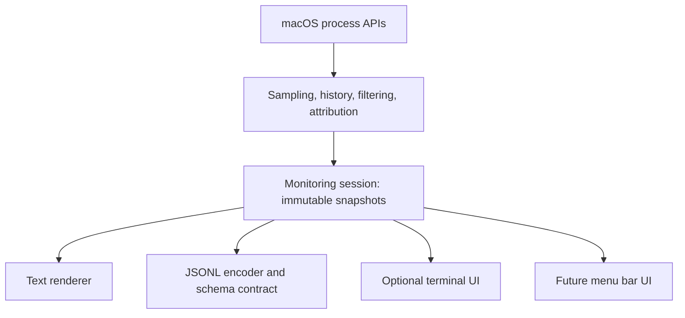

# Architecture

## Purpose and status

Agent Monitor maps heavy processes to specific coding-agent sessions. Sampling and attribution must be reusable by text output, an optional terminal UI, and a possible future menu bar application. This is a PoC. The integrated TUI has passed presentation and real-terminal interaction checks. See [PLAN.md](../PLAN.md) for task status and [PRODUCT.md](research/PRODUCT.md) for scope.

## Current implementation

`AgentMonitorCore` owns native process inspection, resource measurements, metadata parsing, process-lifetime history, threshold filtering, and attribution. Models are `Sendable` values. The monitor is owned by a sequential sampling loop; the core has no terminal UI or SwiftUI dependency.

`AgentMonitor` owns Apple Argument Parser options, validation, and output selection. `AgentMonitorCore.MonitoringSession` owns baseline acquisition, sequential sampling, enrichment, and immutable `MonitoringSnapshot` publication. Its `@concurrent` run method keeps native inspection off the main actor. It awaits each consumer before collecting again, preventing a backlog. Cancellation and collection/consumer errors propagate. An optional async threshold supplier is read once per sample before enrichment and filtering; the resulting snapshot records those same thresholds. The TUI supplies its main-actor-owned requested values, and a pending label distinguishes them from the last applied snapshot. An optional interval supplier works the same way: the session re-reads it every quarter second while waiting, so a shorter interval applies without waiting out the old one, and the snapshot records the interval used; CPU stays exact because it divides by the measured time between samples. Freezing is presentation state only: `LiveReportState` keeps its snapshot and holds the latest received one until unfrozen, while sampling continues. The sampling baseline and process history survive updates; text/JSON callers keep their configured thresholds and interval.

`AgentMonitorPresentation` owns text output, JSONL encoding/schema, and UI-independent sorting, process selection, disclosure, and compact report layout. `AgentMonitorTUI` alone depends on the regular, unmodified SwiftTUI package and maps presentation lines to terminal views. The UI owns keyboard input and the runtime lifetime; its lifecycle task consumes the same monitoring session as the CLI.

`SessionGrouping` derives neutral launch-session groups from the already-filtered snapshot and counts each process lifetime once. Exact groups use provider plus session ID; unresolved entries use process lifetime. A child is assigned to a root only when the current snapshot corroborates an exact root-thread attribution for the same provider and runtime lifetime. Otherwise it stays in its exact-session group. No directory/TTY/shared-runtime heuristic supplies identity, and no extra process collection or provider control requests occur. Missing measurements produce explicitly partial sums of known values; all sums cover heavy findings only.

`LiveReportState` owns typed process/group selection and expanded group IDs, preserving them across sorting and refreshes and pruning vanished identities. Text and TUI reuse the grouping projection; JSONL's flat snapshot and schema stay unchanged.

The shared table formatter pads headers and fields explicitly, reserving a marker cell after each numeric column (`*` for an exceeded process threshold, `~` for a partial group total). The name-only process column fits the longest process name across the current findings or its heading, whichever is wider, up to the viewport-dependent cap. Measuring across findings keeps scrolling from changing column positions. Unused process space goes to provider/session identity and then terminal/project information; short names no longer absorb spare terminal width. Compact views omit the terminal/project column and split the remaining width between process and agent/session, abbreviating oversized names so they cannot push identity out of view. Group headers retain the heavy-process-only totals qualification.

## Attribution evidence and inspection scope

Each finding identifies a process lifetime, its usage, available working directory, provider session/thread ID, runtime PID and terminal when known, and the evidence supporting that association. Only heavy processes appear; smaller ancestors supply tracing context.

- **Codex:** child `CODEX_THREAD_ID` / `CODEX_SESSION_ID` markers identify logical threads and their root session. Open writer-lock descriptors can identify a thread when exactly one candidate exists in the nearest native runtime.
- **Claude Code:** `CLAUDE_CODE_SESSION_ID` identifies launch origin. Native `claude` executables and the versioned native installation are recognized as runtime boundaries. A workload detached from its runtime (for example a background job whose shell exited and which was reparented to launchd) is linked back to the one live Claude runtime that listens on the inbox socket named by its `CLAUDE_CODE_MESSAGING_SOCKET`, provided that runtime started no later than the process carrying the marker; a later start means PID and socket-name reuse. Runtime listening sockets are read only for this case, in a second enrichment pass after the marker is known. npm-based Claude roots have not been validated.
- **Historical ancestry:** parent relationships survive observed parent exit. PID plus microsecond start time prevents PID reuse from inheriting a different process's history.
- **Nested agents:** one agent started inside the other (Codex → `claude`, or Claude → `codex exec`) leaves both providers' markers in its workloads. The inner agent is the nearest runtime above the workload and set its own marker last, so its provider's marker attributes the workload; a detached workload carrying both stays ambiguous.
- **Uncertainty:** multiple runtime thread candidates, conflicting markers, and incomplete metadata remain explicit. A known runtime/terminal can still be reported when the logical thread is unresolved. Unresolved agent-associated heavy consumers remain visible; unrelated unknown consumers require `--all-processes`.

These are **launch-origin associations**. A Gradle, Kotlin, MCP, or other shared daemon can later serve different sessions; its inherited marker does not establish which session caused its current CPU usage. Desktop hosts are labeled nonterminal where identifiable, with no promise of desktop conversation attribution. A terminal-less detached worker can retain a known logical session even when its runtime is unavailable.

The monitor examines only same-user processes. It reads allowlisted session markers, permitted process metadata, and Codex writer-lock descriptor paths; it does not read conversation transcripts or keep full environment buffers. History exists only in memory for live processes and their necessary ancestors. Monitoring after an unmarked process has already detached may not recover its session.

## Boundary for multiple presentations

The monitoring session owns cadence, baseline acquisition, metadata enrichment, cancellation, and snapshot publication. Snapshot values carry timestamps, measurement semantics, process identities, resource usage, and attribution evidence. UI code consumes them without inspecting processes itself. Sampling must not block keyboard input or native UI interaction, and slow rendering must not create an unbounded snapshot backlog.

Snapshots are neutral, immutable, `Sendable` structures with typed identities, numeric measurements, timestamps, session associations, and evidence. They contain no terminal escapes, display strings, widgets, or Argument Parser types. Text, TUI, and JSONL are peer adapters over the same monitoring results, not separate collectors. The CLI loop and report envelope have been extracted; adapters consume the same neutral snapshot.

The JSON adapter owns serialization and the versioned wire contract. `--json` already emits one compact report per line; `--json-schema` emits its schema and exits without collection. Keep schema examples and validation tied to actual encoded snapshots so documented fields and runtime output cannot drift. Generated CLI help should describe defaults, measurement units, streaming behavior, and schema discovery. Neither JSON encoding nor help generation belongs in the collector.

Presentation owns layout, colors, text formatting, keyboard or pointer input, selection, scrolling, and disclosure. Selection and disclosure use process identity (PID plus start time), so sorting or PID reuse cannot silently switch the displayed process. If a process disappears from the findings, clear its details and show a notice while preserving pane geometry. A view refresh does not trigger extra CPU measurements.

Lines carry display roles rather than colors (`ReportLine.Style`): the status line is `title`, filters, key hints and panel notes are `muted`, heavy rows are `heavy`, the selection and details divider are `selected`/`separator`, and action panels add `warning`, `success` and `failure`. The SwiftTUI adapter maps roles to blue, gray, yellow, cyan, green and red; `NO_COLOR`, or `--no-color` passed to the host as `NO_COLOR`, removes them, and the README preview approximates them. Text reports and action commands carry the same roles; `ANSIText` encodes them as basic SGR colors that follow the terminal theme, and the CLI applies them only when the output descriptor is a terminal and neither `--no-color` nor `NO_COLOR` is set.

Text, TUI, and GUI share measurement and attribution results. Their rendering and interaction code remain specific to each interface. A SwiftUI-like terminal library does not itself guarantee reusable native SwiftUI views. Any reusable presentation state must remain free of terminal control codes and UI framework types.

## TUI contract

- Leave mouse reporting disabled through SwiftTUI's public host configuration so the terminal owns drag selection and copying. TUI navigation remains keyboard-driven. The PTY smoke guard rejects mouse-reporting enable sequences in both color and NO_COLOR modes.

- Launch explicitly with `--tui`; accept the user's suggested `-tui` spelling as an alias. The existing default text report and JSON mode retain their behavior.
- Use the terminal window and refresh in place. TUI mode watches continuously unless an explicit `--samples` limit is supplied; `--interval` keeps its sampling meaning. Reject simultaneous TUI and JSON output or a noninteractive output stream with an actionable message.
- Show only heavy processes in a compact table: process/PID, CPU, footprint, provider/session abbreviation, terminal, and project when space permits. Preserve explicit unknown and ambiguous labels. Highlight exceeded resource values and the selected row; meaning must also be readable without color.
- Offer CPU, footprint, and PID sorting; recommend CPU descending by default and PID ascending for tracking a process. Keys `c`, `m`, and `p` select those sorts; `r` reverses direction. Show the active sort and direction. Use stable process identity as a tie-breaker; preserve selection and disclosure by PID plus start time when sorting or refreshing, rather than by row index.
- Arrow keys select a row; Enter toggles disclosure containing the full session ID, directories, runtime, ancestry, and attribution evidence. Keys `[` and `]` scroll long details. Full arguments remain governed by the existing `--commands` option. `q` or Ctrl-C exits and restores the terminal.
- Separate the details pane with a full-width rule and allocate its height from a remembered content-area ratio, independently of row counts, text length, or disclosure content. Start minimized; Enter opens at 50% initially. `-`/`+` adjust by five percentage points within 10–90%; `0` minimizes, `9` maximizes, and `=` restores the remembered ratio. These modes do not overwrite the ratio. Minimum pane heights take precedence in small terminals. Pad each pane to its allocation and constrain each rendered line to one terminal row. Open details follow explicit row selection; disappearing processes clear content without moving the divider.
- Adapt chrome to the terminal width: one header row at 120 columns and above, two at 85–119, and three below 85. These width-based header allocations keep pane geometry stable as counters, notices, and pending filters change. Shorten oversized status text with an ellipsis while retaining filter values. Pack complete key groups onto shared rows where they fit; split an oversized group only between whole controls. Derive table/details heights and detail-scroll limits from the same actual header/footer row counts. Very small viewports retain a bounded resize hint and quit control.
- Handle resizing and preserve selection across updates. Disclosed shared-daemon associations must retain the launch-origin qualification.

## Verification boundary

Core tests continue to use deterministic observations and native measurement checks. The extracted session needs cadence, cancellation, and error tests with controllable inputs. Presentation tests cover selection identity, disclosure, unknown/ambiguous states, and narrow layouts. A real terminal test must verify refresh, resizing, input responsiveness, and terminal restoration. Measure TUI overhead separately from the existing collector result.

The isolated SwiftTUI runtime passed terminal interaction checks; [TUI research](research/terminal-ui.md) records the working host, measured debug/release overhead and the adoption decision. Integration has dedicated presentation tests and a PTY journey. A menu bar application is a future consumer of the contract, not part of this PoC change.

## SwiftTUI host evaluation

The completed [isolated probe](research/terminal-ui.md) used SwiftTUI 0.14.0’s public `RunLoop` with a `TerminalHost`, input reader, signal reader, state container, and focus tracker. This bypasses the high-level scene launcher’s mandatory discovery socket without modifying upstream code. SwiftTUI still owns raw mode, rendering, focus, input, resizing, and cleanup; the application owns the runtime lifetime. No browser or discovery service starts.

The monitor uses the same public host with neutral presentation state confined to the main actor. SwiftTUI is declared as an exact remote package dependency in the main manifest. `swift build -c release` compiles the unchanged upstream sources with standard compiler optimization; no custom framework build or fork is maintained.

## Process and session actions

`AgentMonitorActions` depends only on the monitoring core, Foundation/Darwin, and AppKit's `NSRunningApplication` for finding and activating terminal applications. `ProcessActions` exposes asynchronous termination, message preparation and submission, and terminal focus to the UI; `AgentMessaging` separates provider recipient verification from message acceptance; `SessionActions` selects the Codex or Claude adapter by the attributed provider. `SessionActions` runs native/provider work off the main actor. `ActionPanel` in presentation owns the frozen process, recipient choice, draft, review and result; SwiftTUI maps inputs and owns one cancellable action task. Sampler cadence, text/JSONL output and the snapshot schema remain read-only and unchanged.

Termination rechecks same-user ownership, PID/start time and executable directly before SIGTERM. Messaging obtains a fresh ancestry/metadata observation, independently of display thresholds through `Monitor.finding(for:)`, and compares attribution with the frozen process. It requires a live runtime and exact session UUID; detached historical evidence alone fails closed. Native identity checks and the eventual OS/provider mutation are separate operations, so they cannot eliminate every race.

The Codex adapter uses a bounded `codex app-server proxy` connection with a validated WebSocket upgrade and masked client frames (the proxy forwards raw socket bytes, not JSONL), initializes the protocol, and calls `thread/read` with `includeTurns: false`. The selected thread's live `sessionId` supplies the root; idle/active status permits a recipient, while unloaded/error/unknown states do not. An inherited root marker must agree. The adapter repeats verification before submission and uses `codex queue --remote unix:// --thread <UUID> --message <text>` on the same default local endpoint. It does not resume threads, subscribe to turns, read full transcripts, start servers or retry uncertain submissions. Calls use argument arrays, a ten-second deadline and a one-megabyte output limit; fragmented text and ping/pong follow RFC 6455, while unexpected frame types/extensions fail closed. Cancellation closes the owned CLI subprocess. Provider stderr/output is not persisted or displayed.

The Claude adapter verifies the live binding with `claude agents --json`: exactly one entry must carry the attributed runtime PID, its `sessionId` must equal the attributed session, and its status must be `busy`, `waiting` or `idle`. This catches `/clear` or `/resume` rebinding a runtime after its children inherited an older marker. The inbox path comes from `CLAUDE_CODE_MESSAGING_SOCKET` in the same environment as the attributing `CLAUDE_CODE_SESSION_ID`; the parser keeps it on `SessionMarker`, and `Monitor.attributingMarker(for:)` exposes it to actions without adding it to snapshots or JSONL. Each verification and send reads that environment afresh and requires a non-symlink socket owned by the user. The adapter writes one stream-json user line without the documented auth line: the session token marks the session's own children, whose messages bypass the peer controls that should govern an external monitor. Connection failure before the line is written reports that nothing was sent; the inbox sends no acknowledgment, so end-of-stream after the write is the acceptance signal, and a timeout afterwards is uncertain. See [Claude session messaging research](research/claude-session-messaging.md).

Terminal focus is adapter based. `TerminalFocus` reads the runtime's current controlling terminal and the nearest regular application above it (`NativeActions.terminalHost`, revalidating PID and start time), then routes by bundle identifier to a `TerminalFocusAdapter`. An adapter receives only the `/dev/ttysN` device path and the host application, and returns whether a session owns that device; it may select, unminimize, order and activate, never type, run commands or read screen contents. A host without an adapter is only activated through `NSRunningApplication`, while an adapter that finds no session fails instead of activating, because another window could show a different session. `TerminalAppFocus` is the first adapter: a fixed AppleScript run by `osascript`, with the device path passed as `argv`. The router and protocol live in `Sources/AgentMonitorActions/TerminalFocus/`, one adapter per file under its `Adapters/` folder, registered in `TerminalFocus.local()`. Adding iTerm2, WezTerm, kitty, Ghostty or tmux means adding an adapter (or, for tmux, a resolution step before the lookup); see [terminal focus research](research/terminal-focus.md).

The `kill`, `message` and `focus` subcommands reuse `ProcessActions` through `ActionRunner` in the CLI target. `NativeActions.process(pid:)` replaces row selection: it observes the PID's current lifetime and attribution, independently of thresholds, and that observation is the frozen identity the actions recheck. Confirmation is a `[y/N]` prompt on an interactive stdin, or `--yes`. `ActionFailure.uncertain` marks a request that may have been accepted; the CLI exits with status 2 and the TUI shows it as a warning instead of a failure.

The UI requires a separate Ctrl-Y confirmation for SIGTERM and reviewed messages. Bracketed paste enters only the composer text path. Small viewports cannot confirm hidden actions. Drafts survive report refreshes without following selection; results distinguish accepted signals/queues from confirmed exit or delivery. General provider/plugin registration remains excluded. See [usage](usage.md#process-actions) for the public contract and [feasibility research](research/session-actions.md) for provider evidence.

## Proposed agent adapter boundary

This is a design direction requested on 2026-10-14, not an implemented plugin system or an additional PoC gate. Start with built-in Codex and Claude adapters behind one small protocol and an explicit registry. Their provider-specific runtime recognition, environment-marker parsing, session-ID validation, and evidence decoding belong together. Native process access, CPU/footprint measurement, process-lifetime history, ancestry traversal, ambiguity resolution, and presentation stay shared. Adapters report evidence; the core decides attribution and never resolves competing claims by registry order.

Treat “metrics, details, communicate” as an initial prompt for the design, not a fixed API. The recommended boundary is attribution evidence, optional session inspection, and a separate optional messaging capability. Keep method signatures provisional until extracting the existing providers demonstrates the minimum inputs and outputs.

| Responsibility | Contract | Requirement |
|---|---|---|
| Attribution evidence | Stable provider ID, supported observations, runtime/session candidates, root relationship when known, and evidence provenance tied to a process lifetime. Missing, malformed, and conflicting evidence remain distinct. | Required; sufficient for a minimal adapter |
| Session inspection | Structured session facts and optional provider-specific measurements, such as tokens or cost. Measurements carry units, observation time, and process/session scope; unavailable values are not zero. Presentation builds the details view from these facts. | Optional; basic details already come from core attribution |
| Messaging | Separate capability advertising supported delivery behavior for a verified provider/session recipient. Accepted, unsupported, unavailable, and failed outcomes remain distinct. Acceptance does not imply the agent has acted on a message. | Optional; Codex implementation now lives in AgentMonitorActions |

OS CPU/footprint remain the shared collector's responsibility and continue to drive the existing heavy-process filters. Avoid a generic “metrics” method that mixes OS sampling with provider usage accounting, or a “details” method returning formatted UI content. Observation should not require a messaging implementation. Capabilities describe actual support so callers can omit unavailable operations; do not invent a generic action framework before another concrete action needs it.

Preserve the verified-recipient and process-context contract in [session actions](research/session-actions.md#recipient-and-process-context): default to the root agent, allow an explicit verified selected-agent recipient, and prepend the selected workload's PID/name to the message. A launch association alone does not prove a reachable recipient. New providers must not require provider switches in the UI or weaken ambiguity, PID-reuse, or same-directory safeguards. Registry order cannot select a winner when multiple adapters claim a process; reject duplicate provider registrations and preserve conflicting attribution evidence.

The current closed `AgentProvider` enum and JSON schema only admit Codex and Claude. Before third-party adapters can work, use validated, stable provider identifiers while preserving `codex` and `claude`, and explicitly revise the schema contract for extensible provider and evidence values. Adapters should declare the observations they need; the host retains environment allowlisting, process-lifetime checks, and bounded native inspection. Do not expose full environment buffers as a shortcut.

A later external plugin can implement the same capability model through a versioned subprocess protocol. This is the recommended extension path because it avoids coupling third-party plugins to the host's Swift binary layout. The transport, discovery, installation, and trust policy remain deferred until an actual external adapter is needed. Dynamic library loading, a marketplace, generic action frameworks, and token/cost dashboards are excluded from the current PoC.
