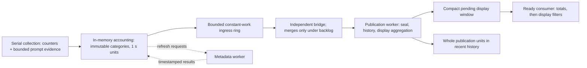

# Display windows and bounded delivery

Acquisition closes accounting units independently of display cadence. Delivery may combine those units under delay or pressure, but must preserve accepted measurements, their enclosing duration and explicit qualifications.

[Architecture overview](../architecture.md) · [All architecture guides](README.md)

## In this guide

- [Independent display windows](#independent-display-windows)
- [Pressure disclosure](#pressure-disclosure)

## Independent display windows

### Cadence, first delivery and draining

Production TUI and native collection use the shared five-second display period in `LiveReportState.displayIntervalSeconds`; text/JSONL use one second. Acquisition requests 100 ms by default. Accounting/history units close at the first scan listing at least one second after their baseline, independently of the display preference. The first closed unit is eligible for immediate display; subsequent reports combine whole units until the display period is reached. Scan overruns or a cadence that does not divide one second can lengthen these windows; rates always use the actual enclosing duration.

Delivery has no additional sleep after its consumer callback. A blocked consumer receives compacted pending work when ready.

Finite `samples` counts these publication boundaries; coalescing may deliver fewer combined reports, but accepted partial work also drains on normal end or collection failure.

### Merge ownership and ordinary windows

Closed units merge only when an earlier unit is still queued for publication. The same exact accounting merge and bounded category compaction apply: eligible CPU sums, interval counts, memory maxima, recovered crossings, scan counts, maximum gap and overrun counts survive. An unrepresentable merge fails explicitly at the publication stage; already admitted units drain before the error. Publication appends a unit before taking its matching history snapshot. Finite collection counts source display boundaries independently of publisher speed, and end/failure drains the last accepted partial after earlier units. Normal display aggregation never marks units as publication-coalesced.

### Publication coverage fields

`publicationCoverage` in JSONL schema 1 records original and admitted unit counts, the number of original units involved in backlog merges, maximum admitted-unit span, and the enclosing monotonic range of coalesced work. Mac/TUI distinguish current-window coalescing from recent-history coalescing in coverage-status notices with unit count and maximum span. Coverage detail qualifies the enclosing monotonic range. Range compaction sums this metadata without pretending to recover the original time resolution. Retention evicts whole admitted units, never prorates their CPU. The newest admitted unit remains inspectable even when its span exceeds the nominal recent-history target; the displayed actual range then exceeds that target. On later admissions it is evicted whole once its start precedes the retention cutoff.

The acquisition worker admits each changed window transactionally: a rejected scan leaves the previous partial and its endpoint metadata intact for draining. Capacity accounting counts UTF-8 bytes directly. Ancestor retention visits only parents not already retained and removes only unreachable nodes; shared departed ancestors remain available while any live descendant needs them. The [pipeline](../../Sources/AgentMonitorCore/IndependentMonitoringPipeline.swift) owns stage scheduling and failure propagation; [AccountingWindow](../../Sources/AgentMonitorCore/AccountingWindow.swift) owns retained observations and frozen contributions; [MonitoringChannel](../../Sources/AgentMonitorCore/MonitoringChannel.swift) owns bounded handoff and pending-window coalescing. Frontends consume the same published snapshot rather than reconstructing accounting from visible rows.

### One accumulator and frozen categories

[AccountingWindow](../../Sources/AgentMonitorCore/AccountingWindow.swift) is the single accumulator for CPU and sampled memory. It retains one eligible CPU sum per exact lifetime, frozen attribution, executable, runtime role and corroborated root category, plus individual contributions whose opening precedes the unit baseline. Repeated categories merge even when another category occurs between them: record endpoints enclose accepted intervals and do not assert continuous ownership. Accepted zero intervals remain measured through `intervalCount`; unavailable CPU remains distinct. Records retain missing-read and exec-change interval counts and evidence-time minima/maxima/missing counts. Evidence timestamps are values, never category keys. Exclusions retain counts and distinct lifetimes rather than every scan identity. Baseline/final endpoints retain timing and host counters, not complete raw scans.

Only contiguous, disjoint units from one run may merge; overlapping ranges are rejected because compact sums cannot deduplicate arbitrary partial overlaps. Merging adds eligible sums, memory extrema and counts, then absorbs crossings whose opening is eligible at the widened baseline. Other crossings retain their original endpoints as recovered CPU, excluded from the displayed rate. It never adds percentages or prorates an interval. Admitted publication units support rolling-history queries; the queued display carries a separate compact aggregate rather than an ever-growing list of original units.

### Departed lifetimes and current memory

Rows include lifetimes no longer observed in the final scan. Their CPU remains eligible for the window, their last footprint remains inspectable, and their current footprint/peak are unavailable and excluded from memory totals. Historical row memory filters use the last observed footprint solely for visibility. Historical rows cannot initiate process actions, including through shared action services. Snapshot publication retains one displayed window for inspection; Pause preserves it while acquisition continues. Counts describe observed contributors, not a count of currently running processes. A row whose contribution identities conflict with its latest point label remains uncertain; it cannot assign current memory to an old session. Grouping preserves unique candidate identities even when the evidence method changes, while each contribution retains its own evidence.

For example, a worker contributing 0.08 measured CPU-seconds to an exactly 1.0-second enclosing window contributes 8% of one core even if it disappears before publication. Its last footprint remains historical evidence, not current memory. Exported contribution records follow the requested process scope, including mixed-ownership lifetimes retained as uncertain candidates. The separate current-user CPU context still uses all sampled same-user contributions; filtering exported records must not redefine that population total.

All fronts qualify CPU as point-evidence candidates or uncertain/unresolved; report JSONL schema 1 carries the full window and contribution records. Current live ancestry still uses the existing point-attribution graph; frozen chains do not certify monotonic historical ancestry or interval continuity. Coverage validation and any future interval-support claims remain subject to the [accounting acceptance gates](../proposals/resource-accounting.md#acceptance-evidence).

## Pressure disclosure

When a pending report exceeds its logical budget, older lifetime detail may collapse into frozen resource categories. Current observations and crossing endpoints needed for recovery remain retained. A collapsed record preserves exact eligible CPU-seconds, accepted interval/missing-read counts, exclusions, the maximum sampled worker footprint with its observation time, evidence-time bounds and its enclosing observation/contribution time range. It contains no synthetic process identity and permits no process action. These CPU sums must be included alongside detailed contributions; they are not additional measurements.

### Count bounds after detail collapse

Distinct process/worker counts become proven ranges. Within a collapse batch, identities are deduplicated exactly.

Across batches, where a missed read can allow the same worker to return, the conservative union lower bound is the maximum of the proven lower bounds and the upper bound is their sum. Accounting can tighten the lower bound when an incoming lifetime’s verified monotonic birth is strictly after every earlier collapsed observation in that category: add that deduplicated disjoint subset to the previous minimum, then take the maximum with the incoming batch count. Worker counts apply the same proof separately from runtime counts. Only raw birth/sample ticks in the same acquisition run establish this ordering; wall-clock identity timestamps, disappearance and CPU interval endpoints do not.

Missing or invalid sample provenance keeps the earlier boundary unknown through updates, merges and category release. Accounting retains fixed-size timing bounds per run/category, not released identities. Independently collapsed populations still combine conservatively; the private provenance does not enter JSONL or history. These bounds also apply when combining retained identities with collapsed records or independently collapsed display/history populations; time containment does not prove identity containment. They are not stopped-process counts. A wide range is shown honestly, rather than assuming disjoint populations. Arbitrary category churn can also exhaust storage: category labels may then collapse into explicitly mixed older agent-associated/other work, keeping runtime and worker roles separate, preserving resource sums, maxima, count bounds and time ranges while declaring lost category detail. Such a remainder does not assign uncertain work to an agent or reclassify historical ownership.

### Charged leases and temporal compaction

Published recent-range snapshots compact immutable categories within at most twelve temporal spans of their retained range, coarsening under pressure; the store alone retains the admitted publication units for rolling eviction. These are normally one-second units but can span several seconds after publication backlog. A paused projection therefore does not pin every original unit.

Each nonempty snapshot lease charges its own header and unit-reference entries in addition to deduplicated backing payloads; fully exhausted snapshots register no empty lease. Holding a projection across run/scope changes keeps its original lease charged until release. Within each immutable unit, equal owner context shares its candidate-array storage and is charged once, preserving all candidate claims. Admission evicts original store units before shortening a published projection. Distinct failed-PID detail is also bounded: released detail keeps count bounds and its observation range, while failed-observation totals and per-scan maxima remain exact. Distinct excluded-lifetime/evicted-baseline counts expose ranges after identity release.

Display and recent-history collapsed records keep separately labelled time ranges in details; overlapping CPU sums are never added together. JSONL carries typed `collapsedContributions`; text, native and terminal presentation disclose collapsed work, its time range and count bounds. Mac/TUI integrate retained frozen categories into the appropriate session/root or uncertainty hierarchy and keep a visible pressure marker beside totals. CPU contributions use the enclosing report duration; historical sampled maxima never enter current memory totals. The bounded recent-history store remains independent of a delayed presentation window.
