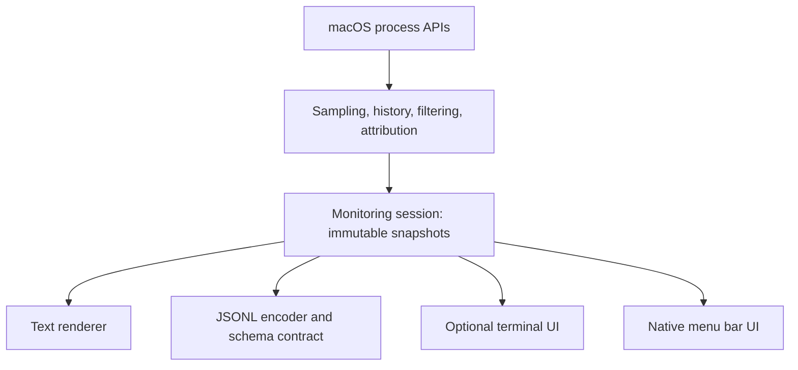

# Shared presentation state

Core snapshots carry typed measurements and evidence. Shared presentation state derives grouping, disclosure, selection and inspection without redefining observed totals. CLI, terminal and native hosts own their output and interaction.

[Architecture overview](../architecture.md) · [All architecture guides](README.md)

## In this guide

- [Current implementation](#current-implementation)
- [Boundary for multiple presentations](#boundary-for-multiple-presentations)

## Current implementation

`AgentMonitorCore` owns native process inspection, resource measurements, metadata parsing, process-lifetime history, threshold filtering, and attribution. Models are `Sendable` values. The serial collection worker owns the mutable monitor and counter ledger; the metadata worker returns timestamped observations. The core has no terminal UI or SwiftUI dependency.

### Target responsibilities

`AgentMonitor` owns Apple Argument Parser options, validation, and output selection. `AgentMonitorCore.MonitoringSession` composes [independent acquisition](acquisition.md#independent-acquisition): one serial native/accounting cycle, a separate metadata worker and immutable `MonitoringSnapshot` publication. The collection cycle owns counter baselines and attribution; bounded display windows coalesce independently of the consumer. Thresholds are read immediately before delivery and only project the unfiltered findings. Zero disables each resource filter independently; enabled filters combine with OR and strict greater-than, while both zero admits every observation, including unavailable measurements. `LiveInterval` wakes the acquisition wait when its value changes; unchanged settings do not create a new wait generation. Freezing remains presentation state: `LiveReportState` holds its displayed snapshot while collection and history continue. Cancellation drains active native work before the session returns.

`AgentMonitorPresentation` owns text output, report and diagnosis encoding/schemas, local guides, and UI-independent sorting, process selection, disclosure, and compact report layout. `AgentMonitorTUI` alone depends on the regular, unmodified SwiftTUI package and maps presentation lines to terminal views. The UI owns keyboard input and the runtime lifetime; its lifecycle task consumes the same monitoring session as the CLI.

### Group identity and window membership

`SessionGrouping` derives neutral groups from unfiltered observations and frozen window contributions. Group CPU follows each contribution’s label and acquisition-time root corroboration; unresolved CPU stays separate. Each process row appears once under its last observed owner, with current memory only when present in the final scan. Earlier resource-only groups remain visible without an actionable child, including when the process is pinned. Group counts are distinct contributors per group and are not additive after a label change. Exact groups use provider plus session ID; unresolved entries use process lifetime.

A changed label or corroborated root is qualified as “Label changed in window”, not converted into conflicting evidence. Such groups retain their headers instead of flattening into a whole-process CPU row. No directory/TTY/shared-runtime heuristic supplies identity, and no extra process collection or provider control requests occur.

Missing measurements produce explicitly partial sums of known values; all sums cover observed members, including those whose rows are filtered. `findings` remains the display projection; group children use only that projection. Unpinned session headers require at least one displayed, unpinned member; explicitly pinned sessions remain visible even without matching children. This visibility rule does not change the group membership or totals.

`LiveReportState` owns typed process/group selection and disclosure for both interactive views. A filtered snapshot cannot distinguish a temporarily quiet workload from an exited one. Group expansion therefore follows the exact provider/session or unresolved process-lifetime identity across absence; active `openGroups` contains only current or pinned groups, while up to 256 absent identities retain expansion in most-recently-expanded order. Visible/pinned expansions are never evicted by that bound. Explicit collapse removes the remembered choice. Disclosure memory retains identities only, never measurements or executable action state.

### One inspected process

Process inspection remains limited to one active process (native inline details or the TUI pane): disappearance clears its visible process and scroll offset, retaining only one pending PID/start identity. That exact process restores its details and report selection on return unless the user selects another row, changes disclosure/grouping, minimizes/restores the pane or opens an action panel. A reused PID cannot inherit it. Automatic fallback selection while the process is absent does not cancel restoration; keyboard focus is not assigned by restoration. The existing details mode and split survive filtering. Collection reset (including native dismissal) clears disclosure memory. Text and TUI reuse the grouping projection; JSONL preserves flat process records for both observed and displayed projections.

### Shared formatting and ordering

The shared table formatter pads headers and fields explicitly, reserving a marker cell after each numeric column (`*` for an exceeded process threshold, `~` for a partial group total). The name-only process column fits the longest process name across the current findings or its heading, whichever is wider, up to the viewport-dependent cap. Measuring across findings keeps scrolling from changing column positions. Unused process space goes to provider/session identity and then terminal/project information; short names no longer absorb spare terminal width. Compact views omit the terminal/project column and split the remaining width between process and agent/session, abbreviating oversized names so they cannot push identity out of view. Group headers label observed totals; sampling can still miss short-lived work.

### Bulk disclosure scope

`LiveReportState.setSessionDisclosure` applies explicit bulk expansion/collapse to the current presentation level. Top-level targets are displayed session groups (including pinned groups); a nested process targets only its containing group. Hosts supply the focused/selected identity and the native singleton-flattening policy, without provider recognition. Individually pinned processes and flattened native singletons are top-level, unavailable/hidden targets cannot supply child scope, and actions block the command. Collapse moves a hidden selection to its parent and clears hidden process details, preventing subsequent sampling from reopening the group to reveal a stale selection. Bulk operations update the same bounded disclosure memory and never open multiple process inspectors.

## Boundary for multiple presentations

The monitoring session owns cadence, baseline acquisition, metadata enrichment, cancellation, and snapshot publication. Snapshot values carry timestamps, measurement semantics, process identities, resource usage, and attribution evidence. UI code consumes them without inspecting processes itself. Sampling must not block keyboard input or native UI interaction, and slow rendering must not create an unbounded snapshot backlog.

### Typed snapshots and display safety

Snapshots are neutral, immutable, `Sendable` structures with typed identities, numeric measurements, timestamps, session associations, and evidence. A process row’s attribution is its last observed point label; its whole-window CPU may span labels, disclosed by `labelChangedInWindow`. Candidate and unresolved CPU-seconds are summed per frozen contribution. `corroboratedRootSessionID` belongs to each CPU record; `lastObservedCorroboratedRootSessionID` separately preserves the row’s final point context even when that observation had no CPU reading. They contain no terminal escapes, display strings, widgets, or Argument Parser types. Text, TUI, and JSONL are peer adapters over the same monitoring results, not separate collectors. The CLI loop and report envelope have been extracted; adapters consume the same neutral snapshot.

The JSON adapter owns serialization and the versioned wire contract. `--json` already emits one compact report per line; `--json-schema` emits its schema and exits without collection. Keep schema examples and validation tied to actual encoded snapshots so documented fields and runtime output cannot drift. Generated CLI help should describe defaults, measurement units, streaming behavior, and schema discovery. Neither JSON encoding nor help generation belongs in the collector.

Presentation owns layout, colors, text formatting, keyboard or pointer input, selection, scrolling, and disclosure. Selection and disclosure use process identity (PID plus start time), so sorting or PID reuse cannot silently switch the displayed process. If a process disappears from the findings, clear its details and show a notice while preserving pane geometry. A view refresh does not trigger extra CPU measurements.

### Semantic terminal roles

Lines carry display roles rather than colors (`ReportLine.Style`): the status line is `title`, filters, key hints and panel notes are `muted`, heavy rows are `heavy`, the selection and details divider are `selected`/`separator`, and action panels add `warning`, `success` and `failure`. The SwiftTUI adapter maps roles to blue, gray, yellow, cyan, green and red.

`NO_COLOR`, or `--no-color` passed to the host as `NO_COLOR`, removes colors while retaining bold, underline and reverse video on capable interactive terminals. The public SwiftTUI capability profile keeps style escapes enabled with color level none; monochrome full chart cells use reversed spaces, and warnings/failures use bold plus their existing text markers. The README preview approximates these roles. Text reports and action commands carry the same roles; `ANSIText` encodes them as basic SGR colors that follow the terminal theme, and the CLI applies them only when the output descriptor is a terminal and neither `--no-color` nor `NO_COLOR` is set.

Shared display sanitization preserves U+200C/U+200D for script and emoji shaping while replacing other control/format characters, including bidi controls. JSON preserves original data. Text, TUI, and GUI share measurement and attribution results. Their rendering and interaction code remain specific to each interface. A SwiftUI-like terminal library does not itself guarantee reusable native SwiftUI views. Any reusable presentation state must remain free of terminal control codes and UI framework types.

### Directory labels are context

The current directory-summary rule (not the required primary session title) uses displayed workload working directories, excluding the runtime’s own directory when workload rows exist. A shared runtime is labeled without a project claim. Groups use the same `WorkloadDirectory` summary as the overview: a compact path for one directory, a count for several (including nested paths), and an explicit unavailable qualifier for missing CWDs. Matching directory suffixes gain leading components across the grouped population, using the same disambiguation rule as the overview. No project-root inference is made. Native subtitles and wide TUI rows do not substitute a shared runtime’s launch directory for workload evidence. Runtime directories remain available in details. Directory labels are presentation only and never alter provider/session identities or attribution confidence.
