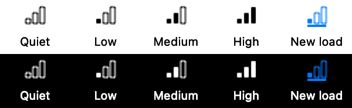

# Usage guide

Follow the [installation guide](installation.md), then start with the [README quick start](../README.md#quick-start). The commands below use the installed `agent-monitor` executable and work from any directory.

## Live terminal view

```sh
agent-monitor --tui
agent-monitor --tui --group session
```

`--tui` (also accepted as `-tui`) watches continuously unless you supply a `--samples` limit. It requires interactive stdin and stdout and cannot be combined with JSON output. Use `--no-color` or set `NO_COLOR=1` to disable colors.

| Key | Action |
| --- | --- |
| ↑ / ↓ | Select a row |
| Enter | Expand/collapse a session or open/close process details |
| `g` | Toggle session grouping |
| `k` | Review SIGTERM for the selected process |
| `s` | Compose a message to a verified Codex or Claude Code recipient |
| `f` | Bring the terminal hosting the selected process's or group's agent session to the front |
| `c` / `m` / `n` | Sort by CPU, memory footprint, or PID |
| `r` | Reverse the sort direction |
| `1` / `2` | Lower/raise the CPU threshold by 10 percentage points |
| `3` / `4` | Lower/raise the memory threshold by 1 decimal GB |
| `<` / `>` | Update less/more often: 0.5, 1, 2, 5, 10, 30 or 60 seconds, applied at once |
| Space | Pin/unpin the selected process or session; values keep updating |
| `p` | Pause/resume the view; sampling continues and resuming shows the latest data |
| `[` / `]` | Scroll process details |
| `-` / `+` | Shrink/grow the details pane by 5 percentage points |
| `0` / `9` | Minimize/maximize the details pane |
| `=` | Restore the chosen details split |
| `q` / Ctrl-C | Quit |

Pins stay first in pin order, independently of sorting. `+` marks a pinned row and `@` marks the selected pinned row; `>` still marks an ordinary selection. A pinned group's expanded children use PID order. If a target leaves the current heavy results, its placeholder remains with **Not in current results**; this does not prove it exited, and no old measurements or actions are offered. The same process lifetime or session can return automatically; PID reuse cannot replace a pin. Space removes the selected pin. Pins last until unpinned or the monitor quits, and native pins also survive closing/reopening the panel. A process pinned separately is omitted from its group's child rows; group totals still cover its full heavy membership. Pinned groups retain their identity when switching to flat mode.

These are the current source-build keys. Release 0.2.2 uses Space for pause and `p` for PID sorting; use the on-screen help for an installed release.

The header shows the update interval and, while frozen, `PAUSED at` the time of the displayed sample. A faster `--interval` than 0.5 seconds is kept until you press `<`. While frozen, selection, sorting, details and actions keep working on the frozen rows; actions still recheck the live process, and threshold changes stay pending until you unfreeze. Selection follows the process across sorting and refreshes. Details start minimized; opening them uses an initial 50% split. The adjustable split ranges from 10–90%, subject to available terminal space. Minimizing or maximizing does not overwrite your chosen split.

The layout adapts to terminal size. Narrow views abbreviate names and session IDs and omit the terminal/project column; open details for the full information. The process column contains names only, with executable paths and optional command arguments in details. Very small windows show a resize hint.

To copy text, drag-select it and use your terminal's Copy command (usually Command-C on macOS). Navigation is keyboard-driven; mouse selection belongs to the terminal. Whether selection survives a refresh depends on your terminal.

## Process actions

These controls are available from release 0.2.0. Expand a session group and select an individual process before terminating or messaging; focus also works on a group. Opening a confirmation freezes its process identity: subsequent sorting, refreshes, and filter changes cannot retarget it.

**Terminate:** press `k`, inspect the PID, executable and session, then press Ctrl-Y to send SIGTERM. Esc cancels. Only the selected process is signaled, including when you explicitly select an agent runtime; children and process groups are not signaled automatically. SIGKILL is not offered. The process must still have the same PID, start time and executable and belong to your user. macOS identity checks and PID-based signaling are not atomic, so a small race remains. “SIGTERM accepted” does not mean the process exited.

**Message:** press `s` to verify recipients and open the composer. For Codex, Root agent is the default and Tab cycles to Selected agent when distinct; a Claude Code session has one recipient. An unavailable root remains disabled rather than silently switching to a child. Type or paste up to 4,000 characters; Backspace edits the end. Bracketed paste preserves newlines and cannot activate commands; terminal control characters are removed. Enter opens the full message review, Ctrl-Y sends it, and Esc returns to editing or cancels. ↑/↓ and Page Up/Down scroll the panel. Ctrl-C quits from any panel; `q` is ordinary message text while composing.

**Focus:** press `f` to bring the terminal hosting the selected process's agent runtime to the front. On a collapsed session group, `f` focuses the group's runtime when its processes share exactly one; otherwise expand the group and select a process. The runtime, not the workload, is the target because agent tool subprocesses often have no terminal. In Terminal.app the tab on the runtime's terminal device is selected, its window is unminimized and ordered front, and Terminal is activated; the result panel names the device. Other terminal and editor apps found above the runtime are only asked to come to the front, so another of their windows may show. Sessions under tmux, screen, or ssh, and background runtimes without a terminal, report that nothing was focused. On first use macOS asks whether the terminal running Agent Monitor may control Terminal; that Automation grant applies to everything run in that terminal, and it can be revoked in System Settings › Privacy & Security › Automation. Since macOS 14 activation is a request, so macOS may keep another app in front. Focus never types into, runs commands in, or reads the target terminal.

The generated prefix identifies the selected workload, for example:

```text
[Agent Monitor: selected process PID 42001 (swift-frontend)]
Please investigate why this process is using so much CPU.
```

The prefix uses the workload PID, not the recipient's runtime PID. Both target and message remain visible in the scrollable review. Immediately before sending, the monitor rechecks live provider routing, process lifetime, executable and attribution. An exited/reused process, changed attribution or changed recipient availability requires reopening the composer. Historical detached ancestry, ambiguous sessions and unverified runtimes cannot be messaged.

Messaging requires a Codex CLI supporting `app-server proxy`, `thread/read` with `sessionId`, and `queue` (protocol checked against 0.162.1). Both inspection and queueing use the default local app-server socket under the current Codex environment. The monitor never starts a server, resumes a transcript or injects terminal input. Standalone/no-daemon sessions and remote/custom sockets are unsupported. Provider calls have a 10-second deadline and bounded output. A queue timeout or failure may occur after acceptance: check Codex before retrying. There are no automatic retries.

Acceptance means only that Codex accepted the queue request; delivery, execution and the workload's continued existence are unverified. Messages are unsuitable as an emergency stop. Message text is passed as a literal CLI argument and may be visible to local process inspection while `codex queue` runs; Agent Monitor does not persist drafts or provider output.

Claude Code messaging requires Claude Code 2.1.224 or later on PATH (checked against 2.1.300) and a session with cross-session messaging, which binds a per-session inbox socket; bare-mode sessions have none. The monitor first asks `claude agents --json` whether the attributed runtime PID still hosts exactly that session, then reads the inbox path that Claude exported to the workload (`CLAUDE_CODE_MESSAGING_SOCKET`) and writes one message line to it. It never reads or sends the session's messaging token, so the session treats the message like one from another session: under the default settings, a session that prompts for permissions delivers it, while a session that bypasses permission prompts holds it for your approval, and `crossSessionInbound` can hold or silently refuse it. A delivered message starts a new turn in an idle session or is read between tool calls in a busy one; it cannot approve prompts or run slash commands. If the inbox is missing or refuses the connection, nothing was sent. A timeout after the line was written may follow acceptance: check the session before retrying. Claude Code does not document the inbox message format; it may change between releases. See [Claude session messaging research](research/claude-session-messaging.md).

### Actions from the command line

The same actions are available without the TUI, for a PID taken from a text report:

```sh
agent-monitor kill --pid 42001
agent-monitor message --pid 42001 --text "Why is this so busy?" [--to root|selected]
agent-monitor focus --pid 42001
```

Each command reads the process's current lifetime and attribution, independently of the display thresholds, and applies the same identity, recipient and runtime checks as the TUI. `kill` and `message` print the target, and for messages the recipient and the exact text with its PID prefix, then ask `[y/N]`. Without an interactive stdin they refuse unless `--yes` is given, so a script must opt in explicitly. `--to selected` addresses the Codex agent that launched the process instead of the root; a Claude Code session has one recipient. `focus` needs no confirmation.

| Exit status | Meaning |
| --- | --- |
| `0` | Accepted: SIGTERM sent, message handed over, or terminal focused. Exit, delivery and action are not confirmed. |
| `1` | Nothing was done: refused, cancelled, not found, or failed before sending. |
| `2` | `message` only: the message may have been accepted although that could not be confirmed. Check the session before retrying. |

JSONL output has no action commands.

## Filters and measurements

By default, findings must exceed **25% CPU OR 1 GB physical footprint**. Only agent-associated processes appear; `--all-processes` also includes unrelated and unattributed processes owned by your user. Unknown or ambiguous agent sessions remain visible.

- CPU is averaged over the elapsed interval between snapshots. **100% means one fully occupied core**, so a multithreaded process can exceed 100%.
- Memory is a snapshot of physical footprint in **decimal GB**. Footprint includes memory accounting that RSS omits.
- `*` marks an exceeded process threshold. Missing measurements are unavailable, not zero.

```sh
agent-monitor --tui --cpu 40 --memory-gb 0.5
agent-monitor --all-processes --cpu 10
```

In the TUI, both thresholds clamp at zero. New settings apply at the next sample and show as pending until applied. Lowering a threshold can reveal previously omitted processes without restarting the monitor. An empty list means no matching heavy processes were found in that sample; try lowering the thresholds.

## Session grouping

`--group session` groups text or TUI output by launch session. In the TUI, press `g` to switch modes. Groups start collapsed; Enter expands a group, and Enter on a process opens its details.

Groups show the project, session, process count, and CPU/memory totals of **displayed heavy processes only**. They do not represent the entire session's resource use. `~` marks a partial total when measurements are missing. CPU/memory sorting orders groups by their totals; PID sorting uses each group's lowest displayed PID.

Unresolved or ambiguous processes stay separate even when they share a project or runtime. Session evidence identifies launch origin: a shared Gradle, Kotlin, or MCP daemon may later serve other sessions. See [attribution evidence](architecture.md#attribution-evidence-and-inspection-scope) for the exact interpretation and inspection scope.

**Shared runtime** identifies a Codex runtime process with multiple distinct thread writer descriptors and no exact attributed thread. This describes shared runtime usage, rather than a failed workload lookup. It appears consistently in process rows, session groups, details, text output and action targets. Its singleton group remains separate from exact sessions and unresolved workloads. JSONL retains the original ambiguous evidence and candidate thread IDs. A runtime without a terminal still cannot be focused; the label does not establish a terminal-client mapping.

## Text and JSONL output

With no options, the monitor takes a baseline, waits one second, and prints one report. `--samples 0` watches until Ctrl-C; `--interval` controls the wait between scans (0.1–60 seconds). Each text report includes a UTC timestamp.

Text reports and the `kill`, `message` and `focus` commands use colors only when their output goes to a terminal: the report header in blue, process lines and unresolved sessions in yellow, secondary details in gray, accepted results in green and errors in red. Pipes and files get plain text, and `--no-color` or `NO_COLOR=1` turns colors off everywhere. JSONL is never colored; `--no-color` is accepted with `--json` and has no effect there.

```sh
# Continuous text reports every two seconds
agent-monitor --samples 0 --interval 2

# Three machine-readable reports
agent-monitor --json --samples 3

# Print the report schema without sampling
agent-monitor --json-schema
```

JSONL contains one complete, compact JSON object per line/report. It retains the flat process list and full attribution evidence, including ambiguous candidate IDs. `--group session` is incompatible with `--json` and `--json-schema`.

`--commands` includes command arguments in reports and process details. Arguments can contain credentials or other sensitive values and are omitted by default. Session IDs and project paths can still appear without this option.

For the complete option reference and defaults, run `agent-monitor --help`.

## Menu bar app

From a source checkout, run `bash scripts/menubar.sh run` and click the load icon in the menu bar. This opens a compact native panel, never a standalone window. The app follows the system’s light/dark appearance, using native background, text and accent colors without a separate theme setting. The panel keeps its height as rows update or details expand; content scrolls inside it. Choose **Compact**, **Standard** or **Tall** in the footer to change the height and see less or more content. The choice lasts until quit and is capped to fit the screen when opening. Click anywhere on a row to expand or collapse it. Unpinned sessions with one displayed heavy process show that process directly, including its project and session context; sessions with multiple displayed processes and pinned sessions get a group row. Compact two-line summaries place CPU beside the process/PID and footprint beside project/session context. Expand a process to inspect attribution and find **Terminal**, **Message…** and **Terminate…**. Open **View options** for **Sessions / Processes**, CPU/footprint/PID sorting, ascending order, CPU and footprint thresholds, and the sampling interval. Show and Sort by offer their checked choices directly in the menu. CPU, footprint and interval submenus list actual values with a checkmark beside the current selection; the panel interval ranges from 0.5 to 60 seconds, including 15 seconds. The TUI retains its incremental controls. The dropdown stays stable while samples arrive. Changes apply to the running collector without restarting its CPU baseline; a pending label remains until the displayed sample uses the requested thresholds. Display/sampling choices survive panel dismissal until quit. The app starts with the default agent-only scope and thresholds.

Point at a row or focus it with the keyboard to reveal **Pin**. A pinned row keeps its pin button visible; click it again to unpin. The row context menu also offers Pin/Unpin. Pins appear in a highlighted section above the other results. Click the row itself to expand/collapse, as before. A pinned session stays a session header even when only one heavy process remains.

Open **View options → Keyboard shortcuts** for compact help inside the panel; **Hide** dismisses it without changing the panel height. Use Tab/Shift-Tab to reach native controls. With a row header focused, ↑/↓ moves between visible rows and scrolls the focused row into view; Enter toggles details. ⌘P pins or unpins the focused row (including its Pin button or an unavailable pin’s Unpin button). The shortcut does not target a hovered row or operate inside the message composer. Space activates the focused native button, including Pin/Unpin. A session's **Terminal** action is available in its details and context menu. Native details use the scroll area and panel size choices instead of the TUI's split-pane keys.

Click **Pause** (⇧⌘P) before targeting a moving row. It holds the displayed values and row order, with **Paused at** showing the sample time; **Resume** immediately shows the latest collected sample. Collection and the live menu bar icon continue while the table is paused. You can expand details and use actions against the held rows; actions still verify the live target. Pause is unavailable before the first sample or during action review. Reopening the panel starts live. For live values with less CPU-driven movement, choose PID sorting instead.

**Terminate…** reviews one frozen process before sending SIGTERM. **Message…** verifies live recipients, defaults to the root agent where applicable, then shows the exact outgoing text including workload context before **Send message**. **Terminal** uses the existing terminal-focus adapters; macOS may ask to let Agent Monitor control the target terminal. Acceptance does not confirm termination or message delivery. No action automatically retries.

An unsent message is kept in memory when you dismiss the panel. On reopening, use **Resume…** to recheck the original target and recipient, **Copy text** to recover it, or **Discard** to remove it. Resume returns to editing and requires review again. If verification fails, the text stays saved. Cancel in the composer discards the message; quitting the app clears saved drafts.

The menu bar icon uses three thick bars for observed agent CPU as a share of your Mac's logical processor capacity: empty at zero, one below 25%, two from 25% to below 50%, and three at 50% or more. Hover for raw CPU, footprint, heavy-process count and sample time. The icon reflects all observed agent-associated processes, independently of table thresholds, pins and Pause. An ellipsis means the first sample is pending; a question mark means measurements are unavailable. Totals with missing measurements are qualified in the tooltip.

<p></p>

A process newly exceeding CPU > 25% (one core = 100%) or footprint > 1 GB briefly inverts the bars inside a filled rounded badge. These fixed trigger thresholds do not change with table filters. The cue clears after two sample intervals—about 30 seconds while closed—and does not keep renewing for sustained heavy load. Existing heavy load at startup does not trigger a cue. The badge means **new heavy load**. macOS supplies its contrasting color for the menu bar background; it does not depend on an accent color being visible. There is no flashing or animation.

Click outside the panel to dismiss it. The live icon samples every **15 seconds** while closed and uses your selected interval while open; the CPU value averages the actual time between samples. Reopening shows the latest snapshot immediately and resumes live table updates. Turn off **View options → Live menu bar icon** for a static terminal icon and no closed-panel sampling; reopening in this mode takes a fresh baseline and waits one interval for measurements. The choice lasts until quit. Closing always cancels pending actions; a send already handed off may still have been accepted, so check any retained outcome before retrying. **Quit** exits and drains owned tasks.

Launch through the script so provider commands receive your shell's PATH. Finder-launched provider discovery, first-use Automation behavior, live message delivery and sustained energy use are not validated for the menu bar app. Quit an existing instance before rebuilding or changing PATH. See [development checks](development.md#menu-bar-app).
