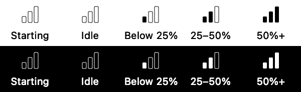

# Usage guide

Follow the [installation guide](installation.md), then start with the [README quick start](../README.md#quick-start). The commands below use the installed `agent-monitor` executable and work from any directory.

## Reading responsibility and retaining data

The [product question](product.md) is which agent/session and executable consume CPU or memory, with the workload CWD as context. The current overview expands sessions into executable groups and exact processes. CPU/memory ordering applies within those groups too. Full paths, available arguments and attribution evidence are inspection details. Provider-listed names are unavailable in local-only operation; session labels use locally verified provider/session IDs, and missing identity remains explicit. Session headings lead with provider/session identity; compact CWD paths or directory counts are secondary context. Overview sessions and native process-group headings use a second compact line for workload context when needed. In the overview, matching path suffixes gain enough leading components to distinguish observed workloads; inspect for the full path. Standalone Mac process rows—including individually pinned processes and flattened one-process sessions—show provider, abbreviated session ID above the executable/CWD/resources. Unresolved or shared ownership stays explicit; “Changed” flags a last-observed label that does not describe all CPU in the window. Children with the same session use its visible header and retain a single resource line. A child belonging to a different thread inside a root group shows its own session identity. Overview executable groups reserve space for their directory independently of the executable name; the TUI uses two linked lines when the fields cannot fit together. The remaining acceptance work is tracked in [UX-01](../PLAN.md#resource-accounting-priority).

Normal monitoring keeps bounded rolling data in memory, including the detailed recent window and scalar chart. It does not automatically write process-data logs or accumulate an unbounded history. Pause freezes a bounded view while collection continues. Diagnostic recording is a [separate, unimplemented proposal](proposals/diagnostic-recording.md), off by default and requiring explicit opt-in. Selecting JSONL or saving an export explicitly is distinct from automatic capture.

## Finite CPU diagnosis and local guides

```sh
agent-monitor guide
agent-monitor diagnose cpu
agent-monitor diagnose cpu --json
agent-monitor diagnose cpu --json-schema
agent-monitor guide semantics
agent-monitor guide diagnostics
agent-monitor guide actions
agent-monitor guide tui
```

`diagnose cpu` takes a baseline followed by three one-second waits and scans, then returns the top ten measured current-user lifetimes, including nonagents and the invoking agent but excluding the monitor. There are no tuning options; explicitly supplied report controls are rejected, including default-valued controls. Report thresholds, streaming and grouping do not alter diagnosis. Collection and native metadata inspection add runtime beyond the waits; help, guides and schemas run locally without any sampling or provider queries.

Contributors rank by observed CPU-seconds, with exact PID/start identity breaking ties. Mean and peak CPU describe each lifetime's own measured coverage; a brief high-rate burst does not outrank more measured CPU. Newborn intervals include zero before birth, earlier contributors retain their measured CPU and latest footprint, and omitted contributors remain in population totals. `elapsedSeconds` includes scans on the Mach clock, excluding sleep; display timestamps do not define it. Missing observations and CPU after the last observation remain uncounted. Coverage counts observations, not complete visibility or unique inaccessible processes.

Host occupancy appears beside measured process contribution. Its valid intervals are duration-weighted, with separate coverage and no single capacity when the logical CPU count changes. It is unweighted occupancy (100% = one logical CPU), not equivalent performance/efficiency-core capacity. Never subtract process totals from it or infer an idle machine from low measured CPU. Missing values are omitted in JSON and explained in text, not invented as zero.

Diagnosis JSON is one compact document with independent `schemaVersion: 1`; report JSONL also uses its own schema version 1. The [diagnosis schema](../Sources/AgentMonitorPresentation/Resources/diagnosis.schema.json) rejects unknown properties. Results include numeric coverage, exact identities, bounded executable labels, attribution evidence and timestamps and stable diagnostic codes. Names and paths are untrusted data. Available attribution is the latest association, not ownership of all window CPU or exclusive ownership of a shared daemon. `notObservedAtEnrichment` does not prove exit; unavailable metadata remains distinct from an unobserved lifetime. Read `guide semantics` and `guide diagnostics` for the published values and next observations.

Exit **0** includes valid empty or partial results; **1** emits `collectionFailed` and an explanation on stderr with no success document; invalid usage exits **64**. JSON stdout has no banners, colour or guidance. Diagnosis does not message, signal, change focus or read transcripts/tokens. Native reads consume resources. Production diagnosis performs no provider listings or provider subprocess launches; no lookup attempt or failure is fabricated for unavailable services. Actions require a separate request and fresh identity verification; `--pid` resolves at invocation rather than binding to a prior diagnosis.

For finite memory or repeated observations, use existing reports:

```sh
agent-monitor --json --all-processes --memory-gb 1 --samples 1
agent-monitor --json --all-processes --samples 3 --interval 2
```

With at least one nonzero threshold, report display filters match strictly above any enabled threshold: CPU **or** physical footprint in decimal GB, not RSS. Zero disables that resource filter. Locate a known PID by its PID/start record in the returned findings; there is no PID-report filter. See [report output](#text-and-jsonl-output) for the separate report controls.

## Live terminal view

`--tui --inspection-observations` opts into experimental between-scan discovery while the TUI is live and unpaused. Complete acquisition and the five-second display stay unchanged. Coverage details show a structured **Between-scan reads** row; a warning appears if more than half of opportunities were skipped. The feature is off by default, is unavailable in ordinary text/JSONL collection and has no Mac control yet. Coverage gains, overhead and skip rate have not been measured. It does not recover final-exit CPU or guarantee discovery of short workers; see the [inspection contract](architecture.md#supplemental-inspection-observations).


```sh
agent-monitor --tui
agent-monitor --tui --group session
agent-monitor --tui --adaptive-sampling --interval 1 --sampling-minimum 0.1 --sampling-window 60
```

`--tui` (also accepted as `-tui`) watches continuously unless you supply a `--samples` limit. It requires interactive stdin and stdout and cannot be combined with JSON output. Use `--no-color` or set `NO_COLOR=1` to disable colors.

Adaptive sampling defaults off. With `--adaptive-sampling`, acquisition starts at the configured minimum, returns there on qualifying activity or missing required evidence, and relaxes toward the visible maximum set by `--interval` during low activity. `--sampling-minimum` defaults to 0.1 seconds and must be between 0.1 seconds and the visible maximum; `--sampling-window` defaults to 60 seconds and accepts 1–300 seconds. Supplying either setting does not enable adaptation. `--no-adaptive-sampling` selects the fixed `--interval`; it is mutually exclusive with `--adaptive-sampling`. All adaptive flags require `--tui`, including explicit `--no-adaptive-sampling`. The existing faster/slower keys adjust the visible maximum and skip steps below the configured minimum. There are no additional TUI keys for these settings. Slower acquisition can miss more short-lived workers; the [adaptive contract](architecture.md#adaptive-acquisition) describes the activity and coverage limits.

| Key | Action |
| --- | --- |
| `v` / `a` | Switch overview/process view / select All or Main contributors |
| Return | Inspect the selected current overview process in the action-capable process view |
| `i` | Show/hide selected details in either view without folding children |
| Page Up / Page Down | Scroll visible details in either view by five lines |
| **?** | Open help and the metric glossary |
| **D** | Open passive diagnostics |
| **d** | Start a finite CPU diagnosis immediately; three one-second waits plus native scans and metadata reads |
| ↑ / ↓ | Select a row |
| ← / → | Collapse/expand children; process leaves do not expand |
| Shift+← / Shift+→ | Collapse/expand displayed session groups at the current level |
| `g` | Toggle session grouping |
| `k` | Review SIGTERM for the selected process |
| `s` | Explain why messaging is unavailable in local-only operation |
| `f` | Bring the terminal hosting the selected process's or group's agent session to the front |
| `c` / `m` / `n` | Sort the current view by CPU or memory; PID applies only in process views |
| `o` | Stable order in the current view: keep surviving sibling positions and append arrivals (process-view default) |
| `r` | Reverse the current view’s sort direction; no effect in Stable order |
| `b` | Cycle the fixed contributor CPU chart range; no effect in process views |
| `h` | Cycle history: CPU (default), memory, heavy-process count |
| `t` | Switch history between the last 10 minutes (default) and one hour |
| `1` / `2` | Lower/raise the CPU threshold by 10 percentage points |
| `3` / `4` | Lower/raise the memory threshold by 1 decimal GB |
| `<` / `>` | Increase/decrease the requested period, or visible maximum in adaptive mode: 0.1, 0.25, 0.5, 1, 2, 5, 10, 30 or 60 seconds; skip invalid steps |
| `.` | Pin/unpin the selected process or session, including absent targets; values keep updating |
| `u` | Unpin all processes and sessions in both views |
| `p` | Pause/resume the view; sampling continues and resuming shows the latest data |
| `[` / `]` | Scroll visible details in either view by one line |
| `-` / `+` | Shrink/grow the details pane by 5 percentage points |
| `0` / `9` | Minimize/maximize the details pane |
| `=` | Restore the chosen details split |
| `q` / Ctrl-C | Quit |

Pins stay first in pin order, independently of sorting. `★` marks a pinned row and `>` independently marks the selection, including without color. A selected pin shows `>★`; a missing pinned target keeps both indicators. A pinned group's expanded children use arrival order in Stable order and PID order in other sorts. If a target leaves the current heavy results, its placeholder remains with **Not in current results**; this does not prove it exited, and no old measurements or actions are offered. The same process lifetime or session can return automatically; PID reuse cannot replace a pin. `.` removes the selected pin even when its target is absent. `u` clears pins in both the overview and process view; the Mac app also offers **View options → Unpin all**. Each view admits at most 256 pins and 64 KiB of retained identity/label text. Reaching either limit refuses a new pin visibly; existing pins are never evicted, and removal remains available. Pins last until unpinned or the monitor quits, and native pins also survive closing/reopening the panel. A process pinned separately is omitted from its group's child rows; group totals still cover its full heavy membership. Pinned groups retain their identity when switching to flat mode.

Session rows have a leading `▸` when collapsed and `▾` when expanded. Column labels are visually quieter than session rows; CPU and memory stay aligned across groups and their children.

These are the current source-build keys. An installed release can differ; use its on-screen help and `agent-monitor guide tui`.

Text, JSONL and TUI reports default to a fixed 100 ms acquisition period. Acquisition runs independently of background metadata and display. Scan overruns delay the next scan without overlapping or catch-up scans; delivery can lag acquisition. An explicit `--interval` overrides the fixed period, or the visible maximum when TUI adaptation is enabled. The header identifies the requested period or adaptive maximum and, while frozen, `PAUSED at` the time of the displayed sample. The shortest selectable acquisition period is 100 ms. While frozen, acquisition and activity detection continue; selection, sorting, details and actions keep working on the frozen rows. Actions still recheck the live process, and threshold changes stay pending until you unfreeze. Selection follows the process across sorting and refreshes. Details start minimized; opening them uses an initial 50% split. The adjustable split ranges from 10–90%, subject to available terminal space. Minimizing or maximizing does not overwrite your chosen split. The divider’s `pane N%` is the requested share of the content area for details, not CPU usage.

The layout adapts to terminal size. Process leaves have a leading `i` inspection marker, distinct from expandable session controls `▸`/`▾`; select the row and press `i` to show or hide its details. The footer groups pane controls after **Details:**. Below 85 columns, process inspection uses two linked lines: agent/session and process name above PID/count, CPU, memory and CWD. Session IDs use eight characters; names and paths abbreviate as needed, with full information in details. Matching directory suffixes gain enough leading components to distinguish workloads in group headings; if the terminal still cannot fit them, an ellipsis marks truncation and details provide the full paths. The viewport keeps each identity/resource pair together; very small panes show a resize hint. Wide flat rows reserve aligned executable, agent/session and CWD columns even when resource values grow; matching directory basenames remain disambiguated. Historical `[past]` labels stay inside the executable cell, and truncated text has an ellipsis. Terminal context, executable paths and optional command arguments remain in details.

To copy text, drag-select it and use your terminal's Copy command (usually Command-C on macOS). Navigation is keyboard-driven; mouse selection belongs to the terminal. Whether selection survives a refresh depends on your terminal.

In CPU diagnosis, **↑/↓** and **Page Up/Down** scroll the fixed result, **x** cancels, **Esc** returns to the live report, and **d** runs again. Rerun discards the old result immediately and remains disabled until the preceding run finishes cleanup. After Back, the live footer shows “CPU diagnosis cleanup in progress” until `d` is available again. Compact live footers retain **? help**; timing is explained in the collecting view and `guide tui`. Runs use native observations without provider queries. The view ranks the top ten by measured CPU-seconds, including earlier contributors; the live table, history and paused state stay independent. Diagnosis rows have no actions. Below 40×8, starting and rerunning are disabled while Cancel, Back and quit remain available. **Monitor helper** flags observed descendants of this monitor only; reparented/unobserved helpers and other monitor instances may be unflagged, and their CPU remains in totals.

## On-demand help and diagnostics

In the TUI, press **?** for Help & glossary and **D** for passive Diagnostics; use **↑/↓**, **Page Up/Down** or **[ / ]** to scroll and **Esc** to return. These pages preserve the current selection, inspection and paused report. The compact footer exposes Help, and measurement warnings link to Diagnostics. Lowercase **d** starts a new finite CPU diagnosis; uppercase **D** only displays existing measurements and their limitations.

In the Mac app, the footer **?** and **stethoscope** symbols open Help and Diagnostics. The **sliders** menu provides labelled **Help & glossary**, **Keyboard shortcuts** and **Diagnostics** items. Each page scrolls independently and closes with **×** or Escape; closing the main panel dismisses it. Compact coverage warnings are passive status. **Diagnostics → Diagnose CPU** starts a separate finite investigation.

The shared [glossary definitions](../Sources/AgentMonitorPresentation/ReportGlossary.swift) explain process counts, current versus recent CPU, memory units, worker/runtime populations, missing data and pause. **Processes / Procs** counts distinct process lifetimes represented by that row in the latest displayed sample, including runtimes where applicable; while paused, it describes the held sample. Recent CPU uses the actual retained recent range, not the chart's 10-minute or one-hour range. The main comparison keeps concise coverage warnings; detailed causes, timing, collection settings and unavailable provider capabilities belong in Diagnostics.

## Process inspection

**On-demand arguments:** open a current process inspector and choose **Read arguments** on Mac, or press `x` in TUI process details (`x` again hides them). The numbered argument list preserves argument boundaries. This reads the process now, even while the view is paused; the inspection shows its read time. PID/start identity, same-user ownership and executable path are checked around the read. A changed, exited, unreadable or oversized process returns unavailable. Only one read may be in flight, the argument-area allowance is 256 KiB, and switching or closing inspection discards the result. Nothing is added to rolling history, reports or recordings by this action.

## Process actions

Select an individual process before terminating; focus also works on a group. Opening a confirmation freezes its process identity: subsequent sorting, refreshes, and filter changes cannot retarget it.

**Terminate:** press `k`, inspect the PID, executable and session, then press Ctrl-Y to send SIGTERM. Esc cancels. Only the selected process is signaled, including when you explicitly select an agent runtime; children and process groups are not signaled automatically. SIGKILL is not offered. The process must still have the same PID, start time and executable and belong to your user. macOS identity checks and PID-based signaling are not atomic, so a small race remains. “SIGTERM accepted” does not mean the process exited.

**Message:** unavailable in local-only operation. Native controls disable messaging; TUI `s` and the CLI `message` command refuse with an explanation. Agent Monitor does not invoke Codex/Claude helpers to discover recipients or send messages, and there is no switch to permit Internet-capable helpers.

**Focus:** press `f` to bring the terminal hosting the selected process's agent runtime to the front. On a collapsed session group, `f` focuses the group's runtime when its processes share exactly one; otherwise expand the group and select a process. The runtime, not the workload, is the target because agent tool subprocesses often have no terminal. In Terminal.app the tab on the runtime's terminal device is selected, its window is unminimized and ordered front, and Terminal is activated; the result panel names the device. Other terminal and editor apps found above the runtime are only asked to come to the front, so another of their windows may show. Sessions under tmux, screen, or ssh, and background runtimes without a terminal, report that nothing was focused. On first use macOS asks whether the terminal running Agent Monitor may control Terminal; that Automation grant applies to everything run in that terminal, and it can be revoked in System Settings › Privacy & Security › Automation. Since macOS 14 activation is a request, so macOS may keep another app in front. Focus never types into, runs commands in, or reads the target terminal.

### Actions from the command line

The same actions are available without the TUI, for a PID taken from a text report:

```sh
agent-monitor kill --pid 42001
agent-monitor focus --pid 42001
```

`kill` and `focus` read the process's current lifetime and attribution, independently of the display thresholds. `kill` prints the target and asks `[y/N]`; without interactive stdin it refuses unless `--yes` is supplied. `focus` needs no confirmation. `agent-monitor message [--no-color]` reports the offline limitation and exits with status 1 before process lookup or confirmation. It accepts no PID, message text or recipient options.

| Exit status | Meaning |
| --- | --- |
| `0` | Accepted: SIGTERM sent or terminal focus requested. Exit and physical focus are not confirmed. |
| `1` | Nothing was done: refused, cancelled, not found, or failed before sending. |

JSONL output has no action commands.

## Main contributors and recent activity

Mac **Diagnostics** and TUI **D** hold detailed coverage metrics and explanations. A compact indication beside totals remains visible when observations are missing; it directs users to those details. At small sizes the TUI preserves the selected identity/resource block and quit/resume/help controls. `i` remains inspection of a contributor, separate from collection diagnostics.

Mac and TUI default to **Main contributors**. Individually shown sessions are the union of the top five by combined group CPU (strictly above 25% of one core) and the top five by current memory (at least 100 MB). Hysteresis keeps small rank changes from constantly reshuffling the list. These relevance floors collapse rows; they do not remove measured work. A zero-CPU process can still matter through memory, and zero CPU does not mean it has stopped.

**Recent contributors** keeps bursts discoverable after workers disappear: sessions qualify through at least 0.5 recent candidate CPU-seconds, a 100 MB sampled worker footprint, or having recently left the main list. **More processes** quantifies the remaining exact-session population. **Unresolved / uncertain** always remains visible; recognised shared agent runtimes have their own summary. **Show all** (TUI `a`) opens the recent/remainder sections. Explicit resource filters still apply to process rows, with filtered counts and full totals retained.

CPU activity lanes share a visible fixed zero-to-ceiling display range; activity never changes it. They show whole measured time spans over the retained recent range, with gaps for unavailable CPU and a maximum-span caption when timing is coarse. TUI lanes use two plot rows at widths of at least 90 columns, and `~ spans` marks incomplete observations. Current CPU and memory stay aligned beside identity; executable/CWD summaries use the full width below. Memory is a current measurement, not a historical graph. Hover in the Mac app for definitions, or expand coverage/details when needed. Expand root/session → thread where relevant → executable → process. `executable node` combines observed paths ending in `node`; it does not merge `node_repl` or guess from display names. Exact lifetimes prevent PID reuse from becoming the same worker. Session CPU is **point-evidence candidate CPU**, not proven ownership throughout an interval. Earlier unresolved work stays unresolved after later evidence becomes available. Workers changing sessions can count in both historical memberships; parent distinct counts deduplicate them.

**Recent** targets 60 seconds, within fixed record/text limits. It reports actual retained coverage, missing observations and older-opening recovered CPU separately. A retention-limit/gap qualifier clears once the affected boundary ages out of the target range. Publication backlog can combine units without dropping measured CPU; a warning shows how many units were coalesced and the maximum unit span. Whole-unit retention can shorten the range, or widen it when the newest unit alone exceeds the target; the displayed duration is the actual range. Memory maxima come from acquisition readings, even if a spike was gone by the next display refresh. Last kernel task peaks remain inspectable but can predate monitoring or reset on exec; they are not recent-window maxima. **No longer observed** means absent from the latest identified scan, not confirmed exit or a monotonic stopped counter. Read failures and exits before read disclose distinct same-user-listed PID values and per-scan failure counts, not identified workers or verified agent ownership; released PID detail produces count ranges. Older collapsed workers carry count ranges; verified birth timing can tighten those ranges without treating disappearance as confirmed exit. Retention cannot recover never-observed processes or their final exit CPU.

Embedded tools recognised by an attribution adapter show their observed invocation name (for example, `ugrep`) even with `--commands` off. This is a label; the actual executable path remains in inspection. Other workers keep the observed executable basename.

Overview headings include **Main contributors (X/Y)** or **All contributors (Y)**: X main/pinned retained session groups out of Y total retained groups. Shared, unresolved and released-detail work remain separate. Hardware chooses the initial range once: performance plus super cores × 100%, falling back to all logical CPUs if core types are unavailable. This gives 400% for four performance cores; a reported two-super/four-performance configuration gives 600%. It does not identify core placement or computing-power saturation: 100% means one CPU-second per elapsed second. Mac **View options → CPU chart range** or `b` cycles/selects a manual range, including all logical cores. Range and sort direction survive collection resets. An orange cap or terminal ↑ marks overflow; contributor details retain actual interval percentages, CPU seconds and durations. Equal-width bars are successive whole-interval averages, with unequal durations identified in the caption. They show observation order, not equal elapsed-time slices.

In TUI, arrows select/fold and `.` pins the owning session. Folding only reveals children; `i` opens a labelled field/value inspection for the selection. A dot marks a process leaf; it does not imply another expandable group. Tab switches focus between the list and bottom details; arrows scroll a visible focused details pane, Page Up/Down scroll by pages, and Esc closes it. At very small terminal heights, enlarge the terminal to reveal the pane; row navigation remains available. Return inspects an eligible current worker without changing the process-view grouping; Return in the process view does nothing. `c`/`m` reorder main contributors by CPU/memory while keeping the overview; `v` switches views; `o` chooses stable order in the current view, `r` reverses metric sorting, `n` sorts by PID only in process views, and `g` enters process inspection. Rows keep their positions across refreshes unless one exceeds a row above it by more than 20%, at every level; new entries arrive in contribution order, and `c`/`m` sort exactly. The coverage-status row below totals exposes read failures, exits before read, excluded observations and unavailable memory. In Mac, click a row body to select it and toggle its children, use its disclosure triangle, or choose **All contributors** from View options for recent/remainder groups. The row’s **ⓘ** information button, `i`, or the row context menu opens its bottom details pane: a persistent ownership heading above complete, selectable paths and an aligned field/value grid, with **Counts and evidence** disclosed separately. Esc or the close button returns focus to the table. **Inspect current process…** opens the current worker's process details and actions. Historical workers have no actions. **Diagnostics** includes sampling metrics, retained-history coverage, failure breakdowns and limitations. Retained time does not establish workload completeness. **Help** defines the terms in both interfaces.

Pause freezes both the overview and worker details. Live-icon mode collects while the Mac panel is closed and preserves history on reopen while clearing inspection. Static-icon mode stops collection and starts a new run labelled **Collected since panel opened**. Run/scope changes reset history; old and new CPU are never combined. History is in memory and needs no recording. Detailed semantics are in the [architecture contract](architecture.md#contributor-overview-and-recent-activity).

## Filters and measurements

The current report is not a complete accounting of agent CPU or memory. Short-lived workers can run entirely between scans, and their final CPU after the last observation is unavailable. Lower thresholds reveal more observed processes; shorter intervals can capture more workers, but neither guarantees complete coverage. These are gaps against the project's [resource visibility requirements](architecture.md#resource-visibility-requirements), not acceptable evidence that a busy agent is idle.

By default, **both display thresholds are zero and all observed processes in scope are included**, including idle processes and unavailable resource measurements. Interactive overviews collapse lower contributors into quantified summaries; the process/text views show their individual rows. Zero disables each resource filter independently. With either threshold nonzero, findings must strictly exceed at least one enabled threshold. Filters change visible rows, never session totals or the Mac icon. Only agent-associated processes appear; `--all-processes` also includes unrelated and unattributed processes owned by your user. Unknown or ambiguous agent sessions remain visible.

- CPU is the sum of measured CPU-seconds in the display window divided by its enclosing monotonic duration. Acquisition defaults to 100 ms; TUI and the Mac app publish at most every five seconds independently; text/JSONL retain one-second report windows. Slow consumers receive a combined window, not a replay burst or only the newest sample. **100% means one fully occupied core**, so a multithreaded process can exceed 100%.
- Memory is a snapshot of physical footprint in **decimal GB**. Footprint includes memory accounting that RSS omits. Process inspection also shows the kernel footprint peak when available, which can reveal earlier allocation bursts. That counter can reset on exec; it is separate from current memory and must not be summed as a simultaneous session peak. Report JSONL schema 1 exposes it as optional `kernelPeakFootprintBytes`.
- `*` marks an exceeded process threshold. Missing measurements are unavailable, not zero.

**Short-lived contributors:** a process observed during acquisition remains in its accounting window after it disappears. The TUI marks it `[past]`; the Mac app marks it **Past**. Expand it to inspect its measured CPU and last observed footprint, or pause the display to keep that window for inspection. Historical rows cannot terminate, message or focus a process. Memory-only filters use their last observed footprint for row eligibility; that value is still excluded from current memory totals. “No longer observed” is not proof of exit.

Session CPU uses frozen point-evidence candidates, not proven ownership throughout each measured interval. Conflicting session candidates remain uncertain and are counted once. Details distinguish candidate and uncertain/unresolved CPU, recovered CPU and evidence age. JSONL schema 1 retains compact CPU records with frozen attribution, accepted interval counts, explicit missing-read and exec-change counts, evidence-time ranges, enclosing scan endpoints and newborn birth evidence. Endpoints are an envelope, not a claim of continuous reads or ownership. A current memory label conflicting with historical CPU ownership leaves the combined row uncertain rather than assigning the memory to the old session.

```sh
agent-monitor --tui --cpu 40 --memory-gb 0.5
agent-monitor --all-processes --cpu 10
```

In the TUI, both thresholds clamp at zero. New settings apply at the next displayed window and show as pending until applied. Lowering a threshold can reveal previously omitted processes without restarting the monitor. An empty list means no matching processes were observed in that window; it does not establish that no agent work occurred.

Text, TUI and native panel headers show `CPU: host 211% of 800% · your measured processes 169% (3 without data)`. The status menu and accessibility text reuse the same context and label the displayed agent total `Observed agents: CPU …` to keep the two figures apart. Host occupancy uses unweighted logical CPUs (100% = one core), not performance/efficiency-core computing capacity. “No data” means no valid host-counter interval between the window endpoints; a measured idle interval shows 0%. Your measured total covers sampled current-user lifetimes with eligible CPU data, including historical contributors, excludes the monitor itself and includes processes below the table thresholds or outside agent scope. The count without data covers observed lifetimes with excluded measurements; it cannot count never-observed workers. No difference between the figures is presented as an explanation of load.

CPU contributions retain exact process lifetimes and opening/closing scan identities. A qualifying newborn can contribute from a verified zero baseline at the retained pre-birth listing even if it is observed only once. Work recovered across read gaps enters a window's rate only when its opening and closing endpoints lie inside the window; older openings are shown as separate recovered CPU-seconds, including when filters would otherwise hide the row. Combining windows deduplicates contributions and recomputes their eligibility and rate. Work never observed and CPU after the final observation stay uncounted.

The default prioritizes visibility over collection cost. On the measured desktop, the previous sequential collector with 100 ms waits used about 29% of one core before UI/provider work; this is a single-run measurement of the earlier implementation, not an overhead measurement of independent acquisition. Short-lived workers can still be missed. See the [controlled accounting probes](research/cpu-accounting.md#controlled-exit-and-scheduler-probes--2026-10-23).

## Session grouping

`--group session` groups text output and the interactive process view by launch session. The TUI opens in Main contributors; press `v` for process inspection or `g` to enter it and switch grouping. → expands a group or opens process details, and ← collapses it. New groups start collapsed; previously expanded session/root groups reopen when the same identity returns after filtering. Explicit collapse stays collapsed. The monitor remembers up to 256 absent expanded groups, evicting the oldest expansion choices first; visible or pinned groups are not evicted.

Both interactive views also restore the inspected process's details when that exact PID/start lifetime returns. While it is missing, no stale details are shown. Selecting another row, changing disclosure/grouping or pane mode, or opening an action panel cancels that pending restoration, so a returning process cannot override a new inspection choice. One process is inspected at a time: inline in the Mac app and in the TUI's details pane. Expansion memory lasts for the current collection/view; closing the native panel or restarting the TUI clears it.

**Shift+←/→** changes session disclosure at the current level in both live views. On a top-level row (or with no row selected), it collapses/expands all displayed session groups, including pinned groups. On a child process inside an expanded group, it changes only the containing session, hiding/revealing siblings; collapsing moves selection/focus to the parent. Individually pinned processes count as top-level rows. The Mac app's flattened single-process rows also count as top-level and have no group disclosure to change. Missing groups are unaffected, repeat presses are idempotent, and choices use the same sticky expansion rules. Process details remain single-target; in Processes view without pinned session groups, the bulk command has no effect. It is disabled in action panels and editors.

TUI session rows show **#N** in **PID/#** for their process count; child rows show their actual PID. **├─ / └─** mark child membership in the executable column (or the compact identity line), keeping numeric CPU/memory columns aligned. A separately pinned process is a standalone row. The group count covers its measured display-window population, including filtered and departed contributors; it differs from the overview’s latest-sample **Procs** count, as explained in Help.

Unpinned groups appear only when at least one member passes the display filters and is not separately pinned. Explicitly pinned groups remain visible even when all their children are filtered. Groups show the project, session, process count, and CPU/memory totals of **all observed session members**, including processes hidden by display filters. These totals do not recover work missed between scans. `~` marks a partial total when measurements are missing. CPU/memory sorting orders groups by their totals; PID sorting uses each group's lowest observed PID.

Unresolved or ambiguous processes stay separate even when they share a project or runtime. Session evidence identifies launch origin: a shared Gradle, Kotlin, or MCP daemon may later serve other sessions. See [attribution evidence](architecture.md#attribution-evidence-and-inspection-scope) for the exact interpretation and inspection scope.

A Claude Code runtime can lack its own session marker, and macOS system binaries can hide their environment. Automatic `claude agents --json` listings are disabled because provider CLI startup cannot be guaranteed offline. Such runtime/child ownership may therefore remain unresolved; native marker, retained ancestry and verified local descriptor/socket evidence still apply. Diagnostics explains this capability limit.

**Shared runtime** identifies a Codex runtime process with multiple distinct thread writer descriptors and no exact attributed thread. This describes shared runtime usage, rather than a failed workload lookup. It appears consistently in process rows, session groups, details, text output and action targets. Its singleton group remains separate from exact sessions and unresolved workloads. JSONL retains the original ambiguous evidence and candidate thread IDs. A runtime without a terminal still cannot be focused; the label does not establish a terminal-client mapping.

Project names describe the displayed workloads’ working directories, not session ownership. Session groups show one compact CWD path or **N dirs**, including when one directory is nested inside another. Missing directory evidence is qualified as **CWD unavailable**. These summaries do not establish separate projects or repository roots. Grouped TUI child rows and Mac process rows show each worker’s compact CWD beside its executable, including sessions with several directories. Matching path suffixes gain leading components; full paths remain in details and native tooltips. A **shared runtime** has no project subtitle because its launch directory may belong to another session. Expanded details retain both the work directory and runtime directory. This labeling does not change attribution or grouping identities.

## Text and JSONL output

With no options, the monitor takes a baseline and requests its next acquisition after a 100 ms start-to-start period, then prints one resolved report. `--samples 0` watches until Ctrl-C; `--interval` controls the requested acquisition period (0.1–60 seconds). Each text report includes a UTC timestamp.

Text reports and the `kill`, `message` and `focus` commands use colors only when their output goes to a terminal: the report header in blue, process lines and unresolved sessions in yellow, secondary details in gray, accepted results in green and errors in red. Pipes and files get plain text, and `--no-color` or `NO_COLOR=1` turns colors off everywhere. JSONL is never colored; `--no-color` is accepted with `--json` and has no effect there.

```sh
# Continuous text reports every two seconds
agent-monitor --samples 0 --interval 2

# Three machine-readable reports
agent-monitor --json --samples 3

# Print the report schema without sampling
agent-monitor --json-schema
```

JSONL contains one complete, compact JSON object per line/report. It retains the flat process list and full attribution evidence, including ambiguous candidate IDs. Schema version 1 retains required `observedFindings`, a flat list independent of display thresholds alongside the filtered `findings`. Both use the same process shape and requested scope. The required report-level `cpuAccounting` object contains: optional `hostBusyPercent`, `logicalCPUCount`, `measuredUserPercent`, `unmeasuredLifetimeCount` and optional `previousScanSeconds`. Unavailable optional fields are omitted. Report and nested objects reject unknown fields. Findings remain flat; evidence values describe locally supported attribution. `--group session` is incompatible with `--json` and `--json-schema`. The optional `cpuAccounting.acquisition` object reports run/scan identity, requested QoS, requested/achieved periods, scan work, resolution delay and prompt-capture outcomes. On-demand Diagnostics shows the achieved acquisition period in milliseconds and resolution delay; neither a requested interval nor a successful prompt read guarantees complete coverage. Each window also reports `acquisitionCoverage`: scan count, maximum gap and overrun count across all scans. `publicationCoverage` distinguishes source units from admitted history units and records backlog-coalesced counts, maximum unit span and the enclosing coalesced time range. Under delivery pressure, `collapsedContributions` preserves exact older CPU, interval counts and sampled memory maxima with a time range and provable worker-count bounds; identity/category detail loss is explicit. Include collapsed CPU when summing detailed records. A current population exceeding the remaining capacity fails explicitly.

`--commands` includes command arguments in reports and process details. Arguments can contain credentials or other sensitive values and are omitted by default. Session IDs and project paths can still appear without this option.

For the complete option reference and defaults, run `agent-monitor --help`.

## History strip

Both live views show one compact history strip. It defaults to **agent CPU over the last 10 minutes**. In the TUI, **h** switches CPU → Memory → Heavy, and **t** switches 10 minutes ↔ 1 hour; the strip shows these hints. In the native panel, click **CPU · 10m** to choose a metric and time range from checked menu items. Changing the strip does not change sampling or table filters.

CPU totals all observed agent-associated processes (100% = one core); Memory totals their physical footprint in decimal GB. Heavy counts distinct agent processes exceeding CPU > 25% or footprint > 1 GB, independently of the table’s filters, including when the TUI shows unrelated processes. The number beside the trace is the latest value; bars preserve peaks within each time bucket and scale from zero to the visible peak (with a minimum upper bound of 1). A flat zero draws a small baseline bar. Empty buckets and unavailable measurements remain gaps. The native graph always has a subtle baseline and shows **No data** when the current measurement is unavailable; the TUI uses **—**. Neither means measured zero. Missing CPU or footprint makes that metric unavailable; the heavy count is unavailable if either resource is incomplete. The scope is observed agents, not a guarantee that unreadable processes are included.

History records **every collected report**, using that report's observations. Acquisition runs independently of the five-second display cadence; coalesced deliveries contribute their enclosing measured window. CPU represents the resource interval measured at each recorded observation; work missed between scans remains missing from history. History accumulates while this instance runs, up to one hour; it is not saved across launches. The range ends at the latest history observation, and unsampled earlier periods stay blank. Pause holds the strip along with the table; Resume includes measurements collected during the pause. The native live icon’s closed-panel delivered windows also feed history. Static-icon mode adds no samples while closed, leaving gaps between observations. Closing/reopening preserves the history and metric/range choice. There is no additional polling or animation timer.

## Menu bar app

In the contributor view, **View options → Display filters → Hide no longer observed** hides fully historical rows, including pinned ones, without deleting pins or changing measured totals/history. Mixed groups with current members and unavailable-presence rows stay visible. A counted notice shows when the filter is active; click it to restore hidden rows. The setting starts off and remains selected across monitoring refreshes.

Mac buttons and status symbols provide concise hover help. Process counts pair each number with a trailing SF Symbol: a solid dot (`circle.fill`) for currently observed processes and an archive box (`archivebox`) for past processes. Mixed groups show both counts; zero categories are omitted when the other is nonzero. Past counts remain visible when past rows are hidden, because measured totals retain that work. Tooltips name both populations; past means no longer observed, not confirmed exit.

The Mac **View options → View** section offers four mutually exclusive choices: **Main contributors (X/Y)**, **All contributors (Y)**, **Processes by session**, and **Processes**. Exactly one is checked; selecting it again leaves it selected. The Sort by section applies only to that chosen view, even before its first sample. PID is available only in process views. If a received snapshot has no contributor history, the controls reflect the rendered process view and contributor-view menu choices are unavailable.

**View options** separates **Display filters** (CPU and footprint thresholds) from **Sampling** (mode, maximum interval, advanced settings and live icon). Filter tooltips explain their scope: visible process rows change, while observed totals and recent activity stay unchanged.

Sampling choices last until quit. Adaptation defaults off, with a 100 ms minimum/visible maximum and closed-panel multiplier one.

| Sampling control | Meaning |
| --- | --- |
| Maximum interval | Visible maximum, from 0.1 to 60 seconds, including the 15-second preset. |
| Mode | **Use maximum interval** keeps a fixed period at the applicable maximum; **Adaptive sampling** starts at the minimum and relaxes during low observed activity. |
| Advanced sampling → Minimum interval | Shared minimum, at least 0.1 seconds and no greater than the visible maximum. |
| Advanced sampling → Activity window | Rolling activity window, from 1 to 300 seconds; default 60. |
| Advanced sampling → Closed-panel multiplier | Multiplies only the maximum while closed, in either mode; at least one, with a derived maximum no greater than 60 seconds. |

For example, a 5-second visible maximum with multiplier 2.5 permits 12.5 seconds while closed; the shared minimum stays unchanged. Invalid combinations are disabled, and a current value outside the presets remains available and checked.

Opening the panel in adaptive mode returns acquisition to the minimum while retaining activity history; closing changes the maximum. Maximum/multiplier changes preserve history, while minimum/window/mode changes restart adaptive control without resetting process CPU counters. Pause holds presentation while acquisition and activity detection continue. Slower acquisition can miss short workers before a trigger is observed; see the [adaptive acquisition limits](architecture.md#adaptive-acquisition).

From a source checkout, run `bash scripts/menubar.sh run` and click the load icon. The native panel follows system light/dark appearance. Drag its top edge to detach it; close it and click the icon to reopen at the menu bar. Drag the grip at the bottom of the panel up or down to resize its height, either attached or detached; width remains 620 points. Hovering the grip shows the resize cursor and instructions. The footer shows **Custom** after dragging. Choose **Compact**, **Standard** or **Tall** to return to a preset. The chosen height lasts until quit, survives close/reopen, is capped to the screen and remains stable as content changes.

The main contributor table aligns **Contributor**, **CPU** and **Memory**. Click a header to sort and again to reverse; the indicator and **View options → Ascending** share the same state. Sorting applies within sessions as well as between them. **Pinned**, **Sessions** and **Other observed work** have separate header bands and spacing. Headings cannot be selected and arrow-key navigation skips them; alternating translucent/unfilled subtree bands, gaps and branch guides replace bright row separators on the original system reading surface without a gray darkening overlay. Executable names are bold. The Mac activity lanes omit drawn ceiling lines; their shared fixed range remains labelled above the table and overflow remains marked.

Click a row to select it. Click its **process-count/chevron button** or native disclosure triangle to expand/collapse children; arrow-key selection remains separate. The numbers count current and past process lifetimes in that contributor, not PIDs or hidden rows; hover for their meaning and expansion action. Unpinned session buttons appear on hover or keyboard focus, and pinned buttons remain visible. Child-row context menus can pin their owning session. **ⓘ**, **i** and the context menu open contributor details. **…** appears only for contributors with current action targets and provides process inspection and actions directly. Groups list exact current targets by name/PID with directory context and offer **Terminate all…**. **k** reviews termination for the selected contributor (all its current targets); **f** focuses the terminal when exactly one current target is available. When the process inspector is open, **k/f** target that exact inspected process instead of its parent group. Action menus show k/f only when the command is available for that exact selected or inspected target. In other contexts the cue is omitted; labels and tooltips do not give preparation instructions. Tooltips also expose the existing keys on disclosure, sort, pin, copy, confirmation and dismissal controls; **i** opens contributor information and **.** toggles the pin. Process inspection stays in the bottom pane with Back/Close, complete selectable paths, arguments on demand and confirmation before termination. Termination review freezes the exact list: new arrivals are excluded, every target is verified again, and the batch stops on failure or uncertainty. Results distinguish accepted SIGTERM from confirmed exit and name any targets not attempted. **⌃Y** confirms the review; **Esc** cancels. It does not switch to the secondary process table.

Historical contributor rows use lighter italic names and subdued activity values; their paths remain readable. The archive-box count identifies past processes; there is no separate historical status marker on the row. The Recent contributors group uses a tray symbol; neither status nor group uses a clock. Eye-slash means current presence could not be established; a branching arrow means recorded ownership changed. Hover counts or status symbols for their meaning and evidence limits. Paths occupy their own truncation area; status wording cannot become part of a shortened path. Full values remain selectable in Details. Coverage warnings appear as an orange warning badge on the footer Diagnostics button; notices use an information badge.

Footer symbols expose **Help** and **Diagnostics** with tooltips and accessible names. The Diagnostics badge tooltip explains that some usage could not be measured, or that measurement limits apply, and directs users to click for details. Technical read-failure counts stay inside Diagnostics. Help, Keyboard Shortcuts and Diagnostics have labelled, explicitly visible icons in the options menu. Options-menu shortcut labels show exact commands; cycling controls explain their keys in tooltips.

The secondary process view retains expandable session/process rows and separate pin controls. Expand a process for attribution and contextual actions. **Terminal** uses local terminal-focus adapters; macOS may ask to let Agent Monitor control Terminal. **Terminate…** reviews one frozen lifetime before sending SIGTERM. **Message…** remains disabled because its provider helpers cannot be guaranteed offline. Acceptance does not confirm termination or physical focus, and no action automatically retries.

**Stable order** is available in both views and is the default in the process view in both GUI and TUI: existing rows keep their relative order as values change, new identities append, and departed rows disappear. Pins stay at the top. In the native app choose **View options → Stable order**; in the TUI press **o**. CPU, footprint and PID remain available (`c`, `m`, `n` in TUI). Switching back to Stable order retains the current order; reverse/Ascending does not apply. The process view starts initial and simultaneous arrivals in descending CPU order. The contributor overview preserves the current sibling order when Stable is selected and appends simultaneous newcomers in identity order. Its relevance groups and retained population continue updating; Stable does not freeze measurements or membership. Sorting never switches views: `o`, `c`, `m` and `r` act on the current view, and `n` is inert in the overview. Native reopening preserves surviving rows’ order.

New process rows and their parent session headers receive a system-adaptive gray background for three seconds, followed by a brief fade (no animation with Reduce Motion). Parent headers highlight even when collapsed, so arrivals are visible without expanding. Initial loading and reopening do not highlight the whole list. Reordering, pinning and expanding rows do not restart the highlight. A returning identity counts as a new arrival; while paused, arrivals are highlighted only when Resume applies the latest sample.

The menu bar icon uses three thick bars for the observed agents’ CPU as a share of your Mac's logical processor capacity: empty at zero, one below 25%, two from 25% to below 50%, and three at 50% or more. Right-click or Control-click the menu bar icon for raw CPU, footprint, the observed-process count, threshold explanation and sample time. The same menu provides **Open Agent Monitor**, **View options** and **Quit Agent Monitor**; left-click opens or closes the process panel. Status text stays fixed while the menu is open and refreshes on the next opening. Opening this menu does not request a fresh sample or switch to the faster panel interval. The icon bars use all observed agents in the displayed snapshot while open, including Pause; Resume updates both immediately. The Observed processes heading shows the same total, including singletons and collapsed children. Pins never double-count a process, and absent pinned placeholders do not count. While closed, the icon uses the latest collected unfiltered observations. The same three-bar icon appears from startup onward. Startup uses the applicable maximum with adaptation off, or the shared minimum with adaptation enabled; there is no separate first-sample cap. Initial settings request 100 ms in either context, with adaptation off and multiplier one. Actual feedback also includes collection and delivery time. Before that first sample or after collection failure, the bars are unfilled; the right-click menu explains the state. Unavailable CPU also leaves the bars unfilled. Totals with missing measurements are qualified in the right-click menu. In static-icon mode, the menu explains that sampling runs only while the panel is open.

<p></p>

There is no numeric status-icon badge. The status menu and accessibility text report **N observed agent-associated processes in this window, including M no longer observed**. This includes filtered and historical contributors, not just busy workers. The bars remain a fixed width and use macOS template contrast without flashing or event animation.

Use **Diagnose CPU** while a slowdown is happening to find which processes consume the most CPU during a new short window. It cannot recover work that ended before you started. Start with the largest CPU-seconds contributors, then use their PID and session evidence to locate the workload in the live table. Check coverage and helper flags before attributing the load to an agent.

**Diagnose CPU** starts a separate finite investigation immediately, with three one-second waits plus native scanning and metadata-read time. Results rank the top ten by measured CPU-seconds and retain earlier contributors; they do not change the live table, history or icon. You can start while paused without resuming the live view. **Cancel** leaves the collecting state while owned work finishes; **Run again** waits for cleanup, discards the previous result and starts a fresh window. Runs never launch provider CLIs. **Back**, popover dismissal and detached-window closure discard the result; dragging the panel into a detached window keeps the run. Diagnosis rows have no actions. **Monitor helper** marks observed descendants of this instance; unobserved/reparented helpers and other monitor instances may remain unflagged. Their CPU stays in the totals.

The result starts with the window summary, followed by numbered contributors ranked by measured CPU-seconds. Each process has a separate card with its name and CPU-seconds emphasized; full identity, measurement coverage and attribution evidence remain underneath. Coverage explanations and guidance follow the contributors. Plain-text output, the TUI and clipboard copy use the same section boundaries with headings and blank lines.

For a completed diagnosis, **Copy report** copies the full readable report, including identities, timestamps, coverage and attribution qualifications, to the clipboard. It shows **Copied** or **Copy failed** and does not collect again or perform actions. Copying is unavailable while collecting, after cancellation/failure, or after dismissal.

Click outside the panel to dismiss it. The live icon keeps collecting under the closed-panel maximum and selected mode, **100 ms by default**; the CPU value averages its actual measured window. Reopening shows the latest snapshot immediately, applies open-panel sampling policy and resumes live table updates. Turn off **View options → Live menu bar icon** for a static three-bar icon and no closed-panel sampling; reopening in this mode takes a fresh baseline and waits the applicable requested period for measurements. The choice lasts until quit. Closing cancels pending actions and retains any uncertain outcome without retrying. **Quit** exits and drains owned tasks.

Provider discovery and messaging are unavailable under the offline requirement. First-use Automation behavior for terminal focus and sustained energy use remain user-run checks. Quit an existing instance before rebuilding. See [development checks](development.md#menu-bar-app).
