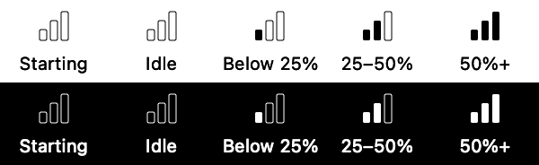

# Use the Mac menu bar app

Compare coding-agent workloads in the native contributor table, inspect the relevant process, and review actions without leaving the overview.

[Usage guide](../usage.md) · [All usage topics](README.md)

## Open, detach and resize

From a source checkout, run `bash scripts/menubar.sh run` and click the load icon.

The native panel follows system light/dark appearance. Drag its top edge to detach it; close it and click the icon to reopen at the menu bar.

Drag the grip at the bottom of the panel up or down to resize its height, either attached or detached; width remains 620 points. Hovering the grip shows the resize cursor and instructions.

The footer shows **Custom** after dragging. Choose **Compact**, **Standard** or **Tall** to return to a preset. The chosen height lasts until quit, survives close/reopen, is capped to the screen and remains stable as content changes.

## Read the overview

The overview places CPU and Memory sort headings above the overall values, aligned with the corresponding contributor columns. The overall chart shares the row-chart column, and the process count labels the total on the left. Totals and sorting remain available when the table is collapsed.

The contributor overview shows **overall CPU history** above the row charts, on their same fixed scale and recent range. It includes hidden contributors, counts each contribution once, and represents the monitored population, not whole-Mac CPU. It uses existing measurements without retaining extra history.

In the TUI, the aligned overall chart appears when the window is at least 90 columns by 20 rows.

## Fold sections or the table

| Fold target | Control | Window behavior |
| --- | --- | --- |
| Pinned / Sessions / Other observed work | Section chevron or **5** / **6** / **7** | Keeps the current window size. |
| Whole table | Chevron beside **Main contributors**, or **8** | Shrinks to the summary; expanding restores the previous height, including a custom drag size. |

Totals, the overall chart and view options remain visible. Folding preserves selection and child expansion across refreshes, closes hidden Details and prevents actions on hidden rows. Reopening restores surviving rows without restoring expired measurements.

The **?** guide lists these Mac shortcuts. TUI folding leaves terminal dimensions unchanged and uses **P/S/O** for sections, with no whole-table key. Section headings are not selectable contributor rows.

## Hide no-longer-observed rows

In the contributor view, **View options → Display filters → Hide no longer observed** hides fully historical rows, including pinned ones, without deleting pins or changing measured totals/history.

Mixed groups with current members and unavailable-presence rows stay visible. A counted notice shows when the filter is active; click it to restore hidden rows. The setting starts off and remains selected across monitoring refreshes.

## Read counts and status symbols

Hover a count or status symbol for a concise explanation. Tooltips name both populations and preserve exact counts; **past** means no longer observed, not confirmed exit.

| Count | Appearance and meaning |
| --- | --- |
| Current | Solid dot (`circle.fill`); the upper line counts currently observed processes and shows zero when none are observed. |
| Past | Archive box (`archivebox`); a smaller lower line counts past process lifetimes. It remains visible when historical rows are hidden because totals retain that work. |
| More than 99 | Displays `99+`; the exact number remains in the tooltip and accessibility text. |

The fixed-width two-line button centers the disclosure chevron beside the counts. Without a past count, it centers the current count vertically in the same button size.

Information-circle buttons open Details; beside summary groups and **Other observed work**, they open the group's glossary definition. The standard **?** button opens Help & glossary. Diagnostics keeps **Measurement limits** in an expandable explanation.

## Choose a view

Choose one view in **View options → View**:

| View | Purpose |
| --- | --- |
| Main contributors (X/Y) | Focus on the main and pinned sessions. |
| All contributors (Y) | Include the retained recent/remainder population. |
| Processes by session | Inspect process rows grouped by launch session. |
| Processes | Inspect individual process rows. |

Exactly one choice is checked; selecting it again keeps it selected. **Sort by** applies to that view, including before its first sample; PID sorting is available only in process views.

If a snapshot has no contributor history, the controls match the rendered process view and contributor choices are unavailable.

## Filters and sampling

**View options** separates **Display filters** (CPU and footprint thresholds) from **Sampling** (mode, maximum interval, advanced settings and live icon). Filter tooltips explain their scope: visible process rows change, while observed totals and recent activity stay unchanged.

Sampling choices last until quit. Adaptation defaults off, with a 100 ms minimum/visible maximum and closed-panel multiplier one.

| Sampling control | Meaning |
| --- | --- |
| Maximum interval | Visible maximum, from 0.1 to 60 seconds, including the 15-second preset. |
| Mode | **Use maximum interval** keeps a fixed period at the applicable maximum; **Adaptive sampling** starts at the minimum and relaxes during low observed activity. |
| Advanced sampling → Minimum interval | Shared minimum, at least 0.1 seconds and no greater than the visible maximum. |
| Advanced sampling → Activity window | Rolling activity window, from 1 to 300 seconds; default 60. |
| Advanced sampling → Closed-panel multiplier | Multiplies only the maximum while closed, in either mode; at least one, with a derived maximum no greater than 60 seconds. |

For example, a 5-second visible maximum with multiplier 2.5 permits 12.5 seconds while closed; the shared minimum stays unchanged. Invalid combinations are disabled, and a current value outside the presets remains available and checked.

Opening the panel in adaptive mode returns acquisition to the minimum while retaining activity history; closing changes the maximum. Maximum/multiplier changes preserve history, while minimum/window/mode changes restart adaptive control without resetting process CPU counters.

Pause holds presentation while acquisition and activity detection continue. Slower acquisition can miss short workers before a trigger is observed; see the [adaptive acquisition limits](../architecture.md#adaptive-acquisition).

## Sort contributors

The main contributor table aligns **Contributor**, **CPU** and **Memory**. Click a header to sort and again to reverse; the indicator and **View options → Ascending** share the same state. Sorting applies within sessions as well as between them.

**Pinned**, **Sessions** and **Other observed work** have separate header bands and spacing. Headings cannot be selected and arrow-key navigation skips them; alternating translucent/unfilled subtree bands, gaps and branch guides replace bright row separators on the original system reading surface without a gray darkening overlay.

Executable names are bold. The Mac activity lanes omit drawn ceiling lines; their shared fixed range remains labelled above the table and overflow remains marked.

## Inspect and act on a contributor

Click a row to select it. Click its **process-count/chevron button** or native disclosure triangle to expand/collapse children; arrow-key selection remains separate. The numbers count current and past process lifetimes in that contributor, not PIDs or hidden rows; hover for their meaning and expansion action.

Unpinned session buttons appear on hover or keyboard focus, and pinned buttons remain visible. Child-row context menus can pin their owning session.

**ⓘ**, **i** and the context menu open contributor details. **…** appears only for contributors with current action targets and provides process inspection and actions directly. Groups list exact current targets by name/PID with directory context and offer **Terminate all…**.

**k** reviews termination for the selected contributor (all its current targets); **f** focuses the terminal when exactly one current target is available. When the process inspector is open, **k/f** target that exact inspected process instead of its parent group.

Action menus show k/f only when the command is available for that exact selected or inspected target. In other contexts the cue is omitted; labels and tooltips do not give preparation instructions.

Tooltips also expose the existing keys on disclosure, sort, pin, copy, confirmation and dismissal controls; **i** opens contributor information and **.** toggles the pin.

Process inspection stays in the bottom pane with Back/Close, complete selectable paths, arguments on demand and confirmation before termination.

Termination review freezes the exact list: new arrivals are excluded, every target is verified again, and the batch stops on failure or uncertainty. Results distinguish accepted SIGTERM from confirmed exit and name any targets not attempted. **⌃Y** confirms the review; **Esc** cancels. It does not switch to the secondary process table.

## Recognise historical and uncertain work

Historical contributor rows use lighter italic names and subdued activity values; their paths remain readable. The archive-box count identifies past processes; there is no separate historical status marker on the row. The Recent contributors group uses a tray symbol; neither status nor group uses a clock.

Eye-slash means current presence could not be established; a branching arrow means recorded ownership changed. Hover counts or status symbols for their meaning and evidence limits.

Paths occupy their own truncation area; status wording cannot become part of a shortened path. Full values remain selectable in Details. Coverage warnings appear as an orange warning badge on the footer Diagnostics button; notices use an information badge.

## Understand summary groups

The **ⓘ** beside **Other observed work** or a summary group opens its definition in Help & glossary. Its tooltip names that action; the same definitions are available in Mac and TUI Help.

| Summary | Represents |
| --- | --- |
| Recent contributors | Sessions outside the main list with recent CPU/memory activity or a former place in the main list. They may still be running. |
| More processes | Additional sessions, retaining their measured contributions. |
| Unresolved / uncertain | Work without a confident exact session assignment. |
| Shared agent runtimes | Runtimes outside one exact session, counted once. |
| Older work · detail released | Aggregates whose individual process/directory detail has been discarded. |

These are summary groups, not additional agents.

## Help and Diagnostics

The title line shows live/paused state immediately left of the pause/resume button. Use the footer controls for explanations:

| Control | Opens |
| --- | --- |
| **? Help** | Help & glossary. |
| **Keyboard** | Keyboard shortcuts for the current context. |
| **Stethoscope** | Passive Diagnostics, with measurement limits and technical read-failure counts. |

With a table row selected, **?** opens Keyboard shortcuts for that view and selection. Unavailable commands are omitted; the guide links to Help & glossary. **Esc** closes it and returns focus to the table.

The **sliders** options menu also provides labelled, visibly iconed **Help & glossary**, **Keyboard shortcuts (?)** and **Diagnostics** items. Each page scrolls independently and closes with **×**, Escape or main-panel dismissal.

Coverage warnings are passive status. The Diagnostics badge's tooltip explains that usage could not be measured or that limits apply, and directs you to the details. **Diagnostics → Diagnose CPU** starts a separate finite investigation.

Footer icons have tooltips and accessible names. Options-menu shortcut labels show exact commands; cycling controls explain their keys in tooltips.

## Keyboard focus

Report shortcuts such as **8**, **p** and **?** work while a table, disclosure button or toolbar control has keyboard focus. Text entry and open reference/action panels keep their own input; arrows, Space and Return operate the focused control. Process-row actions require focus on that row.

## Inspect the process view

The secondary process view retains expandable session/process rows and separate pin controls. Expand a process for attribution and contextual actions.

**Terminal** uses local terminal-focus adapters; macOS may ask to let Agent Monitor control Terminal. **Terminate…** reviews one frozen lifetime before sending SIGTERM. **Message…** remains disabled because its provider helpers cannot be guaranteed offline.

Acceptance does not confirm termination or physical focus, and no action automatically retries.

## Keep a stable order

**Stable order** is available in both views and is the default in the process view in both GUI and TUI: existing rows keep their relative order as values change, new identities append, and departed rows disappear. Pins stay at the top. In the native app choose **View options → Stable order**; in the TUI press **o**. CPU, footprint and PID remain available (`c`, `m`, `n` in TUI).

Switching back to Stable order retains the current order; reverse/Ascending does not apply. The process view starts initial and simultaneous arrivals in descending CPU order. The contributor overview preserves the current sibling order when Stable is selected and appends simultaneous newcomers in identity order.

Its relevance groups and retained population continue updating; Stable does not freeze measurements or membership. Sorting never switches views: `o`, `c`, `m` and `r` act on the current view, and `n` is inert in the overview. Native reopening preserves surviving rows’ order.

## Notice new arrivals

New process rows and their parent session headers receive a system-adaptive gray background for three seconds, followed by a brief fade (no animation with Reduce Motion). Parent headers highlight even when collapsed, so arrivals are visible without expanding.

Initial loading and reopening do not highlight the whole list. Reordering, pinning and expanding rows do not restart the highlight. A returning identity counts as a new arrival; while paused, arrivals are highlighted only when Resume applies the latest sample.

## Read the menu bar icon

The menu bar icon uses three thick bars for the observed agents’ CPU as a share of your Mac's logical processor capacity: empty at zero, one below 25%, two from 25% to below 50%, and three at 50% or more.

Right-click or Control-click the menu bar icon for raw CPU, footprint, the observed-process count, threshold explanation and sample time. The same menu provides **Open Agent Monitor**, **View options** and **Quit Agent Monitor**; left-click opens or closes the process panel.

Status text stays fixed while the menu is open and refreshes on the next opening. Opening this menu does not request a fresh sample or switch to the faster panel interval.

The icon bars use all observed agents in the displayed snapshot while open, including Pause; Resume updates both immediately. The Observed processes heading shows the same total, including singletons and collapsed children. Pins never double-count a process, and absent pinned placeholders do not count.

While closed, the icon uses the latest collected unfiltered observations. The same three-bar icon appears from startup onward.

Startup uses the applicable maximum with adaptation off, or the shared minimum with adaptation enabled; there is no separate first-sample cap. Initial settings request 100 ms in either context, with adaptation off and multiplier one. Actual feedback also includes collection and delivery time.

Before that first sample or after collection failure, the bars are unfilled; the right-click menu explains the state. Unavailable CPU also leaves the bars unfilled. Totals with missing measurements are qualified in the right-click menu. In static-icon mode, the menu explains that sampling runs only while the panel is open.

There is no numeric status-icon badge. The status menu and accessibility text report **N observed agent-associated processes in this window, including M no longer observed**. This includes filtered and historical contributors, not just busy workers. The bars remain a fixed width and use macOS template contrast without flashing or event animation.

## Diagnose a slowdown

Use **Diagnose CPU** while a slowdown is happening to find which processes consume the most CPU during a new short window. It cannot recover work that ended before you started. Start with the largest CPU-seconds contributors, then use their PID and session evidence to locate the workload in the live table. Check coverage and helper flags before attributing the load to an agent.

**Diagnose CPU** starts a separate finite investigation immediately, with three one-second waits plus native scanning and metadata-read time. Results rank the top ten by measured CPU-seconds and retain earlier contributors; they do not change the live table, history or icon. You can start while paused without resuming the live view.

**Cancel** leaves the collecting state while owned work finishes; **Run again** waits for cleanup, discards the previous result and starts a fresh window. Runs never launch provider CLIs. **Back**, popover dismissal and detached-window closure discard the result; dragging the panel into a detached window keeps the run.

Diagnosis rows have no actions. **Monitor helper** marks observed descendants of this instance; unobserved/reparented helpers and other monitor instances may remain unflagged. Their CPU stays in the totals.

The result starts with the window summary, followed by numbered contributors ranked by measured CPU-seconds. Each process has a separate card with its name and CPU-seconds emphasized; full identity, measurement coverage and attribution evidence remain underneath. Coverage explanations and guidance follow the contributors. Plain-text output, the TUI and clipboard copy use the same section boundaries with headings and blank lines.

### Copy a completed diagnosis

For a completed diagnosis, **Copy report** copies the full readable report, including identities, timestamps, coverage and attribution qualifications, to the clipboard. It shows **Copied** or **Copy failed** and does not collect again or perform actions. Copying is unavailable while collecting, after cancellation/failure, or after dismissal.

## Close, reopen or quit

Click outside the panel to dismiss it. The live icon keeps collecting under the closed-panel maximum and selected mode, **100 ms by default**; the CPU value averages its actual measured window. Reopening shows the latest snapshot immediately, applies open-panel sampling policy and resumes live table updates.

Turn off **View options → Live menu bar icon** for a static three-bar icon and no closed-panel sampling; reopening in this mode takes a fresh baseline and waits the applicable requested period for measurements. The choice lasts until quit.

Closing cancels pending actions and retains any uncertain outcome without retrying. **Quit** exits and drains owned tasks.

## Capability and validation limits

Provider discovery and messaging are unavailable under the offline requirement. First-use Automation behavior for terminal focus and sustained energy use remain user-run checks. Quit an existing instance before rebuilding. See [development checks](../development.md#menu-bar-app).

### Historical filter scope

The Mac **Hide no longer observed** filter hides rows with known zero current members, including old groups whose processes are now observed under another directory or owner. Unknown current presence stays visible. Filtering does not change measured totals. The TUI offers the corresponding **H** (Shift+H) control in the contributor overview. Text and JSON output are not filtered by the Mac setting.
